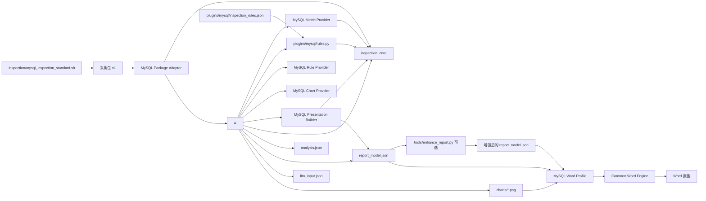

# MySQL 巡检项目地图

> 状态：阶段 12 之后做过一轮仓库整理（阶段 13，见第 21 节）。
> MySQL 已完成解耦和专业报告；PostgreSQL 已接入公共核心、公共 Word 引擎并完成分析器内部解耦；Oracle 与 SQL Server 均已接入报告契约适配器与公共 Word Profile；公共 Linux 采集层在阶段 12 进入 C0/C1 抽取，但其产物目录不在本工作树内（见第 21 节）。
>
> 本文件与其余架构文档同在 `docs/` 下，文内引用同目录文件时直接写文件名。**当前实现一律以磁盘实际文件为准。**

## 1. 当前主流程

```text
inspection/mysql_inspection_standard.sh
  -> 采集包 tar.gz
analyze.py（统一入口，按库分发到 plugins/<db>/）
  -> plugins/mysql/analyzer.py
       -> analysis.json
       -> report_model.json
       -> llm_input.json
       -> charts/*.png
  -> tools/enhance_report.py（可选，只增强文字）
generate_report.py（统一入口，按 generator_contract 分发）
       -> plugins/mysql/word_report.py
       -> inspection_core/word_engine.py
       -> *.docx
```

当前约有 72 个采集状态项、24 条规则和 30 余个报告检查项。三者不是一一对应：一个报告项可能组合多个采集项，一个规则也可能使用多个文件和派生指标。

## 2. 文件职责

| 文件 | 主要职责 | 输入 | 输出 | 直接依赖/使用者 | 修改风险 |
|---|---|---|---|---|---|
| `inspection/mysql_inspection_standard.sh` | 在数据库服务器执行只读采集、能力探测、状态登记、打包和哈希清单 | MySQL 连接参数、主机命令 | tar.gz 采集包 | 被分析器消费 | 高：字段、文件名、item_id 变化会影响分析器 |
| `inspection_core/` | 定义跨分析器共用的数据模型和安全数值转换 | 标准 Python 值 | `Finding`、`RuleEvaluation`、`PackageContext` | 被分析器和规则模块单向依赖 | 低：公共契约变更必须通过基线测试 |
| `plugins/mysql/package_adapter.py` | 识别并加载 MySQL collector v1 物理包，校验版本和 manifest | tar.gz 或已解压目录 | 标准 `PackageContext` | 分析器只通过该适配器读取采集包 | 中：采集布局兼容逻辑集中在这里 |
| `plugins/mysql/metrics.py` | 计算 MySQL 计数器速率、容量、结构、活动和主机指标 | 标准 `PackageContext` | 规则与报告共用的 metrics | 被分析器单向调用；规则只消费结果 | 中：采集字段变化主要在此兼容 |
| `inspection_core/statistics.py`、`sampling.py` | 跨数据库统计汇总和 SAR 历史质量判断 | 标准数值、`PackageContext` | 汇总统计、历史可用性 | 可被四库指标插件复用 | 低到中：修改需跨库回归 |
| `inspection_core/reporting.py` | 公共整改动作和证据披露模型 | 风险、证据不足、许可/节点范围 | 兼容旧格式或扩展管理字段 | 四库 presentation 可复用 | 低到中：公共报告语义需版本化 |
| `plugins/mysql/presentation.py` | 构造 MySQL 9 个章节、33 个检查项、管理摘要和 report model | facts、metrics、findings | `inspection_sections`、`report_model` | 分析器单向调用；Word 只消费输出 | 高：MySQL 报告内容修改集中在这里 |
| `plugins/mysql/charts.py` | 生成 MySQL 与主机性能图表，包含 Matplotlib/Pillow 兼容路径 | context、metrics | PNG 和 chart metadata | 分析器单向调用 | 中：图表改动必须做严格元数据和PNG指纹回归 |
| `plugins/mysql/rules.py` | 执行 MySQL 24条规则并提供 Rule Provider | `PackageContext`、metrics、规则 JSON | `Finding`、`RuleEvaluation` | 仅依赖公共模型 | 中到高：规则逻辑集中在这里 |
| `analyze.py` | 统一分析入口，按数据库类型分发到 `plugins/<db>/`；**支持多包输入**（多实例/主从合并），混合库型与 SQL Server 多包在此拦下 | 采集包（可多个）、`--db-type` | 子进程调用各库分析器 | 用户唯一分析入口 | 低：只做分发，不承载业务；**参数面必须是各库本体的超集** |
| `plugins/mysql/analyzer.py` | 流程编排、采集质量、拓扑、健康汇总和输出落盘 | 采集包、规则配置 | `analysis.json`、`report_model.json`、`llm_input.json`、图表 | 单向调用五个 MySQL Provider | 中：保持数据库独立入口，不承载插件业务 |
| `plugins/mysql/inspection_rules.json` | 规则元数据、阈值、严重性、建议 | 无 | 供 `plugins/mysql/rules.py` 读取 | 与 `rules.py` 中的检查方法共同决定规则是否真正执行 | 中：只增加 JSON 不能自动增加执行逻辑 |
| `inspection_core/word_engine.py` | 数据库无关的 Word 页面、主题、事实章节、章末分析、风险、整改闭环和附录渲染 | 标准报告模型、Word Profile、图表、Logo、布局版本 | `.docx` | 只依赖 `python-docx`，不得导入数据库插件 | 中：公共版式修改需四库 Word 回归 |
| `plugins/mysql/word_report.py` | MySQL Word Profile：契约、数据库名称、章节顺序、图表映射和采样字段 | MySQL `report_model.json` | MySQL 渲染配置和生成器适配器 | 被统一 Word 入口调用 | 中：MySQL 专属展示变化集中在这里 |
| `generate_report.py` | 统一 Word 命令行入口，按 `generator_contract` 分发到四库 Word Profile，默认专业版并可选旧版 | `report_model.json`、客户参数、`--layout` | `.docx` | 调用 Word Profile 和公共引擎 | 低：不得重新加入排版或业务章节逻辑 |
| `tools/enhance_report.py` | 可选 LLM 文字增强 | `report_model.json`、API 配置 | 增强后的报告模型 | 不能作为事实、评分或规则判断来源 | 中：四种数据库存在大量重复实现 |
| `plugins/mysql/chart_style.py` | matplotlib 样式和配色 | 图表调用 | 样式配置 | 被 `plugins/mysql/charts.py` 以相对导入使用 | 低到中：与 Oracle/SQL Server 的同类文件各自演化，尚未合并 |
| `assets/logo.png` | 默认品牌资源 | 无 | Word 中的 Logo | 报告生成器 | 低 |
| `README.md` | 当前使用说明、目录用途和最短运行命令 | 无 | 人工说明 | 用户 | 低：版本或入口变化时同步更新 |
| `requirements.txt` | Python 运行依赖 | 无 | pip 安装清单 | 用户、运行环境 | 低：增加第三方依赖时同步更新 |

## 3. 当前依赖关系



## 4. 从哪里开始修改

| 需求 | 当前需要检查的文件 | 当前连带风险 |
|---|---|---|
| 新增采集 SQL，只展示数据 | 采集脚本、MySQL adapter、`plugins/mysql/presentation.py`、测试样例 | 若不参与判断，通常不需要修改 metrics/rules/Word |
| 新增有阈值的规则 | 采集脚本、`plugins/mysql/metrics.py`、`plugins/mysql/rules.py`、规则 JSON、报告结论 | JSON 不是完整的声明式规则，仍需 Python 方法 |
| 修改采集字段名 | 采集脚本、MySQL adapter、MySQL metrics、报告 item | 旧版本兼容集中在 adapter/metrics，仍缺逐检查项 schema_version |
| 修改 Word 样式或专业版结构 | `inspection_core/word_engine.py`，必要时 `plugins/mysql/word_report.py` | 不改采集、指标、规则；旧版兼容布局必须继续回归 |
| 修改报告章节 | `plugins/mysql/presentation.py`、`plugins/mysql/word_report.py` | presentation 决定语义，Profile 决定顺序和专属图表映射 |
| 修改 LLM 表述 | `tools/enhance_report.py` | 必须确保不改变事实、状态、评分和证据 |

更完整的操作说明见 `docs/change-impact-matrix.md`。

## 5. 跨数据库可复用资产

| 项目 | 应吸收的能力 |
|---|---|
| MySQL | manifest 哈希、采集状态、缺失值策略、`collection/display/analysis` item 模型 |
| Oracle | 触发/通过/未评价/不适用四态、许可边界、证据不足披露 |
| PostgreSQL | 分析器依赖规则模型的方向、多节点支持、较清晰的 `_item` 模式 |
| SQL Server | JSON 采集包、语义化管理章节、较短的分析器、数据驱动 sections |

## 6. 已确认的主要问题

1. ~~`rules.py` 与分析器循环依赖。~~ 已在阶段 1 第一刀中通过 `inspection_core/` 消除；后续四库插件统一依赖该公共方向。
2. ~~分析器同时负责解包、解析、指标、规则、图表和报告构造。~~ 五类插件能力均已拆出；分析器保留独立入口和流程编排。
3. 报告模型已有良好雏形，但四种数据库的 contract 和 item 格式尚未统一。
4. ~~Word 生成器硬编码 MySQL 章节和目录。~~ 阶段 5 已抽为公共引擎 + MySQL Word Profile；阶段 6 增加版本化专业布局和旧版兼容布局。
5. 阶段 0 开始时 MySQL 没有回归样例；现已补充完整采集包及 `tests/baselines/mysql/current/` 输出基线。
6. README 与实际代码缺少自动校验，其他数据库项目已经出现文档列出的文件与磁盘实际文件不一致。

## 7. 阶段 0 文档入口

同目录下：

- `baseline-inventory.md`：文件版本、哈希与样例状态（记录的是整理前的历史快照，文件位置已在阶段 13 变更）。
- `architecture-current.md`：现状数据流、契约和耦合点。
- `check-catalog.yaml`：MySQL 采集项、报告项、规则及已知映射缺口。
- `change-impact-matrix.md`：不同修改类型应检查什么。
- `../tests/fixtures/README.md`：内部完整回归样例的登记、安全边界和验收要求。

## 8. 阶段 0.5 目标设计入口

同目录下：

- `cross-database-capability-matrix.md`：四套实现的差异、采用和不采用决策。
- `architecture-target.md`：公共核心、插件、依赖方向和第一次 MySQL 解耦边界。
- `../contracts/README.md`：collection、rule、report 三类目标契约及迁移说明。
- `collector-capability-matrix.md`：四个采集脚本的公共系统能力和缺口。
- `collector-target.md`：公共 Linux/Windows 采集层、数据库插件和独立交付入口。

## 9. 阶段 1 已落地内容

- `inspection_core/models.py`：公共 Finding、RuleEvaluation、PackageContext。
- `inspection_core/values.py`：公共安全数值转换，不再从分析器反向复用函数。
- `inspection_core/package_io.py`、`inspection_core/tabular.py`：安全包读取和公共表格解析。
- `plugins/mysql/package_adapter.py`：MySQL v1 采集包的识别、版本校验、完整性校验和物理布局解析。
- `tests/test_inspection_core.py`：公共模型与契约单元测试。
- `tests/test_mysql_package_adapter.py`：使用登记的完整采集包验证 adapter。
- `tests/compare_analysis_outputs.py`：区分业务结果与时间/绘图环境噪声的基线比较工具。

## 10. 阶段 2 已落地内容

- `plugins/mysql/metrics.py`：MySQL 指标计算唯一实现，不生成报告、不执行规则。
- `inspection_core/statistics.py`：跨数据库统计汇总。
- `inspection_core/sampling.py`：跨数据库 SAR 历史覆盖、新鲜度和点数判断。
- `tests/test_mysql_metrics.py`：计数器重置、缺失/空结果、远程主机和 SAR 边界测试。
- `analyze_inspection_v2.py` 从 142,817 字节降至 124,495 字节；真实包业务基线保持一致。

## 11. 阶段 3 已落地内容

- `plugins/mysql/presentation.py`：MySQL 章节、检查项、管理摘要和 report model 的唯一构造入口。
- `inspection_core/reporting.py`：可兼容现有 MySQL JSON，并预留责任人、整改窗口、验证方式、许可边界和节点范围。
- `tests/test_mysql_presentation.py`：锁定9个章节、33个唯一 item、报告字段结构和冻结 report_model。
- `analyze_inspection_v2.py` 从 124,495 字节降至 56,123 字节；真实包三份业务 JSON 保持一致。
- 当前发现两个历史 item 使用 `analysis.status=ok`，已登记为统一报告契约的版本化迁移项。

## 12. 阶段 4 已落地内容

- `plugins/mysql/charts.py`：图表唯一实现；同环境严格 JSON 和6张PNG指纹保持一致。
- `plugins/mysql/rules.py`：MySQL RuleEngine 与 Rule Provider。（旧的根目录 `rules.py` 兼容壳已在阶段 13 删除。）
- `tests/test_mysql_providers.py`：规则覆盖唯一性、兼容入口和图表产物测试。
- `analyze_inspection_v2.py` 从 56,123 字节降至 29,008 字节、591行。
- 阶段 4 后 MySQL 仍是独立运行入口，没有合并成四库巨型分析器。

## 13. 阶段 5 已落地内容

- `inspection_core/word_engine.py`：数据库无关的 Word 渲染器，不导入任何数据库插件。
- `plugins/mysql/word_report.py`：MySQL 契约、章节顺序、图表映射和数据库名称配置。
- `generate_report_docx_v3.py`：97 行兼容入口，原有命令和参数继续可用。
- 吸收 Oracle 的动态目录/章节编号、PostgreSQL 的章节图表映射和 SQL Server 的管理型风险结构边界。
- `tests/test_word_engine.py`：锁定拆分前可见内容、MySQL Profile、独立入口和图片替代文字。
- 22 项测试、业务 JSON 和同渲染环境严格图表回归通过；Word 的45张表格几何、标题层级、页面设置和7张图片结构审计通过。
- 当前机器缺少 LibreOffice，仍不能声称已经完成 DOCX 到 PNG 的逐页视觉验收。

## 14. 阶段 6 已落地内容

- 公共 Word 引擎升级为 4.1.0，新增 `professional` 与 `legacy` 两种版本化布局；MySQL 独立入口默认专业版，可用 `--layout legacy` 复现 4.0 内容结构。
- 专业版按“巡检事实与图表 → 本章分析结论”组织 9 个技术章节，分析仍直接读取 report model，不重新判断。
- 风险登记册、分级整改与闭环计划、综合结论与管理建议、证据索引成为独立章节；模型未提供的责任人、窗口和状态明确标记为待指定或未登记。
- 使用专业参考 PDF 的封面、文档控制、编号和事实优先结构，同时避免把大量原始账户/权限明细堆入管理主文。
- 24 项自动测试和三份业务 JSON 基线通过；专业版 59 张表、7 张图片、标题层级、页面设置和可访问性通过结构审计。
- 当前机器仍缺少 LibreOffice，因此逐页 PNG 视觉验收待在具备转换组件的环境补做。

## 15. 阶段 7 已落地内容

- 公共 Word 引擎升级为 4.2.0；专业版标题、表头和正文采用黑色/深灰层级，仅风险级别保留红、橙、黄色。
- 专业版去除表后占位短横线和空白页；报告由 39 页收敛为 34 页，仍保持“事实与图表在前、本章结论在后”。
- 正文对 SQL 摘要、等待事件、文件 I/O、插件和配置明细设置展示上限；完整行数及保留位置通过说明披露，事实数据未删除。
- 图表优先使用可用 SAR 历史；现场短采样改用实际 `HH:mm:ss` 时间轴，启动点从趋势线中排除但保留在分析 JSON 并在图内披露。
- 内存图统一为百分比；磁盘图拆分吞吐、繁忙度和响应时间，消除混合单位纵轴；Matplotlib 与 Pillow fallback 均支持中文字体和时间标签。
- 修正“30.83 小时 SAR 可用”与正文“历史不完整”的矛盾；主机本地时间显示为 `UTC+08:00`，文档控制时间显示为“本地时间”。
- 27 项自动测试通过；旧版 Word 内容哈希保持不变。基线差异仅为上述 SAR 结论纠正及两处时间显示格式化，风险、评分、规则状态和证据未改变。
- 使用本机 Word 导出 PDF 并将 34 页全部渲染为 PNG 检查；未发现空白页、乱码、方框字、裁切、重叠或表头孤立。

## 16. 阶段 8 已落地内容

- 冻结 PG 2.0.1 真实采集包、旧分析 JSON、旧报告模型和旧 Word；登记路径、大小、SHA256 与业务统计。
- 新增 `plugins/postgresql/`，PG 保持独立规则与分析入口，同时复用公共 `PackageContext`、安全解包、表格解析、数值转换、统计和 Word 引擎。
- 新增 `analyze_postgresql.py` 独立入口：保留 `report_model_legacy.json`，并生成标准 `postgresql_inspection_report_model`。
- 新增 `plugins/postgresql/report_adapter.py`：只重组既有事实，不重算评分或规则；旧严重性映射时保留 `source_severity`。
- 新增 `plugins/postgresql/word_report.py` 和 `generate_postgresql_report.py`，14 个 PG 章节由公共 4.2.0 专业 Word 引擎渲染。
- 修正 PG CPU 图误把 idle 当使用率、采集/分析时间混用、版本前缀重复、采样点误报未采集和备份证据不足误写风险的问题。
- 30 项自动测试通过；PG 基线为 1 实例、36 条规则、2 条风险、14 章节、14 项、5 图、健康分 90、数据质量 93.5%。
- PG 专业报告经 Word 导出为 23 页并逐页检查；无乱码、方框字、裁切、重叠和空白页；可访问性审计 0 项问题。

## 17. 阶段 9：PostgreSQL 分析器内部解耦

- `plugins/postgresql/package_adapter.py`：唯一负责 PG 包解压、表格载入、manifest 校验、`PackageContext` 建立和采集质量统计。
- `plugins/postgresql/rule_provider.py`：规则编排入口；分析器不再直接实例化 `RuleEngine`。
- `plugins/postgresql/parsers.py`：集中解析 SAR、文件系统与内存快照，不做阈值判断。
- `plugins/postgresql/metrics.py`：集中派生51项指标，不运行规则、不生成报告文字。
- `plugins/postgresql/charts.py`：集中生成5张PG图表及处理时间轴，不参与风险判断。
- `plugins/postgresql/analyzer.py`：继续作为独立流程编排器；下一步只需迁移旧报告模型和综合结论构建。
- 兼容要求：`analyze_postgresql.py` 命令、标准/旧报告模型以及 PG 阶段 8 基线保持不变。
- 阶段首批 34 项测试通过；PG 的 `analysis.json`、标准 `report_model.json` 和 `llm_input.json` 与冻结基线完全一致。MySQL 回归仅出现阶段 7 已登记的 5 项预期展示差异，风险与 LLM 输入未变化。
- 指标与图表迁移后再次通过34项测试、PG业务JSON回归和严格图表回归；51项指标、36条规则、2条风险及5张图均保持不变。

## 18. 阶段 10：Oracle 报告契约适配器与 Word Profile 接入

- 冻结 Oracle 真实采集包、外部分析 JSON、原始报告模型与 LLM 输入；登记路径、大小、SHA256 与业务统计。
- 新增 `plugins/oracle/report_adapter.py`：只重组既有事实，不重算评分、规则或严重性；为 48 个巡检项补充稳定 `item_id`，把纯事实项归一为 `normal`、无结构化记录项保留 `not_evaluated`，并为 finding 保留 `source_severity`。
- 新增 `plugins/oracle/word_report.py` 和 `generate_oracle_report.py`，9 个 Oracle 章节由公共 4.2.0 专业 Word 引擎渲染，并映射 9 张图表（system_performance 5 张、oracle_performance 4 张）。**阶段 14 第③步后改为 8 张**：system_performance 4 张公共 OS 图、oracle_performance 4 张 Oracle 专属图。
- 公共 Word 引擎综合摘要把 `critical` 计入“高风险”列；MySQL/PG 无 critical，旧版 Word 内容哈希保持不变。
- 基线：1 实例、34 条规则（10 触发/20 通过/4 未评价）、10 条风险（1 critical/2 high/5 medium/2 low）、9 章节、48 项、9 图、健康分 43。
- 48 项自动测试通过；MySQL 与 PG 业务 JSON、旧版 Word 哈希及专业版回归均未新增差异。逐页 PNG 视觉验收仍待具备 LibreOffice 的环境补做。

## 19. 阶段 11：SQL Server 报告契约适配器与 Word Profile 接入

- 冻结 SQL Server 真实采集包、外部分析 JSON、原始报告模型与旧版 Word；登记路径、大小、SHA256 与业务统计。
- 新增 `plugins/sqlserver/report_adapter.py`：以结构化 `sections` 为唯一章节来源，忽略说明性 `inspection_sections`；把 headers+二维 rows 归一为列表字典、`success` 归一为 `ok`；为 27 个巡检项补充稳定 `item_id`；纯事实项归一为 `normal`，规则项保留 `risk/attention`；finding 保留 `source_severity` 并把 owner/target_window/verification/status 迁入整改计划。
- 新增 `plugins/sqlserver/word_report.py` 和 `generate_sqlserver_report.py`，12 个 SQL Server 章节由公共 4.2.0 专业 Word 引擎渲染，并映射 8 张技术图表。
- 基线：1 实例、14 条规则全部触发、24 条风险（8 critical/9 high/6 medium/1 low）、12 章节、27 项、9 图、健康分 0。
- 48 项自动测试通过；MySQL、PG、Oracle 业务 JSON、旧版 Word 哈希及专业版回归均未新增差异。逐页 PNG 视觉验收仍待具备 LibreOffice 的环境补做。

## 20. 阶段 12：公共 Linux 采集层 C0/C1

> ⚠️ 本节记录的 `collectors/` 目录（含 `collectors/common/`、`collectors/tests/`）**不在本工作树内**，无法在本地核对。下表内容为阶段记录，读取时请以磁盘实际文件为准。

- C0 冻结公共系统检查目录与字段 schema：`collectors/common/contract/linux-common-checks.yaml`（26 项公共检查 + 8 个公共模块 + 插件 hook 与主机归属证据契约）。
- C1 抽取 MySQL/PG 共有的数据库无关函数，落地 `collectors/common/linux/{util,runtime,status,security,package}.sh`；公共模块只定义函数，依赖入口全局变量，并通过 `known_tsv_header`/`cleanup_auth` hook 注入数据库差异。
- 新增 `collectors/tests/test_common_linux.sh`，在 Git Bash 下覆盖 id 清洗、JSON 转义、数值判定、SHA256、状态登记、TSV 列过滤、敏感扫描与 manifest 生成，15 项断言通过，模块全部通过 `bash -n`。
- 尚未抽取 system_static/sampling/sar（后续 C1 续做）；SQL Server Windows 公共层与四库统一发布构建分别属于 C3/C4。

## 21. 阶段 13：仓库整理（折叠双轨入口 + 资源归位）

整理目标：根目录只保留必需入口，消除"新旧双轨"与散落资源。**代码行为零变更**，验收口径是测试失败集合不变。

### 21.1 文件搬迁对照

| 整理前（仓库根） | 整理后 | 说明 |
|---|---|---|
| `analyze_inspection_v2.py` | `plugins/mysql/analyzer.py` | MySQL 编排入口，与其余三库的 `plugins/<db>/analyzer.py` 对齐 |
| `analyze_postgresql.py` | `plugins/postgresql/cli.py` | 命令行适配层 |
| `analyze_oracle.py` | `plugins/oracle/cli.py` | 命令行适配层 |
| `analyze_sqlserver.py` | `plugins/sqlserver/cli.py` | 命令行适配层 |
| `inspection_rules.json` | `plugins/mysql/inspection_rules.json` | 与 PG / Oracle / SQL Server 的规则文件位置一致 |
| `chart_style.py` | `plugins/mysql/chart_style.py` | 同时把 `plugins/mysql/charts.py` 的裸导入改为相对导入 |
| `report_config.json` | `config/report_config.json` | 品牌默认值 |
| `logo.png` | `assets/logo.png` | `--logo` 相对路径改为按项目根解析 |
| `enhance_report.py` | `tools/enhance_report.py` | 可选 LLM 增强 |
| `run.ps1` | `tools/run.ps1` | 改为按 `$PSScriptRoot` 定位项目根，不再依赖调用者 cwd |
| `PROJECT_MAP.md` | `docs/PROJECT_MAP.md` | 入口文档归入 `docs/` |
| `INTERFACE.md` | `docs/mysql-collector-interface.md` | 单库契约，文件名补上适用范围 |
| `FIX-PLAN.md` | `docs/mysql-collector-fix-plan.md` | 同上 |
| `_selftest_batch1.sh` | `tests/selftest/mysql_collector_batch1.sh` | 被采集脚本路径改为两级上溯 |
| `_selftest_batch2.sh` | `tests/selftest/mysql_collector_batch2.sh` | 同上 |

删除：根 `rules.py`（旧导入兼容壳）、`_selftest_out.txt`、`mysql_inspection_standard.sh.bak-20260920`、全部 `__pycache__`。

### 21.2 采集脚本目录（2026-09-21 调整）

四个采集脚本已从仓库根移入 `inspection/`：`mysql_inspection_standard.sh`、`pg_inspection_standard.sh`、`oracle_inspection.sh`、`sqlserver_inspection.ps1`（本次未含 SQL Server 公共层改造，脚本一并随迁）。

搬迁前核实了两条前提，缺一条就不能移：

1. **脚本不依赖自身所在目录**——产物父目录由 `--output-dir` 或默认 `/var/tmp` 决定，`$BASH_SOURCE` 仅用于日志文案（Oracle 安全扫描提示）。
2. **分析侧对采集脚本路径零引用**——`analyze.py` / `generate_report.py` / `plugins/**` / `inspection_core/**` / `tests/*.py` 全都不按路径引用采集脚本，只按采集包内容消费。唯一按名字匹配的是 `analyze.py` 里的 `name.startswith("pg_inspection")`，判的是**采集包压缩包名**，不是脚本路径。

结论：**采集、分析、报告行为零变化，基线无需刷新**。

发布约束不变——发布物必须仍是单个文件、可独立拷到数据库服务器运行（见 `AGENTS.md` 目录约定）。根目录 `analyze.py` / `generate_report.py` 仍是唯一对外入口。

> 命名提醒：`docs/collector-target.md` 里规划的源码目录是 `collectors/`（公共 Linux/Windows 模块化目标，其产物不在本工作树内），与本次的 `inspection/` 不是同一层概念——`inspection/` 只是"现有单文件脚本的存放位置"。两者是否统一命名待定。

### 21.3 引用改动清单

- `analyze.py`：`build_command()` 的四个子进程路径指向 `plugins/<db>/`。
- `plugins/mysql/analyzer.py`、`plugins/postgresql/cli.py`、`plugins/oracle/cli.py`、`plugins/sqlserver/cli.py`：新增"以脚本方式直接运行"时的 `sys.path` 引导，把项目根补回 `sys.path`。
- `plugins/mysql/charts.py`：`from chart_style import apply_style` → `from .chart_style import apply_style`。
- `plugins/mysql/rules.py`：`RULES_CONFIG` 由 `parents[2]/inspection_rules.json` 改为 `parent/inspection_rules.json`。
- `plugins/sqlserver/cli.py`：`--rules-config` 默认值改为 `Path(__file__).with_name("inspection_rules.json")`。
- `tests/selftest/mysql_collector_batch{1,2}.sh`：`SRC` 由 `$REPO_ROOT/mysql_inspection_standard.sh` 改为 `$REPO_ROOT/inspection/mysql_inspection_standard.sh`（2026-09-21 采集脚本迁入 `inspection/` 后同步；改前 `SRC` 指向不存在的文件，`_extract_fn` grep 不到任何函数，两个自测都会跑挂）。
- `AGENTS.md` 目录约定：由「采集脚本留在仓库根、不得挪进子目录」改为「源码放 `inspection/`，目录位置不是发布约束；发布物必须仍是单文件可独立运行；脚本不得依赖自身所在目录」。
- `generate_report.py`：`_load_config()` 指向 `config/report_config.json`；`--logo` 相对路径按项目根解析。
- `tests/test_inspection_core.py`、`tests/test_mysql_providers.py`：`import rules` → `from plugins.mysql import rules`。
- `tests/test_word_engine.py`、`tests/test_sqlserver_plugin.py`、`tests/test_oracle_plugin.py`：LOGO 路径 → `assets/logo.png`。
- **退役测试**：`test_mysql_providers.MySQLProviderTests.test_root_rules_module_is_a_compatibility_entry`。它断言根 `rules.py` 兼容壳存在，随该壳一并删除。测试总数由 60 降为 59。

### 21.4 验收证据

- `python -m unittest discover -s tests -v`：59 项，通过 54，失败 5。失败集合与整理前**完全一致**，根因均为缺少自备夹具 `mysql_inspection_v1_db01_192.168.100.80_3306_20260811_160102.tar.gz`（1 个 FAIL 是"夹具缺失"断言，4 个 ERROR 是 `FileNotFoundError`）。相对整理前仅减少 1 项（退役的兼容壳测试）。
- 六个入口 `--help` 均正常退出：`analyze.py`、`generate_report.py`、`plugins/mysql/analyzer.py`、`plugins/postgresql/cli.py`、`plugins/oracle/cli.py`、`plugins/sqlserver/cli.py`。

### 21.5 遗留

- `baseline-inventory.md` 中的哈希与文件位置是整理前的历史快照，未随本次搬迁改写（阶段 14 各步的刷新记录见 `tests/baselines/*/baseline.json`）。
- 原四份 `plugins/*/chart_style.py` 互不相同（MySQL 4414B / PG 1441B / Oracle 5068B / SQL Server 5218B）。阶段 14 已在 `inspection_core/charts/style.py` 落下统一样式；**第②步删除 MySQL 那份、第③步删除 Oracle 那份、第④步删除 PG 那份**，只剩 SQL Server 保留自有配色（不并入，见阶段 14）。
- 本次只做整理，不含对外开源化（LICENSE、README 对外口径、CI、基线分发方式）——那是独立的一轮工作。

## 22. 阶段 14：公共 OS 分析与画图层

### 22.1 新增模块

| 文件 | 职责 |
| --- | --- |
| `inspection_core/system_checks.py` | OS 指标归一化、数据源与置信度（含覆盖比例披露）、`os_pressure_report()` 统一判定入口、规范/退役 rule_id 映射、`DEFAULT_THRESHOLDS`、资源概要行 |
| `inspection_core/charts/style.py` | 调色板、14 个语义序列别名、严重度色、`COLOR_MAP`、rcParams（matplotlib 可选） |
| `inspection_core/charts/history.py` | 时间解析、展示时区、断点检测、序列抽取、`CPU_SUMMARY_VALUES` |
| `inspection_core/charts/specs.py` | 四类 OS 图纯数据规格（CPU/内存/磁盘/网络） |
| `inspection_core/charts/render.py` | 规格 → PNG，matplotlib 后端 + Pillow 降级后端 |
| `tests/test_os_common_layer.py` | 边界测试（第①步 31 项，第②步 +3 项，第⑤步 +11 项） |

### 22.2 收口的三处口径

- **iowait 判据**：窗口峰值 ≥ 20%（原 PG 为 15 且口径不同）。
- **内存判据**：窗口峰值 ≥ 90%（原 MySQL/Oracle 用 `average`，24h 内 2 分钟打满会被平均掉）。
- **规则命名**：`COMMON.SYSTEM.{CPU,IOWAIT,MEMORY}_PRESSURE` + `COMMON.SYSTEM.DISK_UTIL`；原三套拼写（`ORA.SYSTEM.*`、`COMMON.SYSTEM.CPU/IOWAIT/MEMORY`）在第⑤步已全部退役，只留在 `RETIRED_RULE_IDS` 里供读取历史报告，方向单向（旧 → 规范）。

第⑤步补上的两条：

- **阈值归属**：OS 阈值只从 `DEFAULT_THRESHOLDS` 读（含 `filesystem_usage_critical`），插件规则包不再声明任何一个；`globals` 里残留的 OS 阈值一并撤掉。
- **判定入口**：`os_pressure_report(metrics, include=(...))` 一次性给出窗口 + 逐条判定，插件只声明评价哪几条（MySQL/Oracle 三条、PG 四条）。

### 22.3 等价性证据（第①步）

以合成 `PackageContext`（SAR 历史 / 仅实时 / 空包三种输入）对比：

- 四张 OS 图规格与 `MySQLChartProvider._chart_specs` 逐字段相等（标题、x 长度、`source_scope`、文件名、全部面板序列），3 种输入全部一致。
- 渲染出的四张 PNG 与 MySQL 现有渲染器 **SHA256 逐字节相同**，即第②步接线可视为纯代码搬迁。

### 22.4 验收证据

- `python -m unittest discover -s tests -v`：96 项（原 65 + 新增 31），FAIL 1 / ERROR 4。失败集合与阶段 13 逐条同名同根因（缺自备夹具 `mysql_inspection_v1_db01_192.168.100.80_3306_20260811_160102.tar.gz`），零回归。
- `import inspection_core` 不会导入 matplotlib（`inspection_core/__init__.py` 未接入 `charts`）。

### 22.5 后续接线顺序

② MySQL 切 → ③ Oracle 切（补 PIL 降级）→ ④ PG 切（删私有 SAR 解析，图 3→4）→ ⑤ OS 判定与规则下沉、阈值与 rule_id 正式收口。SQL Server 不并入，仅共享调色板与 Pillow 后端。

进度：①②③④⑤ 全部完成，其后的规则包配置收口（⑥）与 severity 二级分级（⑦）也已完成（测试 96 → 99 → 109 → 117 → 133 → 139 → **151** 项，每步均零回归；失败集合始终是同一条缺自备夹具的 MySQL 用例）。

注：⑤ 的项数在 §22.11 草拟时写的是 128，实测 133（`OsThresholdOwnershipTests` 6 + `MysqlSystemResourceWiringTests` 5，另有一批断言替换掉旧的同名用例）。以实测为准。

### 22.6 第②步：MySQL 接线

| 项目 | 结果 |
| --- | --- |
| 改动文件 | `plugins/mysql/charts.py`（474 → 105 行）；删除 `plugins/mysql/chart_style.py` |
| 插件保留 | 仅 `MYSQL_QPS_TPS`、`MYSQL_THREADS` 两张库专属图的规格；四张 OS 图改为 `os_chart_specs()` 直供 |
| 渲染 | `render_spec()` 统一负责，matplotlib → Pillow 降级、`renderer`/`axis_mode`/`time_zone`/`warmup_points_excluded` 元数据不变 |
| 等价性对拍 | 合成包三种输入（SAR 历史 / 仅实时 / 空包）× 6 张图：规格逐字段一致、**18 张 PNG SHA256 逐字节相同** |
| 唯一差异 | 空包时 `SYSTEM_NETWORK_REALTIME.warmup_points_excluded` 由 `1` 改 `0`。旧实现无条件声称"排除了首个启动点"，即使一个点都没丢；空包/两点场景下旧值失实。该字段在空包路径不会进入报告（整图 `skipped`） |
| 新增守卫测试 | `MySQLCutoverTests` 3 项：前四张规格必须等于 `os_chart_specs()`、插件不得再出现 9 个已下沉的辅助函数、私有 `chart_style.py` 不得复活 |
| 回归 | `python -m unittest discover -s tests`：99 项，FAIL 1 / ERROR 4，与阶段 13 逐条同名同根因（缺自备夹具），零回归 |

接线后 `import plugins.mysql` 会连带导入 `inspection_core.charts`，从而在 matplotlib 可用时加载它（`style.py` 内 try/except，缺失时降级 Pillow）。`inspection_core/__init__.py` 仍不导入 `charts`，`import inspection_core` 的轻量性质不变。

### 22.7 第③步：Oracle 接线

Oracle 与 MySQL 不是同一种切法：它的图表被报告模板**按名字三层绑定**（`charts.py` 写 `chart_id`+`path` → `presentation.py` 转 `file` → `report_adapter.py` 按 `chart_id` 查中文图题），因此公共层的 `SYSTEM_CPU` 换上去必然改变报告外观与文件名 —— 这一步是**有意变更报告交付物**，不是纯搬迁。

| 项目 | 结果 |
| --- | --- |
| 改动文件 | `plugins/oracle/charts.py`（重写，343 → 181 行）；删除 `plugins/oracle/chart_style.py`；`metrics.py` 补 `parse_count_hard` 计数器 |
| OS 章节 | 5 张（`system_cpu_sar`/`system_memory_sar`/`system_disk_util`/`sar_iowait_trend`/`system_network`）→ 4 张公共图（`SYSTEM_CPU`/`SYSTEM_MEMORY`/`SYSTEM_DISK`/`SYSTEM_NETWORK_REALTIME`）。独立的「IO Wait 趋势」并入 CPU 图的一条线；iowait 判定改由规则结论表达 |
| 内容变化 | 内存图多出「缓存/Swap 已用」；磁盘图从「所有设备 util 叠加」变「最忙设备 × 吞吐/繁忙度/响应时间」三面板；网络改最忙网卡且剔除启动点。CPU 图从堆叠面积变四条线 |
| Oracle 专属 | `oracle_physical_io`/`oracle_logical_vs_physical`/`oracle_redo_rate`/`oracle_parse_ratio` 保留，改从公共层取配色与时间处理；不再需要 matplotlib 之外的降级 |
| 契约扩展 | 图表记录新增 `status`/`source_scope`（原先由下游按图名猜），`report_adapter._source_scope()` 优先读该字段、旧模型仍走图名兜底 |
| 报告模型 | `file` 改为相对路径（原先算了相对值却写了绝对路径，属未接线的死代码） |
| 基线 | `tests/baselines/oracle/current/` 的 `analysis.json`/`report_model.json`/`report_model_standard.json` 只替换图表块，其余字节不动（先用「旧模型过新适配器 == 旧标准模型」自检过）；5 张废弃 PNG 删除、8 张新 PNG 落盘、`.docx` 重出 |
| 端到端验证 | 真包重跑：健康分 43、采集质量 100、findings 10、9 章节 / 52 项、规则 34（10/20/4）**与基线逐项一致**；Word 内嵌图片 9 = 8 张图 + 封面 logo |
| 回归 | `python -m unittest discover -s tests`：109 项，FAIL 1 / ERROR 4，与阶段 13 逐条同名同根因（缺 MySQL 自备夹具），零回归 |

### 22.8 第③步顺带修掉的四个缺陷

| # | 缺陷 | 证据 | 处理 |
| --- | --- | --- | --- |
| 1 | `_time_line()` 约 50 行从未被调用（所有图内联写的） | 全仓 grep 只有定义无调用 | 随重写删除 |
| 2 | `risk_severity` 分支永不执行：`metrics["_risk_counts"]` 在 analyzer 第 87 行注入，图表在第 78–80 行已生成 | 真包跑出 9 张图，无 `risk_severity` | 随重写删除 |
| 3 | 无 SAR 时 CPU 图发 `system_cpu_realtime.png`，而 Word 模板只登记 `system_cpu_sar` → 该图被静默丢弃 | `word_report.py` 的 `section_charts` 只列 sar 版 | 由公共层一张自适应历史/实时的 CPU 图消除 |
| 4 | `oracle_parse_ratio` 的「hard parse %」是假零线：`parse_count_hard` 不在 `counter_rates` 计数器清单里 | `derived_rate_series` 无该键，`safe_float(None)→0` | `metrics.py` 补入计数器，曲线恢复真实（本包峰值 ≈1.98%） |

另外两处采集形态差异在公共层归一（不再由某个库自己绕）：

- **SAR CPU 列名**：Oracle 采集脚本写 `%usr`/`%sys`，MySQL 走 `sadf` 原样列 `%user`/`%system`（PG 早在 `parsers.py` 里自己绕了一次）。`history.SAR_CPU_ALIASES` + `sar_cpu_summary_rows()` 统一，MySQL 行原样返回不被复制。
- **时区**：Oracle 的扁平 snapshot 没有 `time_evidence`，原先退回 UTC，导致实时图把 20:45 画成 **12:45**（`rcParams.timezone=UTC` + 无 tz 的 `DateFormatter`，已用最小实验复现）；而 SAR 行自带 ` UTC` 后缀照 UTC 显示 —— 同一份报告里两套钟。`display_timezone()` 现在按「采集器记录 → 时间戳自带偏移 → UTC」回落，轴标签明确写出 `时间（UTC+08:00）`。


### 22.9 第④步：PostgreSQL 接线

PG 与前两库的差别在于：进公共层之前，得先把历史数据的路铺通。`package_adapter.py` 一直用逗号 CSV 解析器读 `history/sar_*.csv`，而那是 `sadf` 的分号格式，于是 `ctx.history` 里的 SAR 从来是空的；插件只能自己从 `root/history/` 重读，并养了 8 个私有解析函数（`_read_sar_csv`/`_parse_sar_cpu`/`_parse_sar_disk`/`_parse_sar_network`/`_effective_sar_coverage_hours` …），另有一份 `chart_style.py`、10 个无人调用的 analyzer 转发别名。

| 项目 | 结果 |
| --- | --- |
| 改动文件 | `plugins/postgresql/charts.py`（重写，194 → 139 行）；`package_adapter.py` 改 `parse_sadf`；`metrics.py` 改走公共层；`parsers.py` 255 → 59 行；`analyzer.py` 删 10 个死别名；删除 `plugins/postgresql/chart_style.py` |
| OS 章节 | 3 张（`system_cpu`/`system_memory`/`system_disk`）→ 4 张公共图（`SYSTEM_CPU`/`SYSTEM_MEMORY`/`SYSTEM_DISK`/`SYSTEM_NETWORK_REALTIME`），与 MySQL/Oracle 同名同规格 |
| 内容变化 | CPU 从单条 busy 线变四条线（用户/系统/IO 等待/虚拟化抢占）；内存多出缓存与 Swap；磁盘图从「单设备 util」变「最忙设备 × 吞吐/繁忙度/响应时间」三面板；新增网络吞吐图 |
| 文件名 | 加实例前缀 `{instance_tag}_*.png`。原先是裸名（`system_cpu.png`/`pg_sessions.png`），多实例跑同一份报告会互相覆盖 |
| 契约扩展 | 图表记录新增 `status`/`source_scope`/`axis_mode`/`time_zone`/`renderer`/`duration_ms`/`warmup_points_excluded`，与 MySQL/Oracle 一致 |
| PG 专属 | `pg_sessions`/`pg_stats` 保留自绘，但配色与时间处理取自公共层；两图仍是「会话数」「事务累计」，未改语义 |
| 基线 | `tests/baselines/postgresql/current_v2/` 刷新：自检「除图表块与运行时戳外逐字段一致」通过后才落盘；删 5 张旧 PNG、落 6 张新 PNG、`baseline.json` 的 charts 5→6、指纹重算、`source_implementation` 改为「文件路径 + sha256」以便复算 |
| 端到端验证 | 真包重跑：健康分 90、采集质量 93.5、findings 2、36 条规则（2 触发/32 通过/2 未评价）、14 章节 / 14 项 **与刷新前逐项一致**；OS 六项指标（`cpu_busy_max`=26.95 / `iowait_max`=0.45 / `memory_used_max`=81.02 / `disk_util_max`=3.57 / 覆盖 3.41h / 来源 sar+realtime）**全部未变**；Word 图片部件 6 → 7 = 6 张图 + 封面 logo |
| 回归 | `python -m unittest discover -s tests`：117 项，FAIL 1 / ERROR 4，与阶段 13 逐条同名同根因（缺 MySQL 自备夹具），零回归 |

### 22.10 第④步顺带修掉的三个缺陷

| # | 缺陷 | 证据 | 处理 |
| --- | --- | --- | --- |
| 1 | `ctx.history` 里的 SAR 数据**恒为空** —— `package_adapter.py` 用逗号 `parse_csv` 读 `sadf` 分号文件 | 实测 `parse_csv(sar_cpu.csv)` 返回 `[]`，`parse_sadf` 返回 30 行；两者结果在测试里同时断言 | 改 `parse_sadf`；插件内自建的那套解析整块删除 |
| 2 | CPU **历史峰值从未参与合并** —— `metrics.py` 按 `label == "idle"` 取历史 busy，而解析结果的 label 只有 `busy`/`user+nice`/`system`/`iowait` | 注释声称「merge SAR history peaks」，实际那个分支永不进入 | 改走公共层 `busy_percent()`；本包 SAR busy 峰值 6.12 < 实时 26.95 故数值未变，但逻辑已正确（已加守卫测试：构造 SAR 峰值 62 / 实时 8，必须得 62） |
| 3 | chart→section **双份映射且一份是错的** —— analyzer 打 `filesystem_capacity`、adapter 打 `system_info`，adapter 覆盖前者 | `report_adapter.adapt_report_model()` 第 135 行覆盖 `section_id` | 收敛为 `report_adapter.chart_section()` 单一函数，analyzer 改为调用它 |

两处取舍记在这里，供后续按需决定：

- **网络图在 PG 本包近乎空白**。30 秒采样窗口内网卡没有流量（6 个点里只有第 1 个 138/464 B/s），而唯一有值的那个启动点按规格被剔除。图是数据的事实，但采样窗口决定了它的信息量。若要让网络图拿到 24 小时视野，需要让 `os_network_spec` 优先读 SAR 历史（本包 `history/sar_network.csv` 有 90 行 / 90 点）。这属规格变更、会同时改三库输出，未在本步做。
- **`metrics.py` 的 `round(x, 2) if x else None`** 对 `0.0` 会输出 `None`（`cpu_busy_max`/`iowait_max`/`memory_used_max` 三个键都是这写法，`disk_util_max` 已用 `is not None`）。空闲系统上 `iowait=0.0` 会被写成「未测到」。属判据层，已在第⑤步修掉（见 §22.12）。

### 22.11 第⑤步：OS 判定下沉 + 阈值与 rule_id 收口

前四步把**画图**搬进了公共层，判定还在插件里各写一份：三处各自决定用 SAR 历史还是实时窗口、各自算置信度、各自拼结论文案。第⑤步把这一层也收掉。

| 项目 | 结果 |
| --- | --- |
| 公共层新增 | `OS_CHECK_LABELS`（中文指标名）、`OS_RULE_KEYS`（评价顺序）、`os_pressure_report(metrics, include=...)`（选窗口 + 逐条判定一次返回）、verdict 增加 `rule_key`/`label`/`criterion`/`fact` 字段；`os_source()` 增加 `reason` 与 `coverage_ratio` |
| 判定入口 | MySQL / Oracle / PG 的 `_check_system_resources` 全部改为一次 `os_pressure_report()` 调用；三库各自删掉 `history_usable` / `conf` / `reason_note` 的本地计算 |
| 插件保留的差异 | 只声明评价哪几条：MySQL、Oracle 三条（CPU / IO wait / 内存），PG 四条（多一条 `COMMON.SYSTEM.DISK_UTIL`）。这个差异来自规则包，不是判定逻辑 |
| 阈值收口 | MySQL/Oracle/PG 规则包删除 `cpu_peak_warning`/`iowait_peak_warning`/`memory_usage_warning`/`disk_util_warning`/`filesystem_usage_critical`（含 `globals` 与 per-rule `threshold` 两处）；默认值一律读 `DEFAULT_THRESHOLDS`。PG 的 iowait 由插件自带的 15 收口为公共层 20 |
| rule_id 统一 | Oracle `ORA.SYSTEM.{TIME_SYNC,CPU_PRESSURE,IOWAIT_PRESSURE,MEMORY_PRESSURE}` → `COMMON.SYSTEM.*`，`ORA.CAPACITY.FILESYSTEM_USAGE` → `COMMON.CAPACITY.FILESYSTEM_USAGE`；PG `COMMON.SYSTEM.{CPU,IOWAIT,MEMORY}` → `*_PRESSURE`。Oracle 改动覆盖 `oracle_rules.py` + `presentation.py`（item_id 与 source 由同一常量派生）+ 规则包键 |
| 映射方向收敛 | `LEGACY_RULE_IDS` 更名 `RETIRED_RULE_IDS`，方向改为单向「旧 → 规范」；删除 `legacy_rule_id()`（把规范名翻译回插件拼写的反向函数已无存在理由，留着就是陷阱）。`canonical_rule_id()` 保留，用于读历史报告 |
| 死规则清理 | 删除 `ORA.SYSTEM.SAR_CPU_PEAK` / `ORA.SYSTEM.SAR_IOWAIT_PEAK` —— 全仓无任何代码路径上报它们，规则包 36 → 34 条，与实测评价数 34 一致 |
| 死代码清理 | `oracle_rules.run()` 里 `is_local` / `has_history` 两个局部变量赋值后从未被读 |
| 防复活测试 | `tests/test_os_common_layer.py` 新增 `OsThresholdOwnershipTests`（6 项）：三库规则包不得再声明 OS 阈值、不得出现退役拼写（用完整 id 分词匹配，避免 `COMMON.SYSTEM.CPU` 命中 `COMMON.SYSTEM.CPU_PRESSURE`）、插件源码必须走 `os_pressure_report`、不得再出现 `usable_for_trend_rules`/`system_history`/`0.65`、死规则不得回来 |
| 基线刷新 | `tests/baselines/oracle/current/` 与 `tests/baselines/postgresql/current_v2/` 就地重跑（`analyze.py` + `generate_report.py`），`baseline.json` 重算代码/输出指纹并追加刷新记录 |
| 回归 | `python -m unittest discover -s tests`：133 项，FAIL 1 / ERROR 4，与阶段 13 逐条同名同根因（缺 MySQL 自备夹具 `mysql_inspection_v1_db01_192.168.100.80_3306_20260811_160102.tar.gz`），零回归 |

基线的实际变化（对拍 `tests/compare_analysis_outputs.py --strict-charts`，除图表块与运行时戳外逐字段核对）：

| 库 | 变化 |
| --- | --- |
| Oracle | 5 条 `rule_id` + 5 条巡检项 `source` 改名；`parse_count_hard`/`parse_count_hard_per_sec` 补录（第③步遗漏）；8 张图 PNG 逐字节不变，只有 `duration_ms` 与 `charts[*].path` 这类运行时信息变化；评价仍 34 条（10 触发 / 20 通过 / 4 未评价）、52 项、9 章节、健康分 43 |
| PG | 4 条 `rule_id` 改名；4 条 `reason` 补上 SAR 覆盖披露；OS 四条评价顺序由「CPU → IO wait → 磁盘 → 内存」统一为「CPU → IO wait → 内存 → 磁盘 util」；图表块不变；`expected_summary.health_score` 由 90 修正为 80（旧值是从过期的 `current/` 抄来的），补 `risk_register=2` |

两处仍需注意的行为差异（都不是本步引入，但收口后更显眼）：

- **评价顺序变了**：PG 的 OS 四条顺序与另两库统一，`rule_evaluations` 里第 4、5 项互换。本包只有 2 条触发且都不是 OS 项，finding 编号未受影响；若某包 OS 项触发，finding 顺序可能跟着变。
- **历史窗口胜出仍是默认**：Oracle ZYDB 包 SAR 历史可用，内存评价读历史窗口峰值 81.02%（不触发），而实时采样峰值是 95.60%。这是第②–④步已确认的「历史窗口优先」口径，`os_resource_rows` 的「数据源」列会写明 `SAR 24h 历史`；但实时那 95.60% 不会出现在资源概要表里。若希望两者并列展示，需要改 `os_resource_rows`，属交付物变更。

### 22.12 第⑤步顺带修掉的两个真缺陷

| # | 缺陷 | 证据 | 处理 |
| --- | --- | --- | --- |
| 1 | `os_source()` 扁平分支把 `sar_effective_coverage_hours`（**小时**）直接和比例常量 `0.8` 比较 | 该字段是 `effective_coverage_hours(rows, 24.0)` 的返回值；`coverage >= 0.8` 意味着 48 分钟就算「可用 24h 历史」，报告会写「使用有效 SAR 历史」并把置信度给到 0.9 | 引入 `SAR_WINDOW_HOURS = 24.0` + `MIN_COVERAGE_RATIO = 0.8`，改比 `coverage / 24`；新增 `SHORT_HISTORY_REASON`（「SAR 历史覆盖不足，结论置信度较低」）与 `coverage_ratio` 字段。PG 基线包 3.41/24 = 14.2%，现在会如实披露 |
| 2 | PG `metrics.py` 用 `round(x, 2) if x else None` 写 `cpu_busy_max`/`iowait_max`/`memory_used_max` | 真实读数 `0.0`（空闲主机）被写成 `None`，规则层 `available=False` → `not_evaluated`，即「没测到」而不是「通过」 | 三处统一改 `is not None`（`disk_util_max` 本来就是这写法）。空闲系统的 iowait 现在判 `passed`，不再判 `not_evaluated` |

另外两处遗留：

- ~~`plugins/mysql/inspection_rules.json` 的 `globals` 里 `long_transaction_threshold_seconds` / `replication_lag_threshold_seconds` 是死配置~~ → **已在 §22.13 处理**，并顺着把全量规则包死配置审了一遍。
- 采集层面的分层不一致仍在：`COMMON.COLLECTION.INTEGRITY` / `COMMON.COLLECTION.QUALITY` 在 MySQL 是 `COMMON.*`，在 Oracle 却是 `ORA.COLLECTION.*`。属「采集层」而非「OS 层」，未在本步一并改名。

### 22.13 第⑥步：规则包配置键的消费面收口

第⑤步管的是 OS 阈值（往公共层收），这一步管同一件事的**上一层**：规则包里声明的每一个阈值键，代码到底读没读。两者失败的后果一样 —— 运维照着规则包调一个数字，代码不看它，**调完没有任何效果，而且不报错**。

审计方式：把「调用里出现的小写字符串字面量」当请求集合（MySQL/Oracle 是 `self._threshold(rule, "key", default)`，PG 是内层函数 `threshold("RULE.ID", "key", default)`，所以不能按固定参数位置抽），与「`globals` ∪ per-rule `threshold`」的声明集合做差集。规则 id 是大写，不会混进键集合。

| 项目 | 结果 |
| --- | --- |
| 删掉的死键（6 个） | MySQL `globals`：`long_transaction_threshold_seconds`(300)、`replication_lag_threshold_seconds`(60) —— 在用的键是 per-rule 的 `long_transaction_seconds` / `replication_lag_seconds`（同值），而 per-rule 优先级更高，这两个 globals 永远读不到。Oracle `globals`：`failed_login_warning`(10)、`archive_switch_warning_per_hour`(30) —— 前者无任何规则消费，后者的在用键是 `redo_switch_per_hour_warning`(4)。Oracle per-rule：`ORA.CONFIG.REDO_MEMBER.redo_member_min`(2) —— 代码里是硬编码 `int(raw) < 2`；`ORA.PERFORMANCE.LIBRARY_CACHE.library_cache_hit_critical`(90) —— `_evaluate` 只有 `triggered`/`passed` 两态，二级严重度无处表达 |
| PG | 无死键（`_globals.get` 的直读 + 内层 `threshold()` 的 7 个键全部在用） |
| 新增守卫测试 | `tests/test_rule_pack_config.py`（6 项）：三库 `globals` 声明的键必须都被请求、per-rule `threshold` 声明的键必须都被请求、代码请求的键必须在包里有声明（否则实际生效的是代码默认值，包里那个数字是假的）、已收口的死键不得复活，外加一项守住抽取逻辑本身（否则前几条断言会退化成恒真） |
| 反向控制 | 把删掉的键塞回去，三库分别被抓出 `['long_transaction_threshold_seconds']` / `['archive_switch_warning_per_hour','failed_login_warning']` / `['library_cache_hit_critical']` |
| 等价性对拍 | `analyze.py` 就地重跑三库真包（before/after 各一份），`tests/compare_analysis_outputs.py`：MySQL `analysis.json`+`llm_input.json` MATCH、Oracle 三份 MATCH、PG 三份 MATCH；**三库 PNG 逐字节相同**（MySQL 6/6、Oracle 8/8、PG 6/6）。删的都是读不到的键，输出不变 |
| 基线 | **不需要刷新**（对拍证明零输出变化） |
| 回归 | 133 + 6 = **139 项**，FAIL 1 / ERROR 4，与阶段 13 逐条同名同根因（缺 MySQL 自备夹具），零回归 |
| 顺带修正的文档错误 | §22.5 / §22.11 把第⑤步的回归数写成 128，实测 133，已改 |
| 依赖补登 | `requirements.txt` 补 `tzdata>=2024.1`：Windows 上 `zoneinfo` 缺这个包时 `ZoneInfo("Asia/Shanghai")` 抛错，被 `display_timezone()` 的 `except` 吞掉后图轴静默降级成 `UTC+08:00`（Linux 由系统 tzdata 提供，不影响） |

当时留了两处**未做**，现已在 §22.14 一并处理（都是「把死键变成真旋钮」，会改交付物）：

- ~~`ORA.CONFIG.REDO_MEMBER`：可以让 `< 2` 改读 `redo_member_min`，但结论文案「N 个日志组为单成员」也得跟着改~~ → **已接线**，结论文案改为「N 个日志组成员数少于 2」，fact 键改为 `groups_below_min_members`，触发集合不变。
- ~~`ORA.PERFORMANCE.LIBRARY_CACHE`：要分级得先让 `_evaluate` 支持 severity 覆盖~~ → **已接线**，`_evaluate` 新增 `severity_override` 形参（三库同步），本包 severity 由 `medium` 升为 `critical`，健康分随之 43 → 26。

还有一处采集/规则错配，属加分题：Oracle 采集端有「失败登录审计统计」表（近 7 天 `action#=100 and returncode!=0` 按 userid 汇总），但**规则端从未实现消费**，只留下一个刚被删掉的 `failed_login_warning`。要补是一条新规则，不是修 bug。

### 22.14 第⑦步：severity 二级分级

第⑥步删掉两个「没人读的键」时留下一个问题：`ORA.PERFORMANCE.LIBRARY_CACHE` 的 `library_cache_hit_critical`(90) 并非配错，而是**没地方落地** —— `_evaluate()` 只有 `triggered`/`passed` 两态，`severity` 直接取规则包 JSON 里写死的一个值。所以「命中率低于 95% 报警告、低于 90% 报严重」这种两档判据，在这套代码里根本表达不出来。第⑦步补的就是这个机制。

| 项目 | 结果 |
| --- | --- |
| 机制 | 三库 `_evaluate` / `evaluate` 新增 `severity_override: str \| None = None` 形参，覆盖规则包 `cfg["severity"]`；不传时行为与旧版完全一致。MySQL / PG 本轮只同步签名，未启用 |
| Oracle 接线 1 | `ORA.PERFORMANCE.LIBRARY_CACHE`：命中率同时低于告警档 95 与严重档 90 时 severity 升为 `critical`，`reason` 补「低于严重阈值」。本包 79.2% → `medium` 变 `critical` |
| Oracle 接线 2 | `ORA.CONFIG.REDO_MEMBER`：判定由硬编码 `int(raw) < 2` 改为读 `redo_member_min`（值同为 2，触发集合不变）；fact 键 `single_member_groups` → `groups_below_min_members`，文案「N 个日志组为单成员」→「N 个日志组成员数少于 2」 |
| Oracle 接线 3 | `ORA.STORAGE.TABLESPACE`：原先那个 `severity_override = "critical" if ... else None` 只拿去拼中文措辞（「超过严重阈值」/「超过告警阈值」），**finding 的 `severity` 始终读规则包**；现已改为真覆盖。本包 tablespace 3.4% 未触发，输出不变 |
| 规则包 | 恢复 `library_cache_hit_critical`(90) 与 `redo_member_min`(2)；§22.13 的 `RETIRED_PER_RULE_KEYS` 相应撤出，改成「已接线」断言 |
| 新增测试 | `tests/test_severity_tiers.py`（11 项）：不传 override 时输出与规则包声明一致；传入时 `Finding.severity` 与 `RuleEvaluation.severity_if_triggered` 同时被覆盖；三处接线**改旋钮行为跟着变**（把 `redo_member_min` 调大让原本通过的组触发、把 `library_cache_hit_critical` 调低让 severity 降档）。只断言「默认值等于旧硬编码」是证明不了接线的 |
| 对拍 | MySQL / PG 输出**零差异**、三库 18 张 PNG 逐字节相同；Oracle 差异 73 / 71 / 57 处（analysis / report_model / llm_input），逐条归因见下 |
| 基线 | Oracle `tests/baselines/oracle/current/` 就地重跑（`analyze.py` + `generate_report.py`），`baseline.json` 重算源/输出指纹并追加刷新记录；MySQL / PG **不需要刷新** |
| 回归 | 139 + 11 + 1 = **151 项**，FAIL 1 / ERROR 4，与阶段 13 逐条同名同根因（缺 MySQL 自备夹具），零回归 |
| 契约测试同步 | Oracle 基线的业务值变了，`tests/test_oracle_plugin.py` 三处硬编码期望随之更新：健康分 43 → 26、巡检项 `risk` 3 → 4 / `attention` 6 → 5、Word 表格里的 `43 / 100` → `26 / 100`。`tests/test_rule_pack_config.py` 由 6 项增加到 7 项（撤掉 per-rule 的「死键不得复活」断言，换成「已接线」断言） |

Oracle 那 73 处差异全部来自两条规则，没有意外项：

| 类别 | 明细 |
| --- | --- |
| severity 升级的连锁 | `rule_evaluations[25].severity` `medium` → `critical`、`reason` 补「低于严重阈值」；findings 按严重度排名重排（`LIBRARY_CACHE` F-006 → F-002，其余 5 条 `finding_id` 顺移）；`comprehensive_conclusions` 同步位移；对应巡检项状态 `attention` → `risk`；健康分 43 → 26；critical 1 → 2、medium 5 → 4 |
| REDO_MEMBER 接线 | `rule_evaluations[23].reason` 文案变化；`inspection_sections[3].items[4].analysis.evidence[0]` 的键名 `single_member_groups` → `groups_below_min_members` |

两个值得记的点：

- **排序是设计好的行为，不是副作用**：`oracle_rules.py` 的 `run()` 结尾有 `self._findings.sort(key=lambda x: (order.get(x.severity, 99), x.category))`，之后统一重编号并回填 `rule_evaluations` 的 `finding_id`。所以任何会动 severity 的改动都要预料到 finding 编号会重排。
- **健康分是 severity 计数的加权和**（`critical:20 / high:10 / medium:3 / low:1`，`analyzer.py` 的 per-instance 与 overall 两处同一套权重）。所以分级机制一开，分数就可能跳。另外 `overall_health_summary` 只统计 high/medium/low，**没有 `critical_count` 字段** —— critical 由 1 变 2 在 overall 里只表现为 medium 5 → 4。

### 22.15 文件系统容量口径缺陷（阶段 14 收尾后修复）

用户在审查 MySQL Word 报告时发现「挂载参数」表里躺着一行 `hugetlbfs /dev/hugepages`。顺着这条查下去，
同一个根因还制造了一个更严重的问题：**报告里有一个假风险，而且已经进了整改台账**。

| 项目 | 结果 |
| --- | --- |
| 表面问题 | `hugetlbfs` 是内核伪文件系统，不该出现在「挂载参数」表；该表的依据栏还写着「真实块设备挂载 4 项：/、/dev/hugepages、/boot、/data」—— `hugetlbfs` 不是块设备 |
| 真问题 | 「文件系统容量」表零过滤：10 行里 6 行是虚拟文件系统，最后一行是光驱 `/dev/sr0`（iso9660，恒为 100% 使用、可用 0 字节）。`metrics.py` 取全局最大值 → `max_filesystem_usage_percent = 100.0`，越过 `filesystem_usage_critical = 90` → 触发 `COMMON.CAPACITY.FILESYSTEM_USAGE`（high），报告出现「文件系统使用率过高」，整改台账里配了一条「确认数据目录对应挂载点，清理或扩容并设置容量告警」。光驱是只读挂载，既不是数据目录也无法扩容 |
| 根因 | 伪文件系统过滤散在三处、口径不一。MySQL 挂载表有黑名单但**漏了 `hugetlbfs`**；MySQL 容量表与指标层**零过滤**；PG 容量表筛 5 类（同样不含 `hugetlbfs`）、挂载表零过滤；Oracle 容量规则直接对 df 表取 max，零过滤 |
| 修法 | 判据下沉公共层：`inspection_core.system_checks.is_persistent_fstype()` + `NON_PERSISTENT_FSTYPES`（29 项：内核伪文件系统、只读介质、容器 overlay、桌面/虚拟化 FUSE）。**黑名单而非白名单** —— `nfs/cifs/ceph` 必须保留，「数据目录落在网络文件系统」正是要报的风险 |
| MySQL 接线 | `metrics.py`：`capacity.filesystems` 只含持久化挂载点、新增 `capacity.excluded_filesystems`、`max_filesystem_usage_percent` 从同一批算；`presentation.py`：`_mount_rows` 改用公共判据、文件系统表再筛一次（幂等，旧分析产物重新生成也干净）、挂载表依据栏文案改准、两张表补「已排除……」说明；`rules.py`：理由写明「持久化」，fact 补「已排除虚拟/只读挂载点」 |
| 等价性对拍 | 同一采集包（`..._20260920_151817.tar.gz`）跑 before（`git archive HEAD` 快照）/ after，`tests/compare_analysis_outputs.py --strict-charts`：差异 26 / 27 / 3 处，逐条归因见下；**图表零差异**（早先一次对拍出现的 9 条 `renderer` 差异已定位为 `analysis_output/` 那次运行缺 matplotlib 的环境差异，同环境重跑后消失） |
| 新增测试 | `tests/test_os_common_layer.py` 新增 `PersistentFilesystemCapacityTests`（6 项）：判据边界（伪/只读 FS 全部 False）、**网络文件系统不得被隐藏**、大小写与空格容错、指标层真的只留持久化挂载点（合成 df 走完整 `MySQLMetricProvider.build`）、**光驱不再抬高容量风险**（含 findings 为空）、反向控制（手工塞回 100% 规则立刻触发，证明不触发是过滤而非阈值放宽） |
| 基线 | MySQL `tests/baselines/mysql/current/` **未刷新且无法刷新**（8/11 原始包已不在仓库）。README 补第 3、4 条已知不一致与新旧对照表 |
| 回归 | 151 + 6 = **157 项**，FAIL 1 / ERROR 4，与阶段 13 逐条同名同根因（缺 MySQL 自备夹具），零回归 |

MySQL 的 26 处差异（`analysis.json`）全部可解释，没有意外项：

| 类别 | 明细 |
| --- | --- |
| 指标层 | `capacity.max_filesystem_usage_percent` 100.0 → 33.0；`capacity.filesystems` 10 行 → 3 行；新增 `capacity.excluded_filesystems` |
| 规则 | `COMMON.CAPACITY.FILESYSTEM_USAGE`：`triggered` → `passed`，`reason` 补「持久化」；`evaluation_summary` passed 15 → 16、triggered 8 → 7 |
| 展示 | 文件系统表 10 → 3 行 + 说明；挂载表 4 → 3 行（`hugetlbfs` 消失），依据栏「真实块设备挂载 4 项」→「持久化挂载点 3 项」 |
| 连锁 | findings 8 → 7（假风险消失，其后 `finding_id` 顺移）、风险台账 8 → 7、优化计划 P1 2 → 1、健康分 43 → 58（high 2 → 1） |

**MySQL 基线为什么刷不了**（这条值得单独记住）：`build_report_model()` 是**直接复用** `analysis.json` 里已存的
`inspection_sections`（`plugins/mysql/presentation.py`：`primary.get("inspection_sections", [])`），不重算表格行。
所以只跑 `generate_report.py` 不会更新任何一行——**刷新基线必须重跑 `analyze.py`，而它需要原始采集包**。

同类缺陷仍留在另外两库（本轮未动）：

- **PostgreSQL**：挂载表零过滤，实测基线报告里 **39 行全是 sysfs/proc/devtmpfs/cgroup/pstore/bpf**；容量表的 `_SKIP_FS_TYPES` 也不含 `hugetlbfs`。修法同上。
- **Oracle**：`_check_filesystem_usage` 直接遍历 `ctx.tables["filesystems"]` 取 `USE%` 最大值，零过滤；`_mount_rows` 同样零过滤。当前包里没有 df 数据，规则是 `not_evaluated`（尚未造成假风险），但代码路径与 MySQL 同源，一旦采到就会复现。

### 22.16 主从/多实例分析（阶段 15）

**触发**：用户按文档传三个采集包报 `error: unrecognized arguments` —— 期望做主从合并分析。

**根因**：统一入口比它包装的本体能力更窄。`analyze.py` 的 `source` 是单值位置参数，
`build_command()` 只透传那一个路径；而三个库的本体都是 `nargs="+"`：

| 库 | 本体参数面 | 统一入口改造前 |
| --- | --- | --- |
| MySQL | `plugins/mysql/analyzer.py` `nargs="+"` | 只传 1 个 |
| PostgreSQL | `plugins/postgresql/cli.py` `nargs="+"` | 只传 1 个 |
| Oracle | `plugins/oracle/cli.py` `nargs="+"` | 只传 1 个 |
| SQL Server | `plugins/sqlserver/cli.py` 单值 | 1 个（本就一致） |

「多实例/主从分析」这个能力一直存在（`Analyzer.topology()` 按 `server_uuid` / `source_uuid` / `source_host`
合并 nodes 与 edges），只是统一入口把它降级成了单包。

**改造 A —— `analyze.py` 参数面对齐本体**：

- `source` → `sources`（`nargs="+"`），`build_command()` 原样透传全部输入。
- 新增 `resolve_db_type()`：逐个识别输入类型，**识别出多种库型直接报错**（各库分析器只认自己那套包结构，
  混着传只会在子进程里报出更难懂的错）。
- SQL Server 多包在入口就拦下并给明确文案，不再丢给子进程报 argparse 错。
- 单包调用完全不变（向后兼容）。

**改造 B1 —— 拓扑合并的两处错**：

| 错 | 现象 | 根因 | 修法 |
| --- | --- | --- | --- |
| 自环边 | 关系表出现 `e21a39ca -> e21a39ca`（源节点 = 目标节点） | `.33` 那台的 `source_uuid` 为空、`source_host` 指向自己；旧的 host 匹配候选集**没有排除自身**，于是匹配到自己 | 自指的上游声明统一进 `self_reference_edges`，不画成边、也不混进 `unresolved_edges` |
| 源端被标 replica | 节点表三行**全标 `replica`**，含真源端 | 采集端判据是「`replica_status.tsv` 有数据行 → replica」，不看复制线程是否运行；源端残留一行指向自己的复制状态行即被误判 | 新增 `_self_referencing_upstream()` 判据：**上游声明自指** 且 **被 N≥1 个下游节点声明为上游** → `role_effective = "source"`，并写 `role_note` 说明；原始值保留在 `role_observed` |

**级联复制不得误伤**：中间节点（既被下游指向、又有真实上游）**不改判** —— 判据要求上游声明自指，
有真实 `source_uuid` 的节点天然被排除。`tests/test_topology_master_slave.py` 有专门用例守这条。

**渲染**：`word_engine.py` 的 2.2 节角色列改读 `role_effective or role_observed`（其余三库无此键，自动回落），
并在拓扑表后新增「拓扑口径校正」说明框 —— 否则 2.2 写 `source`、后文实例信息仍写观测值 `replica`，读者会以为自相矛盾。

**验证**（三套主从采集包 `db01/192.168.1.34`、`db02/192.168.1.125`、`db02/192.168.1.33`）：

| 项目 | 改造前 | 改造后 |
| --- | --- | --- |
| 统一入口 | `unrecognized arguments` | 3 实例 / `multi_instance` |
| 拓扑节点角色 | 三行全 `replica` | `.33` = `source`（带 `role_note`），另两台 `replica` |
| 拓扑边 | 3 条（含 1 条自环） | **2 条**（`.33 → .34`、`.33 → .125`） |
| `self_reference_edges` | 无此概念 | 1 条（`.33` 的残留通道），显式记录不画边 |
| `completeness` | `complete`（假自信） | `complete`（真实关系全部解析） |

**单包对拍零业务变化**：同一单包 before/after，`tests/compare_analysis_outputs.py --strict-charts` 只报 3 处新增键
（`self_reference_edges`、`role_effective`、`upstream_node_count`），**无任何业务值变化、图表零差异**。

**新增测试**：`tests/test_topology_master_slave.py`（9 项）—— 自指 `source_uuid` / 自指 `source_host` 必须丢；
指向同伴仍算真边；源端反推 + `role_note` 存在 + `role_observed` 留档；下游角色不受影响；
级联复制中间节点不得改判；单包角色不变且不产生边。

**回归**：157 + 9 = **166 项**，FAIL 1 / ERROR 4，与阶段 13 逐条同名同根因（缺 MySQL 自备夹具），零回归。

**仍未做（B2，属采集改造线）**：采集端 `role_observed` 判据本身仍只看「有复制状态行」，
不看 IO/SQL 线程是否运行 —— 单包分析源端时角色仍会显示 `replica`（无跨包证据可校正）。
要根治得改 `inspection/mysql_inspection_standard.sh` 的 `derive_role_evidence()`，且需下一轮采集才生效。

### 22.17 报告渲染与检查结论缺陷（阶段 16，用户审报告发现）

**触发**：用户拿三套主从包跑出报告后逐项审阅，提出四个问题 —— 图是不是都是主库的、版本为什么"未采集"、
主库为什么不排第一行、参数合规段说 `innodb_flush_method=fsync` 但主库应该没这个问题。逐条核到行级后，
另撞出一处更严重的**报告自相矛盾**。

**① 检查明细四处结论写死，与风险台账打架（P0）**

| 位置 | 报告写的 | 同实例实际数据 |
| --- | --- | --- |
| `mysql.schemas` | 写死 `not_applicable` + “本次仅发现系统 Schema，未发现业务 Schema” | 同一项的 `evidence` 就是 `Schema 数量 18`，业务 Schema 14 个 |
| `mysql.engines` | “业务表引擎合规性因未发现业务 Schema 而不适用” | 同上 |
| `mysql.capacity.risks` | 写死 `not_applicable`，`evidence` 是硬编码字符串 `业务 Schema 0 个` | `metrics.schema` = 无主键表 94 / 非 InnoDB 表 1 / 冗余索引候选 156 / 未使用索引候选 309 |
| `mysql.sql.digests` | 写死“存在未使用索引计数的摘要” | 包内 `SUM_NO_INDEX_USED` 89 行**全为 0** |

而风险台账 R003 / R005 / R006 / R007 报的全是这些对象 → 报告第 3 章说“没有业务对象可评价”、
第 5 章列出 94 张无主键表，客户第一眼就能看出自相矛盾。

**修法**：新增模块级 `MYSQL_SYSTEM_SCHEMAS`（显式名单，不靠“名字看起来像不像”）+ `business_schema_names()`，
四处 `status` 与结论文案改为由 `metrics.schema` / `schemas.tsv` 实际值驱动。修后实测：

| 检查项 | 修前 | 修后 |
| --- | --- | --- |
| Schema 与默认字符集 | `not_applicable` /“仅发现系统 Schema” | `normal` /“共 18 个 Schema，其中业务 Schema 14 个（biz_report、app_cis_sys…）” |
| 可用存储引擎 | “…不适用” | `normal` /“…业务表引擎合规性见「容量与对象检查」” |
| 对象结构与容量候选项 | `not_applicable` /“未发现业务 Schema” | `attention` /“业务 Schema 14 个；候选项合计 760 项（无主键表 94、非 InnoDB 表 1、自增容量候选 100、碎片候选表 100、冗余索引候选 156、未使用索引候选 309）” |
| SQL 摘要 Top | `attention` /“存在未使用索引计数” | `normal` /“已采集脱敏 SQL 摘要 89 条；本次窗口内未出现未用索引的执行记录” |

**② 拓扑节点表“版本”列恒为“未采集”（P0）**

`word_engine.py` 的 2.2 节点表读 `node["version"]`，而 `Analyzer.topology()` 构造节点时没带这个键
（`instance_identity.version = "8.0.30"` 明明有，封面与 2.1 节都显示正确）→ 同一份报告里版本一处有一处无。
修法：节点直接补 `version`。（PG 是在 `report_adapter.py` 里 `setdefault` 补齐，MySQL 没有这层；
从数据源头补更彻底，`analysis.json` 与 `llm_input.json` 一并受益。）

**③ 节点表顺序依赖传包顺序（P2）**

`nodes` 按输入顺序 append，源端 `.33` 排在最后。新增 `Analyzer._topology_sort_key()`：复制源端第一，
其余按 **IP 数值序**（字符串序会把 `.125` 排到 `.34` 前面）。

实测（同一组三包）：`.33 source → .34 replica → .125 replica`，三行版本列全部 `8.0.30`。

**④ 图表环境降级无提示（P1）**

`charts[*].renderer` 全为 `pillow_fallback` —— 运行环境缺 matplotlib，静默退回 Pillow 手绘版
（X 轴末尾刻度重叠、Y 轴标签贴边），报告里除该字段外**没有任何提示**。根因是 PATH 里 `python`
命中的解释器与装了 matplotlib 的解释器不是同一个。
新增 `inspection_core/preflight.py`，`analyze.py` / `generate_report.py` 启动自检：缺 `python-docx`/`Pillow`
**阻断**并打印当前解释器路径与安装命令，缺 `matplotlib` **告警放行**。装上后同一组包重跑，
6 张图全部 `renderer=matplotlib`。

**验证**：`tests/test_topology_master_slave.py` 9 → **12 项**（新增：节点带版本、源端优先、IP 数值序、单包顺序不变）；
新增 `tests/test_preflight_dependencies.py`（3 项：降级告警不阻断 / 致命缺失阻断 / 依赖齐全完全静默）。
全量回归 166 → **172 项**，FAIL 1 / ERROR 4 与阶段 15 同名同根因（缺 MySQL 自备夹具），零回归。

**仍未做**：多实例报告的正文（除拓扑章外）仍只取 `instances[0]`（`plugins/mysql/presentation.py` 的 `primary`），
图表也只引用第一个实例的 6 张 —— 参数合规段据此把第一台（replica）的 `innodb_flush_method=fsync`
当成整组的配置问题，而真源端是 `O_DIRECT`。属已知结构缺口，改动档位（正文顶部加多实例说明块 / 按实例分节 /
`report_model` 改 `instances[]` 契约重构）待定，后两档会动契约、四库基线均需重刷。

### 22.18 复制状态与磁盘吞吐的呈现缺陷（阶段 17）

**触发**：用户拿三套主从包（`.33 source → .34 / .125 replica`）审报告，提出三个问题 —— 磁盘 I/O 图最上面
「吞吐」面板空白；11.5 复制状态整列「未采集」；风险台账 R001–R010 与正文各章「本章分析结论」对不上。
逐条核到字段级后确认**三个问题全部落在分析/呈现层，采集包数据齐全**。

**① 磁盘「吞吐」面板空白（P1）—— SAR 列名两种拼法**

`inspection_core/charts/specs.py` 的 `os_disk_spec` 只认 `rkB/s` / `wkB/s`（`sadf -d ... -p` 的 kB/s），
而现场 `sadf` 输出的是**扇区/秒** `rd_sec/s` / `wr_sec/s`（本包 1396 行全有后者、0 行有前者）→ 读/写两条
series 全为 null，面板成空图。修法：`inspection_core/charts/history.py` 新增 `DISK_THROUGHPUT_ALIASES` /
`disk_throughput_value()` / `disk_throughput_values()`，按 **1 扇区 = 0.5 KiB** 换算，指标层
（`plugins/mysql/metrics.py` 的 `sar_disk`）与图表层共用同一函数。修后吞吐面板读/写各 349 点。

**② `_select_rows` 别名覆盖 → 复制状态整行「未采集」（P0）**

`plugins/mysql/presentation.py` 的 `_select_rows` 允许同一中文列配多个来源拼写（`Replica_IO_Running` 在
8.0.22 前叫 `Slave_IO_Running`）。原实现**后写覆盖前写**：新名取到值、旧名不存在时把 `None` 回写上去 →
通道 / 源主机 / IO 线程 / SQL 线程 / 延迟秒 全部变「未采集」，只有单一来源的 `Auto_Position` 幸存（显示 1）。
改为「首个命中优先」：某拼写取到值后，后续拼写只做兜底，不回写空值。

**③ 正文结论写死 + 附录证据索引状态取错来源（P0）**

- `mysql.runtime.locks` 的结论原写死「未发现长事务」+ evidence「长事务 0 条」，而同页表格 270 条 → 改为按
  `long_transactions` / `data_lock_waits` / `metadata_locks_pending` 行数驱动。
- `mysql.replication.status` 的结论原写死「未发现下游复制…」→ 改为按真实/残留复制行驱动。
- `inspection_core/word_engine.py::_evidence_index_rows` 的状态列原取 `collection.status`（采集健康度，只有
  正常/无记录），与风险台账用的 `analysis.status`（normal/attention/risk）不同源 → 整列恒为「正常」。改为
  **采集正常（`ok`/空）时取 `analysis.status`**，未采集/无权限/不适用等仍原样展示采集状态（不得把空结果说成正常）。

**④ 残留复制通道的口径收口 + R010 降级（P1）**

「`Source_Host` 指向本机、`Source_UUID` 为空」的复制行此前由拓扑层、规则层、呈现层**各判一次**，且规则层
把它当 high「复制状态异常」（R010）。新增共用判据 `local_host_names()` / `is_self_referencing_replica_row()` /
`split_self_referencing_replica_rows()` / `replica_threads_running()`（`plugins/mysql/metrics.py`），三处共用；
规则包新增 `MYSQL.REPLICATION.RESIDUAL_CHANNEL`（low，「存在指向自身的残留复制通道」），
`MYSQL.REPLICATION.HEALTH` 的 `applicable` 改由「是否存在真实复制行」决定、线程为 `None`（未采到）不再报异常。

**⑤ 源端节点的 11.5 改为渲染「下游从库」（本次）**

修完①②③后，源端 `.33` 的 11.5 只剩一条自指残留行（通道空、延迟空），真正的两个从库（`.34` / `.125`，
IO/SQL=`Yes`、延迟 0）**从未被渲染** —— 因为 `mysql.replication.status` 只读 `ctx.tables["replica_status"]`
（本机 `SHOW REPLICA STATUS`），而源端本机没有真实上游行。两个从库的健康记录在各自包的 `facts.role_evidence`
里，数据齐全。新增 `MySQLPresentationBuilder.attach_topology_replication()`
（`plugins/mysql/presentation.py`），在 `MySQLAnalyzer.analyze()` 建好拓扑、写完 `inspection_sections` 之后、
`build_report_model()` 之前调用：**源端**（`role_effective == "source"`）按拓扑 `edges` 列出下游节点，逐行给
`从库主机 | 地址 | IO 线程 | SQL 线程 | 延迟秒`，数据取各下游节点的 `facts.role_evidence`；同时改写该项的
`source` / `collection.row_count`（否则图注会写「本机 replica_status，原始记录 1 条」却列 2 行）、`analysis`
与 `comprehensive_conclusions` 的「复制与高可用」条目。延迟缺失仍显示「未采集」（按
`contracts.missing_value_policy`，不得显示成 0）；从库 / 级联中间节点**不改写**，保留本机观测到的上游行。

修后实测（同一组三包）：11.5 表 = `db01 | 192.168.1.34:3306 | Yes | Yes | 0`、
`db02 | 192.168.1.125:3306 | Yes | Yes | 0`；本章结论 =「关注 · 本实例为复制源端，下游 2 个从库
IO/SQL 线程均在运行，最大延迟 0 秒；本机 SHOW REPLICA STATUS 中另有 1 条指向自身的残留通道，不构成真实主从关系…」。

**验证**：`tests/test_os_common_layer.py` 新增 2 项（`rkB/s` 与 `rd_sec/s` 两种拼法的取值与优先级、扇区拼法下
吞吐面板的 KiB 换算）；`tests/test_mysql_presentation.py` 新增 6 项（下游从库渲染 / 线程停运判 `risk` /
延迟缺失保持「未采集」/ 无残留时 `normal` / 从库主实例不改写 / 无拓扑不改写）。全量回归 172 → **180 项**，
passed 169 → **175**，FAIL 5 与阶段 15 同名同根因（缺
`mysql_inspection_v1_db01_192.168.100.80_3306_20260811_160102.tar.gz` 夹具），零回归。

### 22.19 对象级可操作性缺口（阶段 18，用户对比外部报告发现）

**触发**：用户拿一份外部 MySQL 巡检报告与自己的对比，问「能吸收什么」。逐项核对后确认对方**唯一值得吸收的
是「把对象名写进正文」**——其余（逐参数建议、检查结论）我方更强或对方有误（对方建议 `lower_case_table_names=1`、
不看连接峰值拍 `max_connections=1000`）。核对采集包后确认：**数据早就在包里，只是报告只给了计数**。

**① 对象候选项从「只给数量」改为落到 `schema.table`（加分项）**

`mysql.capacity.risks` 一直只输出计数（无主键表 94 / 非 InnoDB 表 1 / 碎片候选 100 / 冗余索引 156 / 未使用索引 158 /
自增容量 100），客户拿到报告还得回采集包翻 TSV 才知道是哪几张表。而包内 `tables/no_primary_key_top.tsv`（94 行）、
`non_innodb_tables.tsv`、`fragmentation_top.tsv`、`redundant_indexes.tsv`、`unused_indexes.tsv`、
`auto_increment_usage.tsv` **全部齐全**，其中 `redundant_indexes` 还自带可执行列 `sql_drop_index`
（`ALTER TABLE ... DROP INDEX ...`）。

修法：`plugins/mysql/presentation.py` 新增 `_object_detail_item(ctx)`，在 `capacity_objects` 章节的
`mysql.capacity.risks` 之后产出 `mysql.capacity.risk_details`（列 `类型 | 对象 | 关键信息`），每类取前
`OBJECT_DETAIL_PER_KIND`（=5）条，共 26 行；`inspection_core/word_engine.py` 的 `PROFESSIONAL_ROW_LIMITS`
登记限行 30。无候选项时返回空列表（**不产出空表**）。

措辞严格贴合采集口径：未使用索引取自 `sys.schema_unused_indexes`，其语义是「**实例启动以来**未见使用」，
不等于「永远不该存在」→ 只写「未见使用」，不写删除结论；note 明示「本表不构成任何删除或重建判定」。

**② 磁盘介质（HDD/SSD）从「采了没用」改为渲染（加分项）**

`tables/block_devices.tsv`（MySQL / Oracle / PG 同一条 `lsblk` 采集命令）一直只是取证留存，没有任何分析代码
消费——报告里也就没有磁盘类型。而介质直接决定 `innodb_io_capacity`、IO 延迟这类结论怎么落点（机械盘上
`await` 偏高是常态，SSD 上同样数字才是真问题）。

修法（放**公共层**，三库共用）：`inspection_core/system_checks.py` 新增

- `lsblk_entries(rows)` —— 把 lsblk 输出规范成 `{NAME, KNAME, TYPE, SIZE, ROTA, MOUNTPOINT}`；
- `disk_media(rows, data_path=...) -> str | None` —— 返回「机械磁盘（HDD）」/「固态硬盘（SSD）」/
  「混合介质（HDD+SSD）」/`None`。

⚠️ **采集形态的坑**：lsblk 落盘的是**空格对齐表格**，不是制表符分隔——通用 `parse_delimited` 按 `\t` 切，只能
把整行塞进唯一一个键下，按列访问拿不到 ROTA。而**按表头列宽切位也不行**：SIZE 是右对齐数字，会侵占前一列的
空白（`disk  107374182400` 按 TYPE 列宽切出来是 `disk  10737418`）。因此改用 **TYPE 锚点**：NAME/KNAME 恒非空、
TYPE 恒紧随其后，于是 TYPE 之后第一个 token 是 SIZE、之后首个裸 `0`/`1` 就是 ROTA。设备名一律用 `KNAME`
（`NAME` 带 lsblk 树形前缀 `|-sda1`、`|-ao-root`）。

`plugins/mysql/presentation.py` 的 `host_rows` 据此增一行「磁盘介质」，`data_path` 取 `ctx.variables["datadir"]`
定位数据目录挂载点；**读不出来就不加这一行**（按 `contracts.missing_value_policy`，不把「没读到」写成某种介质）。
采集端当前格式下 ROTA 可解；将来若改用 `lsblk -P`，`lsblk_entries` 已兼容具名键形态。

**验证**：`tests/test_os_common_layer.py` 新增 `DiskMediaTests` 7 项（TYPE 锚点 vs 列宽切位、数据挂载点定位、SSD、
混合介质、光驱 `rom` 不参与兜底、读不出来返回 `None`、`-P` 具名键形态）；`tests/test_mysql_presentation.py` 新增 2 项
（对象明细六类落到 `schema.table` 且不含删除建议、无候选项时不出表），注册项计数 35 → **36**。全量回归
180 → **189 项**，passed 175 → **184**，FAIL 5 与阶段 15 同名同根因（缺
`mysql_inspection_v1_db01_192.168.100.80_3306_20260811_160102.tar.gz` 夹具），零回归。
`test_report_builder_matches_frozen_report_contract` 仍通过——改动落在 `build_inspection_model`（items 来源），
`build_report_model` 只搬运 `analysis.inspection_sections`，**基线无需刷新**。

实测（同一组三包）：`system.host` 出现「磁盘介质 = 机械磁盘（HDD）」（datadir `/data/mysql-data` → `sdb1`，ROTA=1）；
8.4 节「对象候选项明细」26 行，含 `app_cpoe.test_patlist | 引擎 MEMORY，行数 0`、
`app_cpoe.admission（IX_Admission_cureno） | 被 PRIMARY 覆盖，可用 sql_drop_index 删除`。

**未采纳**：外部报告的「软件发行版（Community/Enterprise）」一项本次未做（用户选定范围只含前两项）；
`product_comment` 已在 `snapshot.json#instance_identity` 里，将来要显示随时可取。

**作用域**：`attach_topology_replication()` 只作用于**源端实例**；多实例报告正文仍只取 `instances[0]`
（§22.17 末段），从库实例不单独成节 —— 本次未动契约，基线无需因本项刷新（单实例基线无 `edges`，函数直接返回）。

---

### 22.20 采集层三缺陷的外部复核回吐（F-28 / F-29 / F-30）

**触发**：把三套 MySQL 8.0.30 生产采集包（一主两从）绕过分析层、直读原始字节做独立复核，得到 3 条与采集层 / 契约
相关的结论，回吐到 `docs/mysql-collector-fix-plan.md` 批 4。**其中 2 条初版判断经复核被推翻，1 条影响面被高估**。

**① F-28 `long_transactions.query_sample` 保留裸 CR【已改脚本】**

根因：MySQL 客户端 batch 模式的转义集合是 LF / TAB / NUL / 反斜杠，**不含 CR**。`collect_mysql_performance`
里 processlist 项（L1243）做了 `REPLACE`，long_transactions 项（L1230）漏了 → 同包两个同类采集项口径不一致。

初版误判："270 行中 244 行是碎片行"。按字节复核：文件实为 28 个 LF 行 = 表头 + 26 行数据，**每行 7 个 TAB、结构完好**；
LF / TAB 早已被客户端转义（F-01 生效）。"270 行"是通用换行读取（Python 文本模式把裸 CR 认作换行）产生的假象。

修法：`query_sample` 补成**三层 REPLACE**（CR / LF / TAB 各清一次）。列名未变 → `known_tsv_header` 不动。

**② F-29 快照 `global_status.tsv` 不含 `Com_*`【不改采集，写死口径】**

根因：主查询走 `performance_schema.global_status`，而 P_S 状态表**按设计排除 `Com_xxx`**（手册 10.14；Bug #87645
官方判 by design，引 WL#6629）。**不是白名单问题** —— 脚本对该文件没有任何列裁剪，三包均为 317 行、`Com_` 只有
`Com_stmt_reprepare`。

初版把影响写成"分析层派生 TPS = `nan`"，**复核后确认是误判**：`plugins/mysql/metrics.py` 本就取
`timeseries/mysql_status.csv` 的 `Com_commit` / `Com_rollback` 逐点差分（`MYSQL_COUNTERS`），实测
`mysql_realtime.tps.average` = **51.87 / 17.66 / 5.07**（`.34` / `.125` / `.33`）完全正常；`ctx.global_status`
全仓**只有赋值处、无读取处**，是个死字段。后果因此从"下游算不出"降级为"契约没写清、下游可能误用"。

修法（选 B，不改采集）：`docs/mysql-collector-interface.md` 新增 **§8.4** 写死口径「派生 TPS / 读写比一律用
`timeseries/mysql_status.csv` 差分，勿用 `global_status.tsv`」；`inspection_core/models.py` 与
`plugins/mysql/package_adapter.py` 的字段旁各加注释。

**③ F-30 `accounts.tsv` 的 `host` 可为空串【不改采集】**

根因：源端 `mysql.user.Host` 本身就是空串（旁证：同包 `schema_privileges.tsv` 的 GRANTEE 渲染为 `'user'@''`）。
按 MySQL 8.0 手册 8.2.6，**空串等价于 `%`（any host，排序在 `%` 之后）**。28 行中 10 行为空，含核心业务账号 `emr`。

初版误判："采集丢字段、来源未知、须现场补齐" —— **方向相反**，实际是"任意主机可连"，暴露面被反向低估。

修法：不改 SQL、不改 `known_tsv_header`；契约 §8.4 写明语义，分析层把 `host IN ('%','')` 合并计入"任意主机可连"
并单列 `host=''`。

**验证**：`bash -n inspection/mysql_inspection_standard.sh` rc=0；`query_sample` 行经字节比对确认为三层 REPLACE
（文件 129,663 → 129,720 字节，+57）。回归 `pytest tests/test_mysql_{metrics,package_adapter,providers}.py
tests/test_inspection_core.py` → **11 passed / 4 failed**，4 项失败全部是缺
`mysql_inspection_v1_db01_192.168.100.80_3306_20260811_160102.tar.gz` 夹具的预存在失败（与本轮无关，零回归）。
`docs/mysql-collector-interface.md` §8.4 与 `docs/mysql-collector-fix-plan.md` 批 4 已同步。

**作用域**：F-28 只改采集脚本的 SQL 表达式（列集与 `item_id` 均不变）；F-29 / F-30 只改契约文档与 Python 注释，
**不改任何分析逻辑 → 基线无需刷新**。方法论留档：复核采集包**先看字节**（以二进制打开读原值）；**看到"空"先在
包内找旁证**，**看到"缺"先查源表语义** —— 这三条本轮全踩过。

### 22.21 配置表跨节点对比与行级判定（最小验证）+ 一个吞判据的死分支

**触发**：用户拿外部（LLM）独立报告对标自己的分析层，指出「参数表是 `参数/采集值/说明` 单实例三列，
没有跨节点并排与行级判定」，而多实例巡检里配置漂移是最高价值产出。选定「最小验证」范围：
只把 `mysql.config.durability` 一组做成对比表，看效果再铺开。

**① 顺带发现的真缺陷：`_config_recommendation` 有一整段死代码**

`plugins/mysql/presentation.py` 的分支写的是 `elif item_id == "mysql.config.persistence"`，而该组的真实
`item_id` 是 `mysql.config.durability`（同文件 `variable_groups` 定义处）。全仓搜 `mysql.config.persistence`
**只有这一处**、`docs/check-catalog.yaml` 里也没有这个 id —— 分支从未执行过。

被吞掉的检查里恰好包括 **`replica_skip_errors` 非 OFF**、`binlog_format≠ROW`、`sync_binlog≠1`、
`slow_query_log=OFF`、`binlog_expire_logs_seconds=0`。而 `plugins/mysql/rules.py` 里没有任何
`replica_skip_errors` 规则 —— **所以「静默跳过复制错误」这条 P0 此前既没进规则、也没进建议。**

实测证据（同输入同顺序 A/B：`_work/llm_review/baseline` vs 现产物）：

- `instances[1]`（`.125`）建议新增 `replica_skip_errors=1032 → 跳过复制错误会导致主从数据静默不一致，强烈建议设为 OFF`；
- `instances[2]`（`.33`）新增 `replica_skip_errors=1032,1062 → …`；
- 两者的 `mysql.config.durability` 状态 `normal → attention`；
- `comprehensive_conclusions[0]`（配置组）从「1 / 2 组存在可优化项」变为「2 / 3 组」。

修法：`elif item_id in ("mysql.config.durability", "mysql.config.persistence")`（保留旧 id 兼容）。

**② 跨节点对比 + 行级判定（本轮只作用于 durability 组）**

新增 `MySQLPresentationBuilder.attach_config_comparison(analysis)`，在 `AnalyzerV2.analyze` 里紧跟
`attach_topology_replication(analysis)` 之后调用 —— 拓扑就绪才能取到各节点 `role_effective`。

- **取数**：`build_inspection_model(ctx, metrics)` 是逐实例调用的，顺带把 `ctx.variables` 记进
  `self._variables_by_instance[instance_id]`（builder 在 `AnalyzerV2.__init__` 只建一次）；没有这层缓存时
  （手工构造的 analysis、单测）回退 `facts.key_variables`，取不到的参数显示「未采集」而不是 0。
- **列结构**：N≥2 且拓扑可解析 → `参数 / .33（源） / .34 / .125 / 判定`；N=1 或「N≥2 但拓扑未解析」→
  退化为 `参数 / 采集值 / 判定` 并在 `display.note` 说明原因，**绝不生成空节点列**。
- **判定三态**：`达标 / 不达标 / 不适用`，由 `_durability_verdict()` 按角色与形态给出并附一句依据。
  角色守卫：`log_bin` / `gtid_mode` / `enforce_gtid_consistency` 在单实例落「不适用」；
  `enforce_gtid_consistency` 在 `gtid_mode` 未开启时也不生效；`binlog_format` / `sync_binlog` /
  `binlog_expire_logs_seconds` 只在开启了 binlog 的节点上判；`innodb_flush_log_at_trx_commit` 与形态无关，恒判。
- **单一来源**：参数清单抽成模块级 `DURABILITY_VARIABLES`，表格行与判定行共用一份定义。

**实测**（`_work/llm_review/pkgs` 下三包直跑 `analyze.py`）：

```
Binary Log（log_bin）                        | ON     | ON     | ON     | 达标
Binlog 格式（binlog_format）                 | ROW    | ROW    | ROW    | 达标
GTID 模式（gtid_mode）                       | ON     | ON     | ON     | 达标
GTID 一致性（enforce_gtid_consistency）      | ON     | ON     | ON     | 达标
Binlog 同步策略（sync_binlog）               | 1      | 1      | 1      | 达标
事务日志刷盘策略（innodb_flush_log_at_trx_commit） | 1 | 1      | 1      | 达标
Binlog 保留秒数（binlog_expire_logs_seconds）| 259200 | 432000 | 432000 |
    不达标（节点间保留期不一致（3 天 / 5 天），按时间点恢复的窗口不同）
```

Word 渲染核对：生成 `.docx` 后第 29 张表表头即 `['参数', '.33（源）', '.34', '.125', '判定']` 五列 ——
`inspection_core/word_engine.py` 的 `data_table` 按 rows 的列名动态建列，**加列零成本**。

**验证**：

- 逐字段精确 diff（排除时间戳 / 耗时 / `input_packages` 路径）：`llm_input.json` **0 处差异**；
  `analysis.json` 与 `report_model.json` 的实质差异**只落在 durability 一项**（+ 上述死分支连锁）；
  `collection.row_count` 保持 **644**（`global_variables` 的真实采集行数），**未被改成 7**。
- 合成 analysis 覆盖 6 种形态：N=3 / N=2 一主一从 / N=1 单实例 / N≥2 但拓扑未解析 / 无缓存回退 /
  反例（持久性、格式、GTID 全偏）—— 全部符合预期，单实例下 3 项正确落「不适用」而非「达标」。
- 三包跑完 finding 数 **28 条逐一同 id**（与改动前一致）→ 规则层零影响。
- `pytest tests/` → **184 passed / 5 failed**，5 项全是缺
  `mysql_inspection_v1_db01_192.168.100.80_3306_20260811_160102.tar.gz` 夹具的预存在失败（零新增）。

**作用域**：只改 `plugins/mysql/presentation.py`（新增方法 + 死分支修复）与 `plugins/mysql/analyzer.py`
（一行接线）。采集脚本、`docs/check-catalog.yaml`、`word_engine.py`、`llm_input.json` 契约均未动。

### 22.22 多实例报告的主体锚定与风险台账合并（阶段 19，用户审报告发现）

**触发**：用户拿外部（LLM）独立报告对标后追问「为什么我的总结中少那么多东西」「也不说是哪个 IP 参数有问题」
「我的主库是 33，应该以主库为主」。核实确认根因在**数据层而非表达层**。

**① 风险台账只取 `instances[0]`（最严重）**

`plugins/mysql/presentation.py::build_report_model` 取 `findings = primary.get("findings", [])`，
`security` 与 `optimization_plan` 都由这一份派生。三节点实测：`overall_health_summary` 计到
4 high / 15 medium / 9 low，而 `risk_register` 只有 **8 条**（与单实例基线逐条相同）—— 其余节点的风险不可见。
PostgreSQL（`plugins/postgresql/analyzer.py` 的 `all_findings`）与 Oracle（`plugins/oracle/presentation.py`
的 `findings_all`）都是全实例合并，**MySQL 是唯一例外**。

**② 正文主体随传包顺序漂移**

`build_report_model` 取 `instances[0]`；`instances` 由 `build_instance_results` 按 `zip(contexts, ...)`
即命令行顺序排列；`_topology_sort_key` 只作用于 `topology.nodes`。同一份数据换个传参顺序，报告就换主角。
连带：`attach_topology_replication` 以 `instances[0]` 判断"是否源端"，非源端顺序下**整段不生效**。

**③ `requires_restart` 有数据、无渲染**

`inspection_rules.json` 已声明该字段（`MYSQL.INNODB.BUFFER_POOL_RATIO`），`word_engine.py` 全文 **0 次**引用。

**修法**

| 文件 | 改动 |
| --- | --- |
| `plugins/mysql/analyzer.py` | 新增 `Analyzer.order_instances_by_topology()`；在 `build_topology` 之后重排 `instance_results`。节点不足两个、或存在对不上 `node_id` 的实例时保持原序（不猜、不丢实例） |
| `plugins/mysql/presentation.py` | 新增 `_merged_findings()` 与 `_instance_node_label()`；`findings` 改为全实例合并，finding_id 全局连续重排（各实例原本都从 R001 起，直接拼接会撞号）；`node` 键**仅在 N≥2 时**注入 |
| `inspection_core/word_engine.py` | `build_risk_register_professional`：findings 带 `node` 时增加「节点」列（6 列），`requires_restart` 为真时在处置建议后追加「（该变更需重启实例生效）」 |

**为什么 `node` 只在 N≥2 时注入**：单实例正文本来就是它，加列没有信息量；更重要的是
`tests/test_mysql_presentation.py::test_report_builder_matches_frozen_report_contract`
以 `tests/baselines/mysql/current/{analysis,report_model}.json` 做冻结契约比对，
无条件注入会让单实例输出漂移、打穿该测试（首轮实测确实打穿了：6 failed）。

**实测**（`_work/llm_review/pkgs` 三包，故意按 `.34 / .125 / .33` 传参）：

- `analysis.instances` 重排为 `.33 / .34 / .125`；`report_model.overview.ip = 192.168.1.33`（源端）
- `risk_register` **8 → 28 条**（`.33` 10 / `.34` 8 / `.125` 10），编号 R001–R028 连续，
  级别 4 / 15 / 9 与 `overall_health_summary` **首次自洽**
- `optimization_plan` P1 / P2 / P3 = 4 / 15 / 9；`security` 3 条（三节点的远程 root 账户）
- Word 风险表渲染为 6 列 `编号 / 节点 / 级别 / 风险事项 / 事实依据 / 处置建议`，28 行
- 合成一条 `requires_restart=True` 的 finding → 处置建议渲染出「（该变更需重启实例生效）」

**验证**：`pytest tests/` → **184 passed / 5 failed**，5 项全是缺 8/11 夹具的预存在失败（零新增）；
冻结契约测试恢复 PASS。

**遗留（需用户决策，未动代码）**：`health_assessment` 仍取主体实例的 `health_summary`
（`.33` 29 分 / `.34` 51 分 / `.125` 37 分），首页显示 29/100 + 2 / 5 / 3，与 28 条台账的 4 / 15 / 9 矛盾。
评分口径为 `base 100, high −15, medium −7, low −2`，三节点直接相加会把集群分压成 **0 分**，语义不对，
故未擅自改成"汇总"。

**作用域**：`plugins/mysql/presentation.py` / `plugins/mysql/analyzer.py` / `inspection_core/word_engine.py`
三个文件。采集层、`docs/check-catalog.yaml`、`llm_input.json` 契约未动。`word_engine` 的改动
**对其他插件零影响**（PG / Oracle 的 findings 不带 `node` 键，走原 5 列）。
但**基线指纹会变**：单实例包同样会带上「判定」列与新的 `参数` 单元格格式，且死分支修复会改变 durability 组的
建议与状态 —— 已在 `tests/baselines/mysql/current/README.md` 追加说明。

**留档的方法论**：**判据写进代码 ≠ 会执行。** 改判定逻辑之前，先用「生产者的 id / 消费者的 id 是不是同一个
字符串」核一遍分支可达性 —— 本次这条 P0 被吞了整整一轮巡检，报告上完全看不出来。

**未做（加分题，另开一轮）**：`_config_recommendation` 的 `base` 句在参数**齐全**时仍输出
「对缺失参数确认版本适用性」，读起来别扭；而 `has_specific` 判定依赖 `startswith("对缺失参数")` 这个前缀，
改文案必须同时改启发式，属另一轮的事。

### 22.23 反哺分析层：8 条判据进引擎 + 节点级归属呈现（阶段 20，用户对标外部报告）

**触发**：用户把外部（LLM）三节点独立报告与《可沉淀清单_反哺分析层.md》一起丢过来，质问
「你没从这 2 个文件中吸收沉淀到我的分析层吗」「也不说是哪个 IP 参数有问题」，并追加
「总结要说明是哪个比如 33 34 或者 125，不然我不知道是哪台有问题」。诉求分两层：**判据要真进引擎**
（不能只写在技能文档里），**结论/判定/事实必须落到具体节点**。

**① 8 条判据从「文档里写着」变成「引擎里执行」**

`inspection_rules.json` 25 → 33 条（version 仍 2.0），`globals` 增
`memory_available_floor_percent` / `swap_usage_warning`：

| rule_id | 数据来源 | 判据要点 |
| --- | --- | --- |
| `MYSQL.TRANSACTION.ISOLATION_LEVEL` | `transaction_isolation` 变量 | `READ-UNCOMMITTED` / `READ UNCOMMITTED` 触发 |
| `MYSQL.INNODB.REDO_CAPACITY` | 状态变量 `Innodb_redo_log_capacity_resized` | 阈值 `redo_capacity_min_bytes`；缺则退旧参数推算、再退变量值，事实里写明用的哪层证据 |
| `MYSQL.REPLICATION.SKIP_ERRORS` | `replica_skip_errors` + 真实复制通道数 | 非 OFF 且确有通道 → 错误会被静默跳过 |
| `MYSQL.REPLICATION.REPLICA_WRITABLE` | `read_only` / `super_read_only` / `event_scheduler` 三点闭合 | 源端 `not_applicable`；副本可写即触发 |
| `MYSQL.INNODB.DEADLOCK` | `evidence/innodb_status.txt` 的 `LATEST DETECTED DEADLOCK` | 报最近一次死锁时间与发起线程 |
| `MYSQL.SYSTEM.TRANSPARENT_HUGEPAGE` | `tables/hugepages.tsv` | `always` 触发（MySQL 官方建议 never/madvise） |
| `MYSQL.SYSTEM.IDENTITY_CONFLICT` | **跨实例**比对 hostname / machine-id | 见 ② |
| `COMMON.SYSTEM.SWAP_PRESSURE` | `memory_snapshot` swap 使用率 | 阈值 `swap_usage_warning` |

`rules.py` 新增 7 个 `_check_*` 并注册进 `run()`。规则总数实测 `rules=33`。

**② 跨实例判据必须在后处理阶段做**

规则引擎逐实例执行、看不到对端，所以 `MYSQL.SYSTEM.IDENTITY_CONFLICT` 只能放在
`AnalyzerV2.analyze()` → 新增的 `attach_cluster_findings()`（仅 N≥2）里：调用
`plugins/mysql/rules.py::evaluate_identity_conflicts()`，把 finding 挂到 **IP 最小**的节点上，
`facts` 列全成员，再并入各实例的 `findings` / `rule_evaluations`，重算 `health_summary`
与 `overall_health_summary`。实测两组冲突：`.33` 与 `.125` 主机名相同（machine-id 不同）；
`.33` 与 `.34` machine_id 相同（克隆未 sysprep）。

**③ R001 内存长期误报消除**

SAR `%memused` 把页缓存计入"已用"，三节点 24h 峰值 99.7~99.8%，但 `MemAvailable` 尚有
42 / 102 / 99 GiB。`RuleEngine._memory_verdict()` 在 `MEMORY_PRESSURE` 触发时叠加复核：
窗口内**最低可用内存** ≥ 总量 × `memory_available_floor_percent`（10%）则改判 `passed`，
并把依据写进事实。**取值收口在公共层**（`inspection_core.system_checks.os_memory_available_min_bytes`），
插件不得自己翻 `system_realtime`（见 ⑤）。三节点实测全部 `passed`。

**④ 配置对比从 1 组铺到 4 组，判定列点名节点**

`presentation.py` 提 `CONFIG_GROUP_VARIABLES`（memory / connection / durability / charset 四组参数的
**唯一来源**，表头与判定共用），`attach_config_comparison` 遍历四组调 `_config_verdict` 分发；
新增 `_node_value_groups` 把各节点取值按同值聚合渲染（`.33（源）=3 天；.34、.125=5 天`），
`_drift_verdict` / `_memory_config_verdict` / `_connection_config_verdict` / `_charset_config_verdict`
逐组给专属理由。设计上**故意**让 `innodb_redo_log_capacity` 落「不适用」并注明「变量值不代表实际容量」，
把读者引到风险台账的 `MYSQL.INNODB.REDO_CAPACITY`。四组实测列均为
`['参数', '.33（源）', '.34', '.125', '判定']`，判定列点名节点（如「`.34` 取 fsync」、
「`.125` 的 `collation_server`、`time_zone`」）。

**⑤ 节点级归属呈现（本轮用户诉求的核心）**

| 位置 | 改动 |
| --- | --- |
| 首页健康分 | `health_assessment` 增 `nodes` 明细（每节点 hostname / 角色 / score / 高 / 中 / 低）+ `scope_note`；`word_engine.build_summary_v31` 渲染 7 列分节点健康表 |
| 综合结论 | `comprehensive_conclusions` 增「节点风险分布」+ 逐节点风险清单；每条带 `node`；`word_engine` 综合结论表与管理结论表加「节点」列（条件 `has_node`） |
| 风险台账 | 沿用 22.22 的 6 列（含节点），本轮 40 条：`.33` 16 / `.34` 12 / `.125` 12 |

**⑥ 本轮抓到的两个新增回归（已修）**

改完跑全量发现 7 failed（基线应为 5），多出的两条都是被这两个守卫测试抓住的**真缺陷**：

- `test_os_common_layer.py::test_plugin_sources_do_not_recompute_the_window` ——
  `_memory_verdict` 里写了 `metrics.get("system_realtime")`，等于插件自己挑数据窗口，
  正是该守卫要防的事。修法：在公共层加 `os_memory_available_min_bytes(metrics)`，
  `rules.py` 改为调用它（`system_realtime` 字面量从插件消失）。
- `test_rule_pack_config.py::test_every_requested_key_is_declared_somewhere` ——
  `self._threshold(CANONICAL_RULE_IDS["memory_pressure"], ...)` 把**小写字面量** `memory_pressure`
  塞进了 `_threshold(...)` 参数里，被「按调用内小写字面量抽键」的抽取器误当成配置键。
  修法：按既有风格先 `rule = CANONICAL_RULE_IDS["memory_pressure"]` 再传变量。

**实测**（`_work/llm_review/pkgs` 三包 → `out_b`）：

- `analysis` 40 条风险：高 11 / 中 20 / 低 9；`health_assessment.nodes` = `.33` score 0（高4/中9/低3）、
  `.34` score 0（高4/中5/低3）、`.125` score 7（高3/中6/低3）
- 批 B 规则逐节点状态：`.33` 隔离/redo/skip_errors/deadlock/THP/标识冲突触发、`REPLICA_WRITABLE`
  = `not_applicable`（源端）；`.34` 额外触发 `REPLICA_WRITABLE`；`.125` 额外触发 `SKIP_ERRORS` + `SWAP_PRESSURE`；
  三节点 `MEMORY_PRESSURE` 全部 `passed`
- Word：`table[4]` 分节点健康表(7 列) / `table[5]` 综合结论(4 列含节点) / `table[27–30]` 四组配置对比(5 列) /
  `table[55]` 风险台账(6 列 41 行) / `table[59]` 管理结论(5 列含节点)

**验证**：`pytest tests/` → **184 passed / 5 failed / 31 subtests**，5 项全是缺 8/11 夹具的预存在失败
（零新增）。

**作用域**：`plugins/mysql/{rules.py, presentation.py, analyzer.py}`、`plugins/mysql/inspection_rules.json`、
`inspection_core/{word_engine.py, system_checks.py}`。采集层与 `docs/check-catalog.yaml` 未动。
本轮的 `system_checks.py` 改动是**加函数**（新增导出 `os_memory_available_min_bytes`），
对 PG / Oracle 零影响。**基线指纹会变**：finding 数 28(22.22 后) → 40，且新增节点列/健康分表 —— 已在
`tests/baselines/mysql/current/README.md` 追加说明。

**留档的方法论**：「判据写在文档/技能里」与「判据由引擎执行」是两件事，验收必须落到
**引擎输出的 `rule_evaluations`**；节点归属必须在**数据层**（finding 带 `node`）解决，
表达层只负责渲染，否则改一处漏一处。

---

### 22.24 批 C：把清单 A/B/C/D/E/F/J 六类漏检与口径缺陷真正落地

**触发**：批 B 汇报后复核《可沉淀清单_反哺分析层.md》，发现清单里 **A/B/C/D/E/F/J 六大类仍未落地**。
逐条核对采集包原文后确认其中两条清单结论本身有误（见"勘误"），是本轮返工的起点。

**逐条根因 → 修法**

1. **B4/C4 时间同步过度判定**：`rules._check_time_sync` 只读 `snapshot.time_evidence.ntp_synchronized`；
   呈现层 `system.time` 三节点统一判 `risk`。实测 `.33`/`.34` 的 RTC 与 UTC 完全对齐、只有
   `NTP enabled=no`，`.125` 才真偏移 131 秒。
   → 公共层加 `parse_timedatectl()` / `ntp_clock_offset_seconds()` / `ntp_verdict()`（三档：
   `synchronized=no` 且 RTC 偏移 >10s → risk；`enabled=no` 但 `synchronized=yes` → attention；否则 ok）；
   `metrics.time_evidence()` 用 `evidence/timedatectl.txt` **只补空值不覆盖**采集值；规则与呈现共用。

2. **B3 备份"未采集 ≠ 0"**：原 `_check_backup` 把"文件存在但 0 字节"判成"未发现任何备份任务"。
   实测 `.34`/`.125` 三个 `evidence/backup_*.txt` 全是 **0 字节**，`.33` 的 `backup_cron.txt` 有 118 字节
   但两行都是注释。
   → 四态：文件不存在 → 未采集；存在但全 0 字节 → `not_evaluated`（无法判定）；有内容但全被注释 →
   `triggered`（唯一可判"无"）；有未注释任务 → 通过。`metrics.backup_task_visibility()` 单一来源，
   规则与 `mysql.backup` 结论同源。

3. **B2/B10/B5/B9 计数与排序口径**：
   - 自增容量原拿"采集明细条数"当风险对象数（100 条 = 100 个风险），实测最高使用率仅 **22.79%**；
     → 改按 `used_pct` 阈值判定，明细行给"剩余量"绝对值（`{:,}` 千分位）。
   - 碎片明细原按采集端碎片率倒序，TOP 被"分配 0.02 MB / 空闲 18 MB"的极小表占满；
     → 呈现改按 `data_free_mb` 重排，规则按 `data_free_mb ≥ 100MB` 判（`.33` 5,748MB / `.125` 6,014MB）。
   - Binlog 呈现受 `_select_rows(..., 20)` 截断，结论只写"已配置 20 个 Binlog 文件"，实际三包是
     **74 / 129 / 131 个**；→ 补 `metrics.binlog_totals()`，结论报"文件数 + 合计容量 + 最早/最新"，
     明细仍只铺 20 行但明确标注"前 20 条"。
   - 非 InnoDB 按引擎分档：`MEMORY` → 重启即丢数据（`.33`/`.34`/`.125` 各 1 张 `test_patlist`）。
   - **顺带修掉一个错列**：`object_counts.tsv` 的 `no_engine_objects` 在 MySQL 里恒等于视图数
     （实测 37/37、138/138、138/138），呈现层却把它标成"非 InnoDB"，与 `non_innodb_tables.tsv`
     的 1 张自相矛盾 → 改为按 `non_innodb_tables.tsv` 逐 Schema 真实计数。

4. **B7/B6 结论一致性**：
   - 「复制与高可用」主题结论写死 `未发现副本或集群成员运行证据`，与同章表格（源端有残留通道、
     从库有运行通道）直接打架 → 改由本实例复制行推导（线程停 → risk；通道在跑 → normal；
     只有指向自身的残留通道 → attention 源端；一条都没有 → attention 单实例）。
   - 长事务 / SQL 摘要结论补「本节点采集时点 / 本节点采集窗口内」，避免被读成全集群结论。

5. **A6/A7/B11 四条新规则进引擎**（规则包 33 → **38**）：
   - `COMMON.SYSTEM.LOG_ROTATION`：单文件 >1GiB 提醒、>10GiB 告警（`severity_override=high`）；
     并用 `global_status.tsv` 的 `Uptime` 折算**日增速率**。实测 `.34` error **132.89 GB**（≈1.54 GB/天）、
     `.125` slow **51.28 GB**（≈194 MB/天）、`.33` error **16.09 GB**（≈633 MB/天）。
   - `MYSQL.SECURITY.BINLOG_UNENCRYPTED`：三节点 `Encrypted=No` ×74 / ×129 / ×131。
   - `MYSQL.CAPACITY.BINLOG_SIZE`：总量 >50GiB（73.3 / 129.1 / 130.8 GiB）。
   - `MYSQL.REPLICATION.RETENTION_DRIFT`（跨实例，新增到 `attach_cluster_findings` 的求值器元组）：
     源端 `.33`=259200s，副本 `.34`/`.125`=432000s → 倒挂。
   - `MYSQL.CONFIG.RUNTIME_DRIFT`：`metrics.config_runtime_drift()` 比对
     `mycnf_allowlist.tsv` vs `global_variables.tsv`。**归一化是这条规则的成败点**：按字符串比会把
     `200M`↔`209715200`、`1`↔`ON`、`/usr/local/mysql`↔`/usr/local/mysql/` 全报成漂移
     （首版实测 `.125` 报了 28 处，其中 25 处是假阳性）。改为分域比较（`bool`/`size`/`number`/`text`），
     跨域（`log_bin` 路径 vs `ON`）直接跳过；`expire_logs_days` 走别名映射到
     `binlog_expire_logs_seconds`（×86400）；`open_files_limit`/`table_open_cache` 因 MySQL 会按
     OS 限制自动下调而列入排除集。去噪后实测：`.33` 1 处（`long_query_time` 1→5）、
     `.34` 2 处（`long_query_time` 文件内自相矛盾 5/1、`super_read_only` 1→OFF）、
     `.125` 4 处（`server_id` 100125/125、`log_bin` 两个不同路径、`expire_logs_days` 7→5 天、
     `max_connections` 16000→4190）。

**勘误（清单本身的错，已随本轮修正）**

- 清单 C5 称"Binlog 采集端 LIMIT 截断"→ 实测 `tables/binary_logs.tsv` 是 **74 / 129 / 131 行**，
  截断发生在**呈现层** `_select_rows(..., 20)`，采集端没问题。
- 清单把"自增容量 100 条"当风险数 → 实际那 100 条是采集端按使用率倒序的明细，最高仅 22.79%。

**实测**（三包 → `out_c`）：`analysis` **50 条风险：高 14 / 中 24 / 低 12**（批 B 后为 40，
差额 = 新增 13 条 − 自增容量不再误报 3 条）。逐节点新规则状态：

| rule_id | .33（源） | .34 | .125 |
|---|---|---|---|
| LOG_ROTATION | 触发（high 16.09 GB） | 触发（high 132.89 GB） | 触发（high 51.28 GB） |
| BINLOG_UNENCRYPTED | 74/74 | 129/129 | 131/131 |
| BINLOG_SIZE | 73.29 GB | 129.09 GB | 130.81 GB |
| RUNTIME_DRIFT | 1 处 | 2 处 | 4 处 |
| RETENTION_DRIFT | —（锚在 `.34`，事实列全成员） | 触发 | 触发 |
| BACKUP.TASK_VISIBILITY | 触发（全注释） | `not_evaluated`（0 字节） | `not_evaluated`（0 字节） |
| TIME_SYNC | attention（偏移 0） | attention（偏移 0） | **risk（偏移 131s）** |

Word：`table[4]` 分节点健康表(7 列) / `table[5]` 综合结论(4 列) / `table[27–30]` 四组配置对比(5 列) /
`table[31]` 配置文件白名单 / `table[49]` 日志表(6 列含"大小") / `table[52]` Binlog 表(3 列) /
`table[55]` 风险台账(6 列 51 行，含节点) / `table[59]` 管理结论(5 列)。

**验证**：`pytest tests/` → **184 passed / 5 failed / 31 subtests**，5 项全是缺 8/11 夹具的预存在失败。
中途曾出现**新增失败** `test_object_detail_item_lists_candidates_with_source_columns`：
我把自增明细的"关键信息"由 `已用 22.79%（bigint）` 改成追加"剩余百分比"，破坏了断言。
修法是**保留原措辞、只在采集到 `remaining` 时追加绝对值**（`已用 22.79%（bigint），剩余 7,121,722,...`），
断言与真实数据同时满足 —— 而不是去改测试。

**作用域**：`plugins/mysql/{rules.py, metrics.py, presentation.py, analyzer.py, inspection_rules.json}`、
`inspection_core/system_checks.py`（加 `parse_timedatectl` / `ntp_clock_offset_seconds` / `ntp_verdict`）。
采集层未动、`docs/check-catalog.yaml` 未动。**基线指纹会变**（finding 40 → 50，多个 item 的结论与列结构变化），
已在 `tests/baselines/mysql/current/README.md` 追加说明。

**留档的方法论**：跨实例判据一律落在 `attach_cluster_findings` 的**求值器元组**里（本轮从 1 个扩到 2 个），
不要在插件里各写一遍；新旧值比较类判据（配置漂移）**必须先做域归一**，否则单位/写法差异会淹没真信号——
"报出来 28 条里 25 条是假的"比"没报"更伤报告可信度。

---

### 22.25 批 D：A9/A10/A12/A13 四条漏检落地（2026-09-22 第五轮）

**触发**：清单 N6 把 A9/A10/A12/A13 列为"数据齐、没判据"的下一批候选。这四条都是**单实例内部事实**
（A 类形态无关），不依赖对端、不需要角色守卫，但数据源各不相同：两个读 `global_status` 计数器、
一个读 `large_tables_top`、一个扫多张对象表的表名。

**逐条根因 / 修法 / 实测**：

| 清单 | rule_id | 判据 | 三节点实测 |
|---|---|---|---|
| A9 | `MYSQL.RUNTIME.TABLE_CACHE`(medium) | `Open_tables >= table_open_cache`（顶格）或 `Opened_tables/Uptime > 20/s` | `.33` 顶格(4000/4000)+25.9/s、`.125` 顶格(683/400)、`.34` 通过 |
| A10 | `MYSQL.RUNTIME.CONNECTION_ERRORS`(medium) | `Aborted_connects/Connections > 5%`，并提示 `max_connect_errors` 偏低封禁风险 | `.33` 20.1%、`.34` 10.8%（两者 max_connect_errors=1000 偏低）、`.125` 0.47% 通过 |
| A12 | `MYSQL.CAPACITY.LARGE_TABLE`(low) | `large_tables_top.total_mb > 102400`（100 GiB）；`index_mb=0` 追加全表扫描提示 | `.33` 3 张、`.34` 3 张（`tb_doc_html` 111GB 且 index_mb=0）、`.125` 无 |
| A13 | `MYSQL.SCHEMA.TEST_TABLE_LEFTOVER`(low) | 命名模式 `^test_` / `_bak\d+` / `_\d{4}$` / `_copy\d+$` | 三节点各命中 15 / 12 / 14 个（test_patlist、tb_template_bak*、tb_template_*_0728、admission_copy1 等） |

**两个口径决策（都在落地前用三包数据核对过）**：

1. **A13 剔除 `_duplication` 模式**：清单原模式含 `_duplication`，但实测该子串只会命中
   `*_duplicationcheck`（"查重"业务表，如 `warddrugapply_duplicationcheck`、
   `feechargerecord_duplicationcheck`），不是复制残留，收进来全是误报。改为只保留四个有实测证据的模式。
2. **A13 的 `scanned` 返回值**：`leftover_table_items` 返回 `(items, scanned)`，`scanned` 是扫到的
   含表名列的采集表数量，用于区分"没有残留"（passed）与"没采集到任何表信息"（not_evaluated）——
   延续"未采集 ≠ 0"的硬规则。

**关于 A9 的连带项（清单称"R003 编号复用"）**：核实后**不是缺陷**。`finding_id` 是按触发顺序动态编号
（`R{len+1:03d}`），不同节点触发的规则不同、R003 指向不同规则是 by design，不是"编号复用 bug"。
现有的 `MYSQL.PERFORMANCE.TABLE_CACHE_MISS`（采样窗口差分算未命中比例）与新增的
`MYSQL.RUNTIME.TABLE_CACHE`（顶格 + 打开速率）是两个互补信号，不冲突、不合并。

**实测**（三包 → `out_d`）：风险 **59 条：高 14 / 中 28 / 低 17**（批 C 为 50，净增 9 条 =
A9 2 节点 + A10 2 节点 + A12 2 节点 + A13 3 节点）。逐节点新规则命中：

| 节点 | 命中 |
|---|---|
| `.33`（源） | TABLE_CACHE、CONNECTION_ERRORS、LARGE_TABLE、TEST_TABLE_LEFTOVER（4 条全中） |
| `.34` | CONNECTION_ERRORS、LARGE_TABLE、TEST_TABLE_LEFTOVER（3 条） |
| `.125` | TABLE_CACHE、TEST_TABLE_LEFTOVER（2 条） |

风险台账 `node` 列正确（`.33`→R019–R022、`.34`→R039–R041、`.125`→R058–R059）。

**验证**：`pytest tests/` → **184 passed / 5 failed / 31 subtests**，5 项全是缺 8/11 基线夹具的预存在失败，
**零新增回归**（改动不触碰冻结契约 —— 单实例路径不新增 finding 分支，`node` 仍只在 N≥2 注入）。

**作用域**：`plugins/mysql/{metrics.py, rules.py, inspection_rules.json}`（`metrics.py` 新增
`global_status_value` / `large_table_items` / `leftover_table_items`；`rules.py` 新增 4 个 `_check_*`；
规则包 38 → 42 条）。呈现层、采集层、`docs/check-catalog.yaml` 均未动（新规则全进既有风险台账与
`overall_health_summary`，无需新章节）。基线指纹会变（finding 50 → 59）。

### 22.26 批 E：Word 展示层聚合与着色（2026-09-22 第六轮）

**触发**：用户拿《可沉淀清单》对账，确认「分析层已基本吃干净（A 组 16 条吸收 14 条、B/J 全落地），
缺口全在 Word 展示层」。第一批做四件事，全部**不需要扩图表渲染器、也不需要改采集脚本**。

| 项 | 清单 | 改动 | 实测 |
|---|---|---|---|
| BACKUP 标题与触发态矛盾 | — | `MYSQL.BACKUP.TASK_VISIBILITY.title`：`未发现备份任务配置` → `备份任务配置未生效` | 四态里 empty/absent 是 `triggered=False` 不产生 finding，**唯一会触发的是 disabled 态**，其事实是"配置 2 条、全部被注释" → 原 title 在风险台账里渲染成"未发现…／证据：2 条"，自相矛盾且违反「禁用未发现」 |
| events / routines 呈现 | E⑨ | 新增 item `mysql.capacity.programmable_objects`（8.5 节） | 存储程序 464 个（过程 413 / 函数 51）+ 24 个事件清单（Schema/事件名/状态/周期/最后执行/定义者） |
| 待客户确认事项章节 | E③ | `CONFIRMATION_TEMPLATES` + `pending_confirmations()` + `attach_pending_confirmations()` + Word 第 14 章 | 16 项（`.33` 8 / `.34` 5 / `.125` 3），每条带节点 |
| 参数对比表偏离着色 | F1 | `table(status_column=)` + `data_table` 自动识别「判定」列 | 不达标 `9B1C1C`+粗体 / 达标 `222222` / 不适用 `666666` |

**四个防止回归的设计决策**：

1. **`pending_confirmations` 必须条件注入**：`build_report_model` 只在键存在时才写入。冻结契约测试
   `test_report_builder_matches_frozen_report_contract` 是对 `report_model.json` 做**逐字典等值比对**，
   而它喂的是**旧基线 analysis.json**（不含该键）→ 不注入 → 契约继续通过。这与 §22.22 把 `node`
   限制在 N≥2 注入是同一类约束。
2. **按「已触发的规则」派生，不写第二份判据**：模板是 `rule_id → (主题, 问题)` 的映射。规则引擎已经
   回答"这是不是风险"，本表只回答"要客户确认什么"。因此不存在两处口径打架的可能，也不会因新增规则
   而漏配（未配模板的规则只是不进表，不会产生错误结论）。
3. **判定列着色用前缀匹配**：单元格形如「不达标（.34 取 fsync/fdatasync，双重缓冲）」，说明文字在
   括号里，等值比较会让**所有带说明的行全部失色**。列名「判定」是 MySQL 配置对比表的固定契约；
   `mysql.config.file` 的表没有该列（实测其 35 行无判定键），自动不触发。
4. **章节编号顺延**：待确认事项插在「分级整改与闭环计划」(13) 与「综合结论与管理建议」之间，
   后者 `5+N → 6+N`、附录 `6+N → 7+N`。渲染层的编号是硬编码表达式，改了一处必须同步另一处。

**待确认事项的派生口径**：只收两类规则 —— 需要业务语义决策的（副本定时事件归属、脏读依赖）、
以及数据库侧无法自证的（备份可恢复性）。纯技术整改项（日志轮转、redo 容量、无主键表）**不进表**：
那些直接改就行，问了只增加沟通成本，还会把清单做成第二个风险台账。此外多实例追加一条
「节点间参数漂移是否有意设计」（呈现层结论、无对应 rule_id，只挂主体实例一次），
其比对白名单 `CONSISTENCY_VARIABLES` 只含语义上应一致的参数，**刻意排除容量与规格类**
（buffer pool、io capacity、连接数）——后者按节点硬件取值本就合理，报成漂移会淹没真问题。

**实测**（三包 → `out_e`）：风险 **59 条：高 14 / 中 28 / 低 17**，**与批 D 逐项一致**（本轮不动规则层）；
Word **67 张表**（批 D 为 65，+2 = 待确认事项表 16 行 + 事件清单 24 行）；章节编号
`12 风险登记册 → 13 分级整改 → 14 待客户确认事项 → 15 综合结论 → 16 附录` 正确。

**验证**：`pytest tests/` → **184 passed / 5 failed / 31 subtests**，5 项全是缺 8/11 基线夹具的预存在失败，
**零新增回归**。

**作用域**：`plugins/mysql/{presentation.py, analyzer.py, __init__.py, inspection_rules.json}`、
`inspection_core/word_engine.py`、`docs/check-catalog.yaml`（新增 item 登记 + 从 `known_mapping_gaps`
移除 events/routines）。

**已知限制（本轮未做）**：`inspection_sections` 仍只渲染**主体实例**，因此 8.5 节呈现的是源端 `.33` 的
24 个事件（全部 `ENABLED`），看不到 `.34` 上的 4 个 `SLAVESIDE_DISABLED`。这与 §22.22 只修风险台账
是同一类限制（当时只合并了 `findings`，没动 `inspection_sections`）；要合并章节级数据会牵动所有 item
的呈现方式与单实例冻结契约，另开一轮评估。

**下一批候选**：F2 风险×节点矩阵（可用 Word 单元格着色实现，无需扩渲染器）、
F3 慢 SQL TOP10 条形图 / F5 计数器横向对比柱状图（**须先给 `inspection_core/charts/render.py` 加
bar 支持** —— 当前 `_render_matplotlib` 只有 `axis.plot` 折线，报告里 6 张图全是趋势线）、
E⑥ 数据一致性与可靠性独立章节、D5 章尾「本章不确定项」、A15/A16。

### 22.27 批 F：风险分级 × 节点矩阵（2026-09-22 第七轮）

**触发**：《可沉淀清单》F2 —— 「风险压在哪台」原先只能靠通读几十条台账自己数。

| 层 | 文件 | 改动 |
|---|---|---|
| 呈现层 | `plugins/mysql/presentation.py` | 新增 `_risk_matrix()`（classmethod）+ `RISK_MATRIX_SEVERITIES`；`build_report_model` 条件注入 `risk_matrix` |
| 渲染层 | `inspection_core/word_engine.py` | 新增 `_risk_matrix_table()` + `RISK_MATRIX_STYLES` / `RISK_MATRIX_PEAK_FILL`，接在 12 章「登记口径」之后、台账明细之前 |
| 测试 | `tests/test_mysql_risk_matrix.py`（新增） | 6 条边界用例 |

**三个防止回归的设计决策**：

1. **数据源就是台账本身**（`_merged_findings` 的产物），不另算一份口径 —— 矩阵必须与登记册逐条对得上，
   否则同一章里两张表自相矛盾。实测各行合计之和 = 59 = 登记册条目数，且逐节点计数与台账现场统计三处
   （矩阵 / `risk_register` / 各实例 `health_summary.counts`）完全一致。
2. **行集合来自拓扑层，不来自 findings**：按 findings 反推行集合会把「一条风险都没有」的节点整行丢掉，
   而「哪台干净」本身就是读者要的信息。行序取 `topology.nodes`（源端第一），**不得依赖调用者传包先后**
   —— 实测把三包按 `.125 → .33 → .34` 传入，输出的 `instances` 与 `topology.nodes` 仍归一成
   `.33(源) → .34 → .125`，矩阵行序不变；拓扑不可用时退化为 IP 字符串序，同样与传包顺序无关。
3. **中文列头只在渲染层翻译**：呈现层只给英文档位（`severity_columns`），渲染层用 `SEVERITY_CN` 出表头，
   保证严重度中文词汇表只有一处定义。未登记的新档位自动成列，否则各列之和小于合计、读者会以为算错。

**着色口径**：只区分「该节点有没有这一级别的风险」，**不做数量渐变** —— 渐变需要图例，Word 表格里没
地方放，客户看到深浅会问「这个颜色什么意思」。高危 `F6DEDE`+`9B1C1C` 粗体 / 中危 `FBF0DC`+`B26A00` /
低危 `F2F2F2`+`6B5A00`；合计最高的一行加 `EDEDED` 底纹（并列最高时都标，不人为取舍）。

**实测**（三包 → `out_f3`）：矩阵 3 行 × 5 列，`.33（源）` 5/12/7=24、`.34` 5/7/6=18、`.125` 4/9/4=17；
Word 表数 67 → **68**，章节编号 `12 风险登记册 → 13 → 14 → 15 → 16` **不变**（矩阵不新增章节）。
`pytest tests/` → **190 passed / 5 failed / 31 subtests**，5 项仍是缺 8/11 基线夹具的预存在失败，**零新增回归**。

**作用域**：`plugins/mysql/presentation.py`、`inspection_core/word_engine.py`、`tests/test_mysql_risk_matrix.py`。
单实例不注入该键（`_risk_matrix` 返回 `None`）→ 冻结的单实例报告契约不受影响。

**顺带撞出的两个问题（本轮未修，待决策）**：

1. `plugins/mysql/analyzer.py:75 stage()` 的 `finally` 在 **`BaseException`**（非 `Exception`）路径下
   `status` / `reason` 未赋值 → 抛 `UnboundLocalError`，把真实异常整个顶掉。实测被环境的批量删除拦截
   触发时，报错只剩 `ERROR: cannot access local variable 'status' where it is not associated with a value`，
   真实原因完全丢失（当时误以为是自己改的矩阵炸了，排查绕了一圈）。修法：`try` 之前先
   `status, reason = "running", ""`。
2. `analyze.py` 的 `build_command()` **不透传** `--keep-extracted`（本体有这个参数）。AGENTS.md 明写
   「统一入口的参数面必须是各库本体的超集」，并已点名 `unrecognized arguments` 这类事故；这里是
   **静默不透传** —— 参数不报错、只是不生效，比报错更隐蔽。

**下一批候选**：F3 慢 SQL TOP10 条形图 / F5 计数器横向对比柱状图（**须先给 `inspection_core/charts/render.py`
加 bar 支持** —— 当前 `_render_matplotlib` 只有 `axis.plot` 折线）、E⑥ 数据一致性与可靠性独立章节、
D5 章尾「本章不确定项」、A15/A16，以及上面顺带撞出的两条。


### 22.28 批 G：摘要位瘦身 + 采集消费面审计修复（2026-09-22 第八轮）

**触发**：用户反馈「我最上面的综合总结，全堆在一起，谁看的下去」，同时问「分析层还有没有可吸收的、
是否通用（别换了包就不行）」。

**问题定位（先量化再动手）**：第 1.1 节把 `comprehensive_conclusions` 原样拼成 `{topic}：{conclusion}`
塞进一个单元格。三节点实测 **10 条 / 6585 字**，其中 4 条是「逐节点风险清单」，最长单条 **1988 字**
（把该节点全部高/中/低风险标题与事实串成一句），且与第 12 章风险登记册逐条重复。同一份数据在第 15 章
又渲染了一遍 —— 1 章与 15 章职责重叠，摘要位干了明细的活。

| 层 | 文件 | 改动 |
|---|---|---|
| 呈现层 | `plugins/mysql/presentation.py` | 结论条目新增 `scope`（`cluster` / `node_detail`）；节点风险清单的 `conclusion` 由 1988 字压成一句计数摘要 + 指向第 12 章；节点风险分布删掉「高风险集中在：…」的条目标题罗列（那是明细）；顺带删除因此失去用途的 `locate()` / `highs_all` |
| 渲染层 | `inspection_core/word_engine.py` | 1.1 只渲染 `scope != node_detail` 的条目；新增 **1.2 高风险项速览**（从 `risk_register` 现取 high，一行一条，带节点）；1 章小节号改为动态（`_summary_sub`），有速览时「管理关注与处置节奏」自动顺延为 1.3 |
| 工具 | `tools/coverage_audit.py` | 修 evidence 读取模式漏判（见下） |
| 测试 | `tests/test_mysql_summary_digest.py`（新增） | 5 条边界用例 |

**四个防止回归的设计决策**：

1. **数据层打 `scope`，渲染层不靠文案猜**。判断「哪条是明细」必须靠结构化字段，不能靠
   `topic.endswith("节点风险清单")` 这种文案匹配 —— 文案一改就静默失效。
2. **明细标题不得出现在任何结论条目里**。这是防「重新堆起来」的闸门，`test_detail_titles_never_leak_into_conclusions`
   逐条断言明细标题不出现在 `conclusion` 中；压缩可以，但信息不能丢（计数、健康分、指向第 12 章都在）。
3. **单实例路径逐字不变**：单实例直接 `return base`，条目不带 `scope`，1.1 自然全量渲染；速览表取
   `risk_register` 里带 `node` 的条目，而 `node` 键只在 N≥2 注入 → 单实例报告不会多出这张表。
   冻结契约（`report_model.json` 逐字典等值比对）实测 PASS。
4. **风险速览取现成台账，不另算判断**。渲染层只做筛选+截断（`facts[:2]`，90 字上限），不重新计算
   严重度或结论。

**实测**（三包 → `out_h`）：`comprehensive_conclusions` 合计 **6585 → 1105 字（-83%）**；1.1 表
10 行 → **7 行**，单格最长 **1988 → 239 字**；明细条目由 4864 字压到 **259 字/3 条**。Word 表数
68 → **69**，1 章小节 `1.1 综合结论 → 1.2 高风险项速览 → 1.3 管理关注与处置节奏`，章节主编号
`12 → 13 → 14 → 15 → 16` **不变**。`pytest tests/` → **195 passed / 5 failed / 31 subtests**
（190 + 新增 5 条），5 项仍是缺 8/11 基线夹具的预存在失败，**零新增回归**。

**顺带修掉的真缺陷（`tools/coverage_audit.py`）**：evidence 类的「真读取」模式只认单字符串路径
`root / "evidence/x.txt"`，而项目里有两种更常见的写法被抓漏：

- 两段式路径：`ctx.root / "evidence" / "timedatectl.txt"`（`metrics.py` / `rules.py`）
- 目录变量 + 文件名常量：`evidence_dir = ctx.root / "evidence"`，`BACKUP_EVIDENCE_FILES = (...)`
  再 `evidence_dir / name`（`metrics.py::backup_task_visibility`）

后果是**每次审计都稳定报 5 项假阳性**（`timedatectl.txt`、`backup_cron/processes/timers.txt`、
`innodb_status.txt` 全被打成「仅声明未读取」），而这几项上一轮刚确认过是真读的。补齐后实测
evidence 类 **真读取 3 → 8、仅声明 4 → 0**，总账 `采集 83 / 真读取 49 → 54 / 仅声明 5 → 1 / 无人提 29 → 28`。
**这类假阳性的危害是反向的**：它让「这条证据没人读、是缺口」的结论站不住，从而可能催生重复实现。

**分析层通用性核查结论**（回答「换包会不会不行」）：

- **零客户特征硬编码**：`plugins/mysql` 全目录 grep 业务 schema 名 / 主机名前缀 / 内网 IP 段均无命中 ——
  库名、IP、主机名全部来自采集数据，判据不含环境常量。
- **零 `missing`**：`coverage_audit` 的「源码读取但包内不存在」档为空（历史踩过 `rules.py` 读
  `backup_evidence` 而采集端从不产出该表），说明不存在「读了某包不会有的键」这类换包即崩的写法。
- **形态覆盖的边界是复制形态，不是客户**：主从（含一主多从）形态内判据通用（三态判定 + 角色守卫）；
  但 **MGR / Galera 形态采集了却零分析** —— `group_replication_members.tsv`（87B 有内容）、
  `group_replication_stats.tsv`（212B）、`wsrep_status.tsv` / `wsrep_variables.tsv` 均无人读取。
  换成 MGR 或 PXC 的客户包，这一整块是哑的。这是「换包就不行」唯一坐实的场景。

**分析层可吸收清单（按通用性排序，均已有数据、待实现）**：

| 优先 | 采集项 | 实测数据量 | 缺口 |
|---|---|---|---|
| 1 | `history/sar_io.csv` / `sar_load.csv` / `sar_network.csv` / `sar_process.csv` | 18–116 KB | OS 历史只消费了 cpu/disk/memory/swap 四路，半数 SAR 数据零消费；IO await/%util、网络丢包重传、负载趋势都缺 |
| 2 | `tables/inodes.tsv` | 548–694 B | 文件系统章节只报容量，不报 inode 用尽（小文件多的库是真实宕机原因） |
| 3 | `tables/table_io_top.tsv` / `open_tables.tsv` | 5.4–5.8 KB / 163–222 B | 表级 IO 热点与表级打开数；现只有全局 `file_io_top` 与状态变量口径 |
| 4 | `tables/replication_channels.tsv` / `replication_workers.tsv` | 266–887 B | 多源复制通道与并行复制（MTS）配置零消费，复制分析不完整 |
| 5 | `tables/schema_privileges.tsv` | 1951 B | 库级授权最小化未评价（端口只为全局/主机级账号） |
| 6 | `evidence/chronyc_tracking.txt` / `chronyc_sources.txt` | 26 B | 时间同步只判 `timedatectl` 的布尔同步位，不看时间源质量 |
| 7 | `evidence/mycnf_path.txt` / `mycnf_includes.txt` | 12–71 B | 多配置文件（include）场景下，配置漂移判据可能读不到全部配置 |
| 8 | MGR / Galera 形态支持 | 见表 | 见上，属独立立项（新增形态分支，非补一条规则） |

**留档豁免（不补分析，写明理由即可）**：`redacted_findings.txt`（脱敏结果留档）、
`tables/error_log_samples.tsv` 与 `partition_summary.tsv` / `triggers.tsv`（本包 41–47 B 仅表头，
属客户环境偶然，按 AGENTS.md「不凭单包决定补什么」先记录不实现）。

**作用域**：`plugins/mysql/presentation.py`、`inspection_core/word_engine.py`、
`tools/coverage_audit.py`、`tests/test_mysql_summary_digest.py`。


### 22.29 批 A/C/★2/N：整改三要素、SAR 历史回填、结论速览、计数器判据补强（2026-09-22 第九轮）

**触发**：用户拍板落地顺序「A（零风险、客户第一眼就看到）→ C（含金量最高的分析缺口）→ ★2（一句话
解决 0 分误解）」，并附加批 N（上一轮扫缺口实测出的 N1–N4 四条补强）；明确砍掉 N5（OS EOL 与
mysqld 启动方式不一致 —— 属**新维度**，不混进本批）。

#### 批 A：整改三要素从「渲染位空着」到「逐条有值」

问题（§22.28 已定位）：`build_remediation_plan_professional` 整改计划表有 6 列，而 `optimization_plan`
条目只有 `finding_id`/`title`/`recommendation` 三键 → 责任人 / 计划窗口 / 验证方式 / 状态**永远渲染成空登记**。

| 层 | 文件 | 改动 |
|---|---|---|
| 模型 | `inspection_core/models.py:30-32` | `Finding` 加 `owner` / `apply_mode` / `verification` 三个可选字段；`to_dict()`（:51-56）**条件注入**（仅非空才写键） |
| 公共 | `inspection_core/reporting.py:34` | 新增 `RemediationAction.to_plan_dict()`；`to_legacy_dict()`（:25）**契约不动**（仍三键） |
| 规则 | `plugins/mysql/rules.py:50` | 新增 `remediation_kwargs(cfg)`：由规则包 `apply_mode` 映射计划窗口；3 处 `Finding(...)` 构造展开（:200 / :1207 / :1291） |
| 呈现 | `plugins/mysql/presentation.py:121` | `PLAN_WINDOW_BY_APPLY_MODE`（online→「无需重启，业务低峰执行」等，**不含具体日期**）；`priorities` 循环改 `.to_plan_dict()`（:2985） |
| 规则包 | `plugins/mysql/inspection_rules.json` | 42 条规则各加 `owner`（写**角色**不写人名，跨客户才不错）/ `apply_mode` / `verification`，126 行新增、0 行删除 |

**为什么另开 `to_plan_dict()` 而不是直接改 `to_legacy_dict()`**：后者的契约被冻结
（`test_management_models_preserve_legacy_and_extended_fields` 断言「传了 owner 仍只输出三键」）。
第一版把三要素塞进 legacy 出口 → 立刻多 1 个 FAIL；改成独立出口后回归回基线。
**冻结契约面前，扩展只能靠新出口，不能改老出口。**

#### 批 C：SAR 历史四路回填（分析层最大的数据缺口）

`package_adapter.py` 的 `glob("sar_*.csv")` 早就把全部 8 路 CSV 加载进 `ctx.history`，
但 `build_base()` 只消费 cpu/disk/memory/swap 四路 → **io / network / load / process 四路进了内存没人读**。

`plugins/mysql/metrics.py::build_base()`（:468-582）扩展 `system_history`：

| 路 | 取用 | 三条红线 |
|---|---|---|
| `sar_load` | 1 分钟 / 15 分钟**每核**负载 + 运行队列峰值 | 负载**必须按 CPU 核数归一**（64 核 → 0.47/核，不是 30.26）；`runq-sz` 是瞬时值 → **只给峰值不给均值** |
| `sar_io` | tps / rtps / wtps | — |
| `sar_network` | 按网卡收发（kB/s） | **剔除 lo 与全零虚拟网卡**（virbr0） |
| `sar_process` | proc/s、cswch/s | — |

呈现层 `plugins/mysql/presentation.py:1488` 新增 `system.performance.history` item 与 `history_rows`；
`history_load_note(window)`（:812）**按窗口分别给说明**。

**踩坑（两处内容错误，均为端到端自测抓出，不是靠读代码）**：

1. 「采集端请求 None 小时」—— `requested_hours` 取错了源：`system_history.coverage` 根本没有这个键，
   真实来源是 `sampling_context.history`（即 `history/coverage.tsv` 的 `requested_hours`）。
2. 15 分钟负载行复用了 1 分钟行的原始均值说明 → **两行串数**；改成按 `window` 出文案。

#### ★2：结论速览（一句话解决「0 分误解」）

健康分 0/100 会被客户误读成「系统不可用」。`inspection_core/word_engine.py::build_summary_v31`
（:884）开头加 `note_box("结论速览", …)`（:949），三句话全部从
`health_assessment.scoring_policy` / `counts` / `collection_gaps` 拼出，**数字 100% 来自 model，禁止手写**：

> 总体健康分 0/100：以 100 分为基线，按高风险 5 项、中风险 12 项、低风险 7 项分别扣 15、7、2 分，
> 合计扣 173 分，扣分已触及 0 分下限 —— 该分数表示风险项数量超出评分区间，**不代表系统当前不可用**。

顺带修掉一个**公共层崩溃**：`scoring_policy` 在 Oracle model 里是字符串 → `.get()` 抛 `AttributeError`；
加 `isinstance(dict)` 守卫（:896）。**公共层四库共用，取字典前必须守类型。**

#### 批 N：四条判据的事实补强（只补事实，不新建 rule_id）

策略：**只给已有规则补事实**，不动风险计数结构 —— 本批风险计数 14 high / 28 medium / 17 low
= **59 项，前后不变**。

| # | 规则 | 补的事实 | 依据 |
|---|---|---|---|
| N1 | `MYSQL.INNODB.REDO_CAPACITY` | redo **使用率**（未检查点 LSN 距离 / 物理文件大小）+ `Innodb_log_waits` 次数与 `innodb_log_buffer_size` | `rules.py:675-699`。**容量小 / 用得满 / 等过 buffer 是三个不同的病**：`.33` 使用率 94.8%、`.34` 仅 14.7% 却有 17556 次 log_waits（`innodb_log_buffer_size` 未配置=默认 16M）→ 合成一句「redo 有压力」会把整改方向指错（该加容量还是该加 buffer） |
| N2 | `MYSQL.INNODB.TABLE_CACHE` | `Table_open_cache_overflows` 溢出次数与**溢出率**（/Uptime） | `rules.py:962-983`。`.125` 溢出 2.4 亿次、运行值 `table_open_cache` 仅 400 |
| N3 | `MYSQL.SQL.NO_INDEX_DIGEST` | `.125` 慢日志暴涨的**根因候选**：`log_queries_not_using_indexes=ON` | `rules.py:466-469` |
| N4 | 配置对比组 `mysql.config.charset` | 加 `log_timestamps`（日志时间基准），并给**专属判定分支** | 见下 |

**N4 两个要点**：

- `plugins/mysql/presentation.py:104` 进 `CONFIG_GROUP_VARIABLES["mysql.config.charset"]`：
  三节点实测 `log_timestamps` = UTC / SYSTEM / UTC → 两个节点按 UTC 写日志、一个按本地时，
  **跨节点按同一时刻检索日志会错位 8 小时**。
- `_charset_config_verdict()`（:2143）**必须给专属分支**：第一版进了配置表但沿用字符集兜底句
  「跨节点写入的字符集解释可能不同」—— 对日志时间基准根本不成立。未采集时落「不适用」（:2149），
  不得落「不达标」。

#### 守契约的三个设计决策

1. **入口条件注入，不动老出口**：三要素只在非空时写进 `Finding.to_dict()`；`to_legacy_dict()` 三键冻结；
   `node` 键仍只在 N≥2 注入 → 单实例报告逐字节不变（冻结契约实测 PASS）。
2. **只补事实，不加规则**：批 N 全部落在既有规则的 `facts` 列表里，风险计数结构不变（59 项）。
3. **文案分层到数据层**：计划窗口由 `PLAN_WINDOW_BY_APPLY_MODE` 一处映射，规则包只声明 `apply_mode`；
   表里没有的值回退 `None`（渲染层显示空，而不是猜一个）。

#### 实测（三包端到端）

- **批 A**：整改计划 **59/59 条**责任人 / 计划窗口 / 验证方式三列有值，**0 行空登记**
  （此前 59 行共用同一句）；覆盖 4 种角色、3 种窗口、28 种验证方式。
- **批 C**：SAR 历史表（表 22，7 行）三节点正确 —— 负载每核峰值 0.12 / 0.47、运行队列 — / 38、
  磁盘 I/O tps 1310.92 / 5064.14、网络 ens192 519.9 / 14812.9 kB/s。
- **★2**：结论速览段全字段来自 model（0 分下限说明、高风险分布 `.33` 5 项 / `.34` 5 项 / `.125` 4 项、
  证据缺口 1 项）。
- **批 N**：四规则事实全部新增，风险计数 **59 项不变**。
- `pytest tests/` → **195 passed / 5 failed / 31 subtests**，5 项仍是缺
  `mysql_inspection_v1_db01_192.168.100.80_3306_20260811_160102.tar.gz` 夹具的预存在失败，
  **零新增回归**。

**docx 内容哈希冻结值刷新**：`tests/test_word_engine.py` 的 `PRE_SPLIT_NORMALIZED_DOCUMENT_XML`
因新增「结论速览」段而变化。用**控制变量法自证**（`_work/_verify_hash.py`：把同一份 model 的
`scoring_policy` 删掉后重渲染，哈希精确回到旧冻结值 `F7B0D245…`）→ 证明差异**仅**来自新增段、
不是别处被改坏，再刷新为 `A9F7C279…`。

**作用域**：`inspection_core/models.py`、`inspection_core/reporting.py`、`inspection_core/word_engine.py`、
`plugins/mysql/rules.py`、`plugins/mysql/metrics.py`、`plugins/mysql/presentation.py`、
`plugins/mysql/inspection_rules.json`、`tests/test_mysql_presentation.py`、`tests/test_word_engine.py`。

**下一批候选**：N5（OS EOL 与 mysqld 启动方式不一致 —— 用户明确标为新维度，另立项）、
`tables/inodes.tsv`（inode 用尽）、`table_io_top` 与 `replication_channels`（表级 IO 热点 / 并行复制）、
`schema_privileges`（库级最小授权）、chronyc 时间源质量、MGR·Galera 形态分支。

### 22.30 SQL Server 采集器 v1.1.0 → v1.2.0：对齐现场人工巡检报告（阶段 21，用户提供报告 + 脚本）

**触发**：用户拿一份现场人工巡检报告（Windows Server 2019 + SQL Server 2019 RTM 15.0.2000.5 +
AlwaysOn 双副本）和对应的 `sqlserver_inspection.ps1` 问「这个巡检脚本，对这个巡检报告，有什么缺漏的吗」。
先出覆盖度清单 `docs/sqlserver-collector-gap-plan.md`（F-01…F-19，A 硬缺口 10 / B 口径不一致 9 /
C 报告自身矛盾 4），用户回「做吧」→ 本批把清单落地，并把清单升格为「设计与验收文档」
（§8 落地状态逐条对照、§9 登记新发现）。

#### 三层一起动，缺一层都不算修完

| 层 | 文件 | 主要改动 |
|---|---|---|
| 采集 | `inspection/sqlserver_inspection.ps1` | 37 处结构化补丁 + 2 处收尾：新增 3 个模块（`server_services` / `memory_clerks` / `system_memory`）+ `ha_status` + `os_metrics`；`replication` 改从**分发库**取（旧版查 `msdb.dbo.MSpublications` 恒空）；`error_log_summary` 中英双语筛选 + `error_number` 聚合键 + 轮转遍历；`volumes` 三层合并（补上备份盘）；状态补到五态；退出码 `exit 2` |
| 分析 | `plugins/sqlserver/rules.py` + `inspection_rules.json` | 新增 4 条判据：`INSTANCE.SERVICE_STARTUP` / `HA.AG_SYNC_MODE` / `HA.AG_LAG` / `HA.AG_CONNECT_ERROR`；新增阈值键 `ag_replica_lag_warning_seconds` / `require_service_autostart` |
| 报告 | `plugins/sqlserver/{presentation,word_report,report_adapter}.py` | 新增 6 个报告条目（服务与启动参数 / 副本同步与延迟 / 副本连接与状态 / OS 采样 / 磁盘繁忙率 / 网络吞吐）；`ha` 补进 `section_order`；9 处既有条目补列 |

#### 本轮抓到的四个缺陷（三个会写错结论，一个是"测试给了假保证"）

1. **子串陷阱把异步副本判成同步提交。** `HA.AG_SYNC_MODE` 首版写 `"SYNCHRONOUS" in mode`，
   而 `'ASYNCHRONOUS_COMMIT'` **含子串 `'SYNCHRONOUS'`** → 异步副本（`SYNCHRONIZING` 本就是常态）
   被判成「同步提交副本未能追平主副本」。改 `mode.startswith("SYNCHRONOUS")` 并在代码里写明原因。
   **枚举值判断一律不能用手感子串。**

2. **判据顺序把关卡设死。** 官方定义里 `synchronization_health_desc` 已把提交模式揉进去了
   （sync 提交副本 `SYNCHRONIZING` 记 `PARTIALLY_HEALTHY`，async 提交副本 `SYNCHRONIZING` 记 `HEALTHY`），
   所以"健康度不等于 HEALTHY"这一分支会先把"同步提交 + SYNCHRONIZING"全部截走 ——
   按 `availability_mode_desc` 区分的分支就成了**永远走不到的死代码**（首版正是这么写的）。
   重排为「模式 → 健康度 → 延迟 → 队列」并把这个因果写进 docstring。
   **elif 链的顺序是判据的一部分，不是排版。**

3. **守门测试用"相等"给了假保证。** `test_word_profile_covers_all_sections` 断言
   「适配器输出的章节集合 == `section_order`」，而适配器会**跳过无条目的章节**、基线包恰好没有
   AlwaysOn / 复制数据 → `ha` 在基线里是空章节 → **"ha 没登记"反而成了通过条件**。
   改成子集断言 + 新增双向校验用例（用"每个章节能触发的最小快照"验，不再依赖基线包）。
   **契约测试的断言方向选错，比没有测试更坏。**

4. **`_coll()` 找不到模块名时静默回退成 `ok`。** 改名不同步会让报告安安静静地显示"正常"。
   回退值本身没改（动它会波及历史包语义，需单独成批），但补了静态守门
   `tests/test_sqlserver_module_names.py`：每个 `_coll(主名)` 必须能在采集脚本里解析到，
   别名必须是登记过的旧名。

#### 消费面闭环：8 个「采了没人读」逐一定性

AGENTS.md 要求「采集了却没人读的字段要么补进分析、要么从采集端移除」。用
「采集端注册名 × 呈现端 `_coll` 名」两张表交叉比对（**注意注册有四种写法**：位置式
`Invoke-CollectionModule '名' '键'`、命名式 `-Name`、`Add-ModuleStatus -Name`、
以及内联 `$moduleStatus.Add([ordered]@{name='X'})` —— 只认前三种会误报），结论：

- **补消费 7 项**：`server_services`、`availability_replicas` 的模式/延迟/重做/连接错误、
  `backup_history` 的耗时/压缩/加密/类型标记、`top_queries` 的 `total_spills`/`query_hash`、
  `error_log_summary.error_number`、`os_metrics.samples`（F-02 的消费侧）、`identity` 的页面文件与物理处理器；
- **移除 1 项**：`backupmediafamily.device_type` —— 裸数字枚举、下游零消费者，
  而 `physical_device_name` 在采集端**内部**被消费（解析盘符合并进 `volumes`），保留。

另外发现 `query_hash` / `query_plan_hash` 是 `binary(8)`，ADO.NET 读出来是 `byte[]`，
`ConvertTo-Json` 会写成 `[0,0,...]` 数字数组 → **在 SQL 侧统一转 `CONVERT(varchar(18), col, 1)` 十六进制**。

#### 基线策略：刻意避开会改基线的改动

SQL Server 的源采集包已不在仓库（`tests/baselines/sqlserver/current/` 只剩产物），**基线无法刷新**。
因此本批所有改动都只影响"基线里不存在的键"：新增的 4 条判据依赖 `server_services` /
`availability_replicas`（基线里都是空数组）、新增章节 `ha` 在基线里是空章节（适配器跳过）→
**基线仍是可复现的**。据此把两条会改基线的缺陷**留作下一批**（清单 §9 F-20 / F-21），
其中 F-20（`is_query_store_on` 写死 `CAST(NULL AS bit)` → `DB.QUERY_STORE` 判据永不触发、
`require_query_store_for_user_db` 成死旋钮）是 P0，但必须先解决"基线能否重采"再动。

#### 实测证据

- PowerShell 5.1 解析器：`PARSE_OK`；文件保持 **UTF-8 带 BOM + 纯 LF**（1632 LF / 0 CRLF）。
- OS 指标模块在本机实测两态：`-Server .` → `success` 且采到 CPU/磁盘/SSD 介质；
  `-Server 192.168.1.37` → `skipped` + limitation 写明"OS 计数器属于执行机"。
- 合成 v1.2 快照端到端（`_work/_verify_sqlserver_plugin_v12b.py`）：4 条新判据全部按预期触发，
  且**四条 AG 分支各自可达**（同步提交未追平 / 异步断连 / 异步高延迟 / 主副本正常不报），
  10 个新列全部渲染到目标条目，采集完整度把 `skipped` / `not_applicable` 正确排除出分母。
  **为什么必须单独验**：基线包是旧采集器产的，pytest 里的适配器测试根本走不到这些分支。
- `pytest tests/` → **5 failed / 199 passed / 31 subtests**；5 项与改动前**逐条一致**
  （仍是缺 `mysql_inspection_v1_db01_192.168.100.80_3306_20260811_160102.tar.gz` 夹具的预存在失败），
  通过数 195 → 199 全部来自本批新增测试，**零新增回归**。

**作用域**：`inspection/sqlserver_inspection.ps1`、`plugins/sqlserver/rules.py`、
`plugins/sqlserver/inspection_rules.json`、`plugins/sqlserver/presentation.py`、
`plugins/sqlserver/word_report.py`、`plugins/sqlserver/report_adapter.py`、
`tests/test_sqlserver_plugin.py`、`tests/test_sqlserver_module_names.py`（新增）、
`docs/sqlserver-collector-interface.md`（升到 v1.2）、`docs/sqlserver-collector-gap-plan.md`。

**下一批候选**：F-20（判据永不触发，P0，需先能重采基线）、F-21（`-OutputDir` 默认取脚本目录，
违反"采集脚本不得依赖自身所在目录"）、`_coll` 回退值改成"未采集"语义、
两个 `top_queries_*` 模块接成报告条目或从采集端移除、注释密度 3.9% → 20%。

### 22.31 SQL Server 采集器 v1.2.0 → v1.3.0：吸收第二份现场报告（阶段 22，用户提供报告）

**触发**：用户再给一份现场人工巡检报告（HISDB-NODE1 / Windows Server 2012 R2 Datacenter /
**SQL Server 2014 SP2** 12.0.x / 64 逻辑核 / 256 GB / AlwaysOn 已启用 / 排序规则 `Chinese_PRC_BIN`，
含 1.1 实例信息、1.2 启动参数、1.5 数据库基本情况、1.8 bufferpool、1.9 活跃用户进程、1.10 Job、
1.11 缺失索引、1.12 表大小、3 总结），指令「一样，看有什么确认的，采集，吸收下」。

**方法论：把第二份样本当「交集判据」，不当「需求清单」照抄。** 第一份是 2019 + AlwaysOn，
这份是 2014 SP2 单实例形态；只有**两份都出现**的缺口才算通用缺口，单份独有的先记录不动手。
这一步直接筛掉了「1.12 表大小」「1.11 缺失索引」等已覆盖项，也把上一批靠单包得出的两条结论翻掉了（见下）。

#### 三层一起动

| 层 | 文件 | 主要改动 |
|---|---|---|
| 采集 | `inspection/sqlserver_inspection.ps1`（→ **v1.3.0**，1676 行 / 44 处 `Invoke-CollectionModule`） | ① `Convert-DbValue` 的 DBNull 判空 **P0 修复**；② 新增 `session_activity` 模块（按 login_name × status 聚合会话资源）；③ `configurations` 白名单补 `blocked process threshold (s)`（16 → 17 项）；④ `-OutputDir` 默认值改为与脚本位置无关；⑤ 头部补 `bit 列语义（v1.3.0 起）` 契约段 |
| 分析 | `plugins/sqlserver/rules.py` + `inspection_rules.json` | `_dt()` 不可达代码 **P0 修复**；新增 `INSTANCE.ADHOC_WORKLOADS` / `INSTANCE.BLOCKED_PROC_THRESHOLD` / `INSTANCE.BACKUP_COMPRESSION` / `INSTANCE.VERSION_SUPPORT` / `SESSION.RESOURCE_HOG` / `AGENT.JOB_OVERDUE` 六条判据 + MAXDOP=0 分支；规则包**删 3 个死键**、**补 9 个键**（含 `sqlserver_extended_support_end` 版本生命周期映射） |
| 报告 | `plugins/sqlserver/presentation.py` | 实例信息补「物理CPU / 每插槽核数」「NUMA 节点数」；作业清单补「最近耗时」（HHMMSS → `20m53s`）；TempDB 补累计读/写次数与平均延迟；等待章节补「会话资源占用」条目 |

#### 抓到的四个缺陷（两个静默 P0，两个是上一批我自己写错的结论）

1. **`Convert-DbValue` 的 `$Value -eq [DBNull]::Value` 让所有「为真」的 bit 列序列化成 `null`**【P0，静默假阴性】
   PowerShell 的 `-eq` 会按**左操作数**类型强制转换右操作数：`$true -eq [DBNull]::Value` 结果是 **`$true`**，
   于是「非空且为真」的 bit 列被当成空值返回 `null`。脚本不报错、包照常产出，只有下游判据集体失效。
   实测坐实：把基线包里 3 行 `is_db_chaining_on` 的 `null` 还原成 `true` 后，`DB.CHAINING` 立刻多触发 3 条
   （findings 24 → 27）→ 这是**静默漏报**，不是「缺少该列」。改为 `$Value -is [System.DBNull]`。
   **连带语义**：bit 列在系统视图里是 `bit NOT NULL`，所以 `null` 只可能来自序列化缺陷、不可能来自数据库 →
   `collector_version < 1.3.0` 的历史包里的 `null` 只能当「未知（可能为真）」，**与 `false` 不等价**。

2. **`rules.py` 的 `_dt()` 是不可达代码，恒返回 `None`**【P0，静默降级】
   解析代码被 `_elapsed_seconds` 的 `return` 隔在后面，函数体只剩 `if not value: return None` 便走到末尾 →
   所有「距今多久」的判据退化成「时间未知」，`DB.CHECKDB` 因按「时间为空」取高档而**恒为 high**。
   修复后 4 条 `DB.CHECKDB` 由 high 降为 medium、证据文案从「未取得成功 CHECKDB 时间」变成「距上次成功 CHECKDB N 天」。
   影响面实测：health / findings 数 / sections / items / charts **六项全不变**，故 `expected_summary` 主体仍与冻结值一致，
   只需同步 `severity_counts`（`8/9/6/1` → `8/5/10/1`）。

3. **上一批的 F-20 判断有误，撤回。** 当时登记「`is_query_store_on` 写死 `CAST(NULL AS bit)` → `DB.QUERY_STORE` 判据永不触发、
   `require_query_store_for_user_db` 是死旋钮」。逐行复读后发现：主查询里确有该占位列，但**紧随其后有一条按 `$productMajor`
   版本门控的二次查询会覆盖它**；基线快照里 `is_query_store_on` 的实际取值是 `false`（不是 `null`）→ 覆盖路径真实生效，
   阈值键有真实消费方。此条撤回，并把这个排查习惯写进 `docs/sqlserver-collector-interface.md` §10-③：
   **看到 `CAST(NULL AS ...)` 先往下读几行再下结论。**

4. **「基线源包不在本机、无法刷新」也是错的，已更正。** `tests/baselines/sqlserver/current/README.md` 与
   `docs/baseline-inventory.md` §7.1 都写着「源包已不在本机 → 刷新路径走不通」。实测：源包**在本机**
   （`D:\inspection\sqlserver_inspection_v1_db-sql-01_20260728_000158.zip`，35,349 字节），
   sha256 = `F7EB3FC1…D6DBA` 与 `baseline.json.source_package.sha256` **逐字节一致**；
   `source_implementation` 的四个 sha256（collector / analyzer / rules / rules_config）实测**全部匹配**；
   `tests/test_sqlserver_analyzer.py` **真的在跑**（读 `source_package.path` 实跑 `analyze_sqlserver()`），不是 skip。
   准确表述是：`current/` 下的 `analysis.json` / `report_model.json` / `*.docx` 是**外部实现**的产物，
   本批没有重新生成它们（重新生成只能再跑外部工具，与本批改动无关）；本批守的契约是 `expected_summary`，由仓库代码实跑对照。

#### 守门测试（防三条回归复活）

- `tests/test_sqlserver_module_names.py`：新增 `test_collector_does_not_compare_dbnull_by_value`
  （断言无非注释的 `-eq [DBNull]::Value`、且存在 `-is [System.DBNull]`）+ 新类 `SQLServerRuleHelperTests`
  （`_dt` 能解析 ISO 时间戳、`_elapsed_seconds` 归一化时区、作业耗时按 HHMMSS 渲染而不是当秒数）。
- `tests/test_rule_pack_config.py`：**把 `sqlserver` 加进 `TARGETS`**，让它也受「规则包每个阈值键都必须有代码请求」约束；
  取键正则锚到 `self.t`（`self\s*\.\s*t\s*\.get`），否则会被 `tempdb()` 里的局部变量 `t` 打出假阳性。
  （SQL Server 的请求形态是 `self.t.get("key", default)`，与 MySQL/Oracle 的 `self._threshold(...)`、PG 的内层 `threshold(...)` 都不同。）

#### 实测证据

- PowerShell 解析 `PARSE_OK`；文件保持 **UTF-8 带 BOM + 纯 LF**（1676 LF / 0 CRLF）；44 处 `Invoke-CollectionModule`；
  注释 79 行 / 密度 4.7%（上一版 63 行 / 3.9%）。
- 合成 v1.3 快照端到端（`_work/_verify_sqlserver_v13.py`）：六条新判据按预期触发，`INSTANCE.MAX_MEMORY` 按报告原文取值应为「不报」（220000/262144 = 83.9% < 90% 阈值），测试期望已按实测校正。
- 定向 pytest（`test_sqlserver_module_names.py` + `test_sqlserver_plugin.py` + `test_rule_pack_config.py` +
  `test_sqlserver_analyzer.py` + `test_severity_tiers.py`）：**34 passed / 17 subtests passed**。
- `pytest tests/` → **5 failed / 203 passed / 34 subtests passed**；5 项与改动前**逐条一致**
  （仍是缺 `mysql_inspection_v1_db01_192.168.100.80_3306_20260811_160102.tar.gz` 夹具的预存在失败），**零新增回归**。
- 文档同步：`docs/sqlserver-collector-interface.md` 升到 **v1.3.0**（阶段行号重测、§3 键数 46→47、§4 清单 46→47 项并插入 `会话资源占用`、
  §9 撤回 F-20 / 标记 F-21 已修、§10 新增第 8 条 bit 序列化规则）；`tests/baselines/sqlserver/current/baseline.json` 同步 `severity_counts` 并追加 `refresh_notes`。

**作用域**：`inspection/sqlserver_inspection.ps1`、`plugins/sqlserver/{rules.py,inspection_rules.json,presentation.py}`、
`tests/{test_sqlserver_module_names.py,test_rule_pack_config.py}`、`tests/baselines/sqlserver/current/{baseline.json,README.md}`、
`docs/{sqlserver-collector-interface.md,sqlserver-collector-gap-plan.md,baseline-inventory.md,PROJECT_MAP.md}`。

**下一批候选**：`_coll()` 回退值改成「未采集」语义；两个 `top_queries_*` 模块接成报告条目或从采集端移除；
注释密度 4.7% → 20%；`output_sha256.report_model_standard.json` 长期对不上且无人校验（登记项）。


### 22.32 批 A：把已采到的数据接通到报告（SQL Server v1.3.0 → v1.3.1，2026-09-24）


**背景**：第二份现场报告（HISDB-NODE1 / SQL Server 2014 SP2 / Win 2012 R2）与 MySQL 采集器的横向对比（§22.30 / §22.31，

见 `docs/sqlserver-collector-gap-plan.md` §10–§14）累计出 14 类可提升项。用户选定**只做批 A 四项**，目标是

「让已经采到的数据走到客户眼前」，不再补采集 —— 采集面已经够（47 个顶层键 / 0 个孤儿键），断点在渲染侧。


#### 落地的四项


1. **补 2 个 TOP SQL 报告条目**：采集端按 CPU / 逻辑读 / 执行次数 / 物理读四个维度各取 TOP30，报告此前只渲染前两个。

   补「高执行次数SQL」「高物理读SQL」到 `sql_index` 章节 —— 物理读那条是判断「缓冲池不足还是索引缺失」的直接证据。

2. **补 4 张对象明细表**：陈旧统计信息 / 索引碎片 → `db_objects`；孤立用户 → `security`；可疑页面 → `backup`

   （页级损坏直接影响可恢复性，不塞进「数据库对象」）。同时给 `PERF.STALE_STATS` / `PERF.INDEX_FRAGMENTATION` /

   `SEC.ORPHANED_USER` / `DB.SUSPECT_PAGES` 补 `_inject_analysis` 映射。

3. **3 处写死 `collection.status`**（性能采样 / SQL登录 / sysadmin成员）改为读真实 `module_status`；

   `_coll` 兜底从 `{"status": "ok"}` 改为 `{"status": "not_evaluated"}`。

4. **新增第 14 章 `collection_detail`（采集执行明细）**：逐模块 状态 / 行数 / 耗时ms / 错误，**按耗时降序**；

   采集端实例基础信息 / TempDB / 安全与权限 / 性能采样四个专用块各自计时，`Add-ModuleStatus` 新增 `-Begin`。


**顺带修（不在四项内，可单独否决）**：`appendix.collection_window.sqlserver_sample_points` 原写死 `1`、实采 **6**；

`word_report.py` 的 `section_order` **13 → 14**；`collector_version` **1.3.0 → 1.3.1**

（`elapsed_ms` 取值语义由「恒 0」变为「真值 / null」，属可观测的输出变化，下游需要能按版本判断）。


#### 关键实现约束（都是踩过才写下来的）


- **`_coll` 的第二个参数只能是已登记的真实旧名**（`LEGACY_ALIASES`），不是「备选名」。深度三项的采集端注册名

  **至今带「（深度）」后缀**（它们确实默认不采），所以只能传单参数 —— 给它们编一个「去后缀名」是篡改历史，

  会被 `test_alias_arguments_are_known_legacy_names` 拦下。

- **安全块两条共用一个 `_cst("安全与权限")`**：安全块是一个 try 包住 `sql_logins` / `sysadmin_members` 等多类查询，

  `module_status` 只有一条 —— **状态可以共用，行数不能共用**（否则 sysadmin 条目会显示登录名的行数）。

- **未计时落 `null`，不落 `0`**：把「没计时」写成 0 毫秒，会让这四个最可能慢的块在明细表里显示成最快。

- 新章节**无条件登记**到 `sections`（适配器会按有无条目跳过空章节，但 `section_order` 双向契约测试看的是

  呈现层能产出的全部章节），故 `_full_snapshot` 不需改。


#### 实测证据


| 项 | 实测 |

|---|---|

| ps1 语法 / 规模 | `PARSE_OK`（6625 tokens）；**1691 行 / 81 行注释 / 4.8% / 纯 LF + UTF-8 BOM** |

| `presentation.py` | **892 行 / 43 行注释 / 4.8% / 纯 CRLF**（该文件既有约定） |

| 定向 pytest | **34 passed / 17 subtests passed** |

| 全量 pytest | **5 failed / 203 passed / 34 subtests passed**；5 项与改动前**逐条同名一致**（MySQL 夹具缺失的预存在失败）→ **零新增回归** |

| 实跑基线包 | `sections` **12 → 13**、`items` **27 → 30**；`health_score=0` / `findings=24` / `charts=8` / `severity_counts=8/5/10/1` **五项未变** |

| 合成快照验证 | 6 个新条目全部渲染、状态跟随 `failed`、耗时降序、未计时显示 `-` → **ALL_PASS** |


**过程中两次自伤（已记入项目记忆）**：

（1）改 CRLF 文件时用了 `open(p, 'w', newline='')` —— 读取时的 universal newlines 已把 `\r\n` 折成 `\n`，

写入再不转换就丢了 CR，`presentation.py` 的 790 行 CRLF 一度变成纯 LF（已恢复并逐字节校验 892/892）。

**改这类文件一律按 bytes 读写 + 显式 `\n → \r\n`**。

（2）把 `_coll("陈旧统计信息（深度）", "陈旧统计信息")` 的第二个参数当成「备选名」，被契约测试拦下。


**作用域**：`inspection/sqlserver_inspection.ps1`、`plugins/sqlserver/{presentation.py,report_adapter.py,word_report.py}`、

`tests/{test_sqlserver_plugin.py}`、`tests/baselines/sqlserver/current/baseline.json`、

`docs/{sqlserver-collector-interface.md,sqlserver-collector-gap-plan.md,PROJECT_MAP.md}`。


**下一批候选**：批 B 采集端工程面（异常分型 `Exception.Number` / `target_key` 落盘 / 单调时钟 `Stopwatch` / `trap` 中断处理）；

破坏性项需先定口径（manifest 逐文件 sha256 + size、`privacy` 段、打包前敏感扫描）；

§14.5 的三个中转字段按决策**保留**（`sqlserver_performance` 装着两个 TOP SQL 的键，删掉等于关掉本批①的数据来源）。

### 22.33 批 C：SQL Server 采集口径修正 + 四项现场证据（v1.3.1 → v1.3.2）

对照两份老巡检脚本（`D:\inspection\老脚本`，实为 2 份：两份 mssqlcheck 相似度 0.991）
后定的批 C（gap-plan §16.7），四项全部落地：

- **C-1 语句归属库口径**：`DB_NAME(sys.dm_exec_sql_text.dbid)` 对 **ad-hoc 计划恒为 NULL** ——
  `cpu_by_database` 因此整表 0 行（还自带 `IS NOT NULL` 过滤把 ad-hoc 全丢），
  四个 TOP SQL 的「数据库」列 30/30 全空。**一处口径错，两个模块出问题**。
  改取 `sys.dm_exec_plan_attributes(plan_handle)` 的 `attribute=N'dbid'`；
  TOP SQL 用 `OUTER APPLY`（缺属性不能丢行），`cpu_by_database` 用 `CROSS APPLY` + 排除 32767=ResourceDB。
- **C-2 `dm_os_schedulers` 进采样循环**：每个采样点加 `runnable_tasks_count` / `runnable_tasks_max` /
  `work_queue_count` / `pending_disk_io_count` / `current_tasks_count`（`scheduler_id<255`）——
  此前整份报告**没有任何 CPU 时间序列**。报告新增「CPU 调度压力采样」表。
- **C-3 `restore_history`**（`msdb.dbo.restorehistory` 按库聚合）→ 备份章节「还原验证历史」。
  **"备份文件存在" ≠ "备份可还原"**，这是备份章节唯一缺的一环。
- **C-4 `job_steps`**（`msdb.dbo.sysjobsteps` TOP300，最近失败优先）→ 作业章节「步骤明细」，
  补上"失败在哪一步"。

采集器 **v1.3.2 / 1762 行 / 44 个采集模块 / 49 个顶层采集键 / 注释 101 行（5.7%）**；
`schema_version` 保持 1.1（只增键，无破坏性变更）。

三条纪律（写在这里，下次加采集项还会用到）：

1. **改了采集 SQL ≠ 老包里有数据**：C-1 是纯 SQL 修正，既有基线包不受影响
   （`cpu_by_database` 仍是 `[]`）→ **拿老包跑"没生效"不代表改错了**，必须重新采集才验证得了。
2. **老包缺的字段，报告要"不加行"而不是"补 0"**：`perf_summary` 的 4 个新峰值在无数据时返回 `None`，
   `_build_sections` 只在非 None 时 append —— 「可运行任务 0」与「没采到」是两件事。
3. **新增含敏感文本的采集项，同步改 `-ExcludeSqlText`**：`job_steps.command_preview`
   （作业步骤命令常含明文口令/连接串）已并入抹除名单，循环从"6 个键写死 `sql_text`"改成
   `键 -> 字段名` 的映射表。
   另：`_inject_analysis` 按**子串**匹配标题，往已有章节加条目前先确认新标题不会被旧规则误命中
   （本轮把 `('ops','作业')` 收紧成 `('ops','作业清单')`，否则新表「步骤明细」会被挂上作业级判据）。

证据：PowerShell `PARSE_OK tokens=6752`；`test_sqlserver_module_names.py` 7 passed；
`test_sqlserver_analyzer.py` passed（**老包 expected_summary 未变 → 无需刷新基线**）；
`_work/_verify_pres_c.py` 12 项 ALL_PASS（新包三表都出 / 老包三表都不出）；
全量 pytest **5 failed / 203 passed / 34 subtests passed**，5 项与改前逐条同名（MySQL 夹具缺失的预存在失败）。

未做：批 D 六项（锁对象级 / DB 级角色成员 G-19 / 计划缓存 / AG 监听器 / FCI 节点 / 集群仲裁）、
B-10~B-16 只记录；§15.5 ①（附录「规则执行状态」三行恒 0）仍未修。
详见 `docs/sqlserver-collector-gap-plan.md` §17、`docs/sqlserver-collector-interface.md` §9-⑮。

### 22.34 附录「规则执行状态」四态收口（SQL Server 分析层，2026-10-08）

修 gap-plan §15.5 ①：附录那张表结构上只可能填出「触发 N / 通过 0 / 未判断 0 / 不适用 0」。
根因**不在 Word，也不在 adapter 的计数写法**：SQL Server 的 `evaluations` 只由 findings 反推
（`report_adapter.py` L219–234 每条写死 `status="triggered"`），而 `RuleEngine` 全文只有
`self.add(...)`（命中才产出）→ **"通过"没有分母、"不适用"没有出口**。
MySQL / Oracle / PG 走声明式引擎（`inspection_core/declarative_rules.py`）天然四态 → SQL Server 是唯一例外。

三层同改（缺一层都不成立）：

1. **规则包补 `rules` 目录（分母）**：`plugins/sqlserver/inspection_rules.json` 新增 `rules` 段 **66 条**
   （60 静态 + 5 条 `SEC.*` 动态 + 1 条 `HA.REPLICATION_AGENT`），每条含
   `category` / `severity` / `title` / `required_modules`；`schema_version` 1.0 → 1.1；47 条 `thresholds` 一条未丢。
2. **新建 `plugins/sqlserver/module_catalog.py`**：快照键 / 规则 → 采集模块的**唯一真值来源**
   （`LEGACY_MODULE_ALIASES` + `MODULE_BY_SNAPSHOT_KEY` 49 项 + 三组状态集合 + 四个函数），规则层与测试共用。
3. **`RuleEngine` 产出四态**：新增 `gap()` / `na()` 登记出口，补 **13 处登记点**；
   `rule_evaluations()` 按「已登记 → 模块 `unavailable`→未判断 → 模块 `not_applicable`→不适用 → 通过」定态。

接线：`rule_provider.evaluations` → `analyzer`（写 `analysis.json` 顶层 `rule_evaluations`）→
`presentation.build_model(..., evaluations=...)`（**新参数带默认值，向后兼容**）→
`report_adapter._build_appendix` **优先读 `source["rule_evaluations"]`**，旧模型无此键时回退原行为。

三条纪律（下次给别的库补四态还会用到）：

1. **判"输入在不在"只能看 `collection.module_status`，不能看快照里有没有这个键** ——
   `normalize_snapshot` 对 30+ 个键 `setdefault(key, [])`，"没采"与"采到空"形状完全相同。
2. **"通过"的分母必须来自规则包目录**，不能由 findings 反推（那只得到"触发几条"，
   正是原来恒 0 的原因）；模块整版不存在时是"未判断"而非"通过"。
3. **旧名回退必须有**（`无主键表（深度）` / `大表统计（深度）` / `复制配置` → 新名），
   否则老包"能判的"会被误判成"未判断"；adapter 与 `build_model` 都要留向后兼容分支。

证据：`inspection_rules.json` 17564 字节 / `rules` 66 / `thresholds` 47 / `schema_version` 1.1；
`tests/test_sqlserver_rule_catalog.py` **12 passed / 66 subtests passed**（含"空快照不得判出通过"）；
`pytest -k sqlserver` **16 passed**；实跑基线包四态 **触发 14 / 通过 33 / 未判断 6 / 不适用 13 = 66**，
Word 附录表已按四态渲染；`baseline.json` 的 `expected_summary` 四态入册、其余六项未动；
全量 pytest **5 failed / 215 passed / 100 subtests passed**，5 项与改前逐条同名 → 零新增回归。

未做：批 D 六项（锁对象级 / DB 级角色成员 G-19 / 计划缓存 / AG 监听器 / FCI 节点 / 集群仲裁）、
`buffer_pool.cache_pct > 100%` 的呈现口径（等有真实负载的新包定）。
详见 `docs/sqlserver-collector-gap-plan.md` §18。
### 22.35 真机首跑崩溃修复（SQL Server 采集器 v1.3.2 → v1.3.3，2026-10-08）

用户真机首跑采集器，脚本 **100% 崩溃、零产出**，控制台只有两行：

```
[2026-09-10 03:45:33][INFO] Collector 1.3.2 started for .
... : 在此对象上找不到属性"connection_ip"。请确认该属性存在。
FullyQualifiedErrorId : PropertyNotFoundStrict,sqlserver_inspection.ps1
```

**P0 根因链（三步，"错误信息不含变量名"是主要排查阻力）**：
① 阶段 ③ 实例查询写了 `w.windows_version` / `w.language` / `w.os_language` 三个列，
而 `sys.dm_os_windows_info` **一个都没有**（官方自 2008 R2 SP1 起至今恒为
`windows_release` / `windows_service_pack_level` / `windows_sku` / `os_language_version`）→ 整条 SQL `Invalid column name`；
② 异常被 catch 吞，**而那个 catch 当时连日志都不写**（只写 `limitations` / `module_status`，两者都要等包产出才看得见）→ 控制台无痕；
③ `$snapshot.instance` 落成空 `[ordered]@{}` → `$snapshot.instance.connection_ip`
在 `Set-StrictMode -Version Latest` 下抛 `PropertyNotFoundStrict` → 脚本终止。

**本批最重要的结论（放大器效应）**：一个模块失败能升级成"整脚本崩溃"，
是因为**"静默吞异常" + "裸点取属性"同时存在** —— 前者藏住原因，后者把后果放大到全局。
两者单独看都只是坏味道，合在一起就是 P0。

**P1（由本批新建的等价冒烟抓出，且是改造自己引入的回归）**：
`Get-ObjProp` 不能用来取数组型字段。实测（PS 5.1）两个行为相乘 ——
`return $value` 走管道会**把单元素数组拆包成标量**（1 元素 → `isArray=False`），
而 StrictMode 下**对 PSCustomObject 取 `.Count` 会抛 `PropertyNotFoundStrict`**。
后果：**机器上恰好只有 1 块盘 / 1 张网卡就崩，2 块盘反而正常**。
（裸点取 `$last.disks` 走属性访问、不拆包；换成语义更严的 `Get-ObjProp` 反而丢了数组性。）

**修法**：R1 列名改回官方三列 + 6 行「改这里先核文档」注释；R2 catch 补
`Write-CollectorLog "实例基础信息 failed: ..." 'ERROR'`；R3/R4 连接 IP·端口 / 目录命名 / 本机判定
全改走 `Get-ObjProp` / `Set-ObjProp`；R5 新增两个严格模式安全访问器；**R6 新增第三个访问器
`Get-ObjArray`（恒返回数组）**，`$lastDisks` / `$lastNet` / `$osDisks` 三处改用。
版本 `1.3.2 → 1.3.3`；**`schema_version` 保持 `1.1`**（§3 键类型表不枚举 `instance` 子键，删掉的是从未进入契约的列）。

**三条纪律（写进 interface §10-10/11）**：
1. StrictMode 下取属性只有三种合法写法：标量走 `Get-ObjProp`、写回走 `Set-ObjProp`、
   **数组型字段走 `Get-ObjArray`**（`.Count` 只对数组安全）；三个访问器必须"先定义后调用"。
2. **`catch` 必须留痕**（`Write-CollectorLog ... 'ERROR'/'WARN'`），不许只写 `limitations` / `module_status`。
3. **冒烟要抽"真实代码段"而不是手抄等价逻辑** —— P1 正是抽真实代码段才抓到的；
   手抄会把引入回归的那次改写一并"抄对"，从而漏掉。

证据：StrictMode 三行为探针 + 数组拆包/`.Count` 探针（`_work/count_probe.txt`）；
等价冒烟 `_work/_smoke_strict.ps1` → `smoke_strict.txt` **7 用例全绿**
（A 空 instance＝**当初的崩溃输入** / B 正常实例 / C 采样点缺全部条件键 / **D 恰 1 盘 1 网卡** /
E OS 模块失败兜底 / F 真实 SQL 行的 instance / G 多盘多网卡）；
**反向验证两轮**（改回旧写法 → 冒烟恰在用例 D 抛 `Count`、用例 G 照常通过，两条静态守门同时失败）；
全脚本 SQL 标识符审计（53 个 `sys.*` + 12 个 `msdb.dbo.*` + 7 个 DMV 函数，除已修三列外无其他拼写缺陷，
`os_language` / `os_locale_language` **全仓零消费**）；AST `PARSE_ERRORS=0` / `TOKENS=7139` / BOM + 纯 LF（1856 行 / 109465 B）；
`tests/test_sqlserver_collector_strict_safety.py` **9 passed**；
全量 pytest **5 failed / 224 passed / 100 subtests passed**（5 项与改前逐条同名）→ 零新增回归。

未做：批 D 六项（锁对象级 / DB 级角色成员 G-19 / 计划缓存 / AG 监听器 / FCI 节点 / 集群仲裁）、
`buffer_pool.cache_pct > 100%` 呈现口径（等新包）、C-1 采集 SQL 现场验证。
详见 `docs/sqlserver-collector-gap-plan.md` §19、`docs/sqlserver-collector-interface.md` §9-⑯⑰。
### 22.36 真机首跑暴露的另外三个 SQL 缺陷（SQL Server 采集器 v1.3.3 → v1.3.4，2026-10-08）

v1.3.3 修掉"整脚本崩溃"之后包能产出来了（53 个顶层键 / 46 个模块 / Markdown 简报正常），
但 `collection.module_status` 里 **3 个模块 `failed`** —— 都是 SQL 写错，被模块级 catch 吞成一行 `limitations`：

| 模块 | 报错 | 根因（官方文档已核） |
|---|---|---|
| 会话资源占用 | 列名 `'physical_reads'` 无效 | `sys.dm_exec_sessions` 没有这一列；**`reads` 本身就是物理读**（官方描述：*physical reads performed, by requests in this session*）。原 SQL 把同一个量写了两遍，其中一遍名字是错的 |
| SQL Server 服务与启动参数 | 列名 `'servicetype'` 无效 | `sys.dm_server_services` 没有这一列；**同一条 SELECT 里还跟着一个同样不存在的 `version`** —— SQL Server 只报第一个无效列名，修一个冒一个 |
| 复制拓扑 | 关键字 `'table'` 附近有语法错误 | `DECLARE @dist sysname, @blocks table(...)`：**T-SQL 不允许表变量与标量变量合并声明**。该模块里 `table` 只出现三处，报错位置唯一 |

**为什么上一轮"列名审计"没抓到**：那轮审计的是 **DMV 对象名**（如 `MSpublications` 在分发库不在 msdb），没有逐列比对；
而第三条是**语法级**错误，任何"列名对照"式审计都看不见。结论：**列名与语法都要变成可执行的守门。**

**修法**：S1 `session_activity` 改 `SUM(es.reads) total_physical_reads`（**输出列名不变**，下游 2 个消费点继续可用）；
S2 `server_services` 删 `servicetype` + `version`；S3 `presentation.py` 服务表同步 7 → 6 列（采集端删了列、呈现端不同步就会永远输出一个空列）；
S4 `replication` 拆成两条 `DECLARE`；S5 新增两条静态守门（DMV 陷阱列名黑名单，**别名感知**以免误伤 `qs.total_physical_reads`；
`DECLARE` 混合声明检测），两条都先剥 SQL 的 `--` 行注释（脚本刻意用注释记录了"曾经写错什么"）。`schema_version` 不 bump。

**附带结论（用户直接问的"OS 指标为什么这么久"）**：真机包 `elapsed_ms` 合计 73,532ms，其中
**OS 指标 44,625 + 性能采样 25,125 = 69.8s，占 95%**；而 44 个真·采集模块合计只有约 3.8 秒。
44.6s 里 **25s 是纯 `Start-Sleep`**（5 × 5s）、约 10s 是**一次性 WMI provider 冷启动**
（实测 `PerfOS_Processor` 首查 8.6s vs 热态 1.4s；`Get-PhysicalDisk` 首查 2.5s vs 40ms）。
**实测否定了两个"看起来该优化"的写法**：`-Filter` 服务端过滤（1396ms / 5 次）与复用 `CimSession`（1409ms / 5 次）
相比现状的客户端 `Where-Object` 过滤（1432ms / 5 次）**无差别**，不值得改；冷启动每次进程只付一次，减采样点也省不掉。
要快只能调参数（`-SampleCount 3 -SampleIntervalSeconds 2` → 采样段从 50s 降到约 4s）；
**`-SampleCount 1` 不可用**（格式化 perf 类首点失真，真机首点 `cpu_pct=0` 而 `cpu_idle_pct=98`；性能采样差分也需要 ≥2 点）。

**证据（可复跑）**：`_work/_revcheck2.py break` 退回修复 → 两条守门精确命中 4 处（含隐藏的 `version`），`restore` 后全绿；
守门 11 passed；全量 pytest **5 failed / 226 passed**（5 项与改前逐条同名）→ 零新增回归；
`_work/_verify_svc_render.py` 用真机包 + 官方列名注入，四张表 headers/rows 长度全部自洽（服务表 6 列）；
AST `PARSE_ERRORS=0` / `TOKENS=7139` / UTF-8 BOM + 纯 LF / **1859 行 / 143 行注释（7.7%）**。

未做：`os_metrics.samples[0]` 首点失真（呈现层仍渲染全部采样点，未标注首点）；批 D 六项；C-1 现场验证。
详见 `docs/sqlserver-collector-gap-plan.md` §20、`docs/sqlserver-collector-interface.md` §9-⑱ / §10-12 / §2。
### 22.37 产物路径回显（SQL Server 采集器 v1.3.4 → v1.3.5，2026-10-08）

用户跑出 v1.3.3 的包后问"为什么包不在脚本同目录"。排查确认**这不是缺陷，是 v1.3.0 刻意修的 P2（gap-plan §9 · F-21）**：
v1.2.0 的写法就是 `[string]$OutputDir = $PSScriptRoot`，修的依据是 AGENTS.md「采集脚本不得依赖自身所在目录」，
而立法理由写在同一句的括号里 —— **「这是"脚本可以在仓库里任意摆放"的前提」**。
也就是说：这条规矩防的是**开发机上产物落进仓库**；现场场景是"脚本离机部署到目标机"，那时脚本根本不在仓库里，
规矩要保护的对象不存在，代价（RDP 会话下多一层 `\2\`、要进 `AppData\Local\Temp\2\` 里翻）却照付。

**决定：维持 `%TEMP%`（用户选），只把路径回显做显眼。** 三个候选（改回 `$PSScriptRoot` / 改成当前目录 / 维持 `%TEMP%`）
的正反推演见 gap-plan §21.4 —— 其中关键一条：**若要改默认位置，必须先治理"每次留目录 + zip 两份"**
（`Compress-Archive` 之后不清理），否则桌面会逐次变脏；而这条在 `%TEMP%` 下无害。

改动四处（`inspection/sqlserver_inspection.ps1`）：① `-Help` 的 `-OutputDir` 说明 1 行扩成 3 行（点出 RDP 的 `\2\` 段）；
② `-Help` 示例补 `-OutputDir "$env:USERPROFILE\Desktop"`；③ 跑完在 `OUTPUT_DIR=` / `OUTPUT_PACKAGE=` **之后**加 5 行人类提示框
（那两行是机器可读的，相对位置与格式不得动）；④ `-Help` 的 here-string 由双引号改**单引号** ——
本批自己踩的坑：双引号会在**运行脚本那台机器上**展开 `$env:USERPROFILE`，帮助里打出 `C:\Users\wangjs\Desktop`
（开发机的用户名）。已固化为 interface §10-13。

**默认输出目录不变、`schema_version` 不变**（`-Help` 文案与 stdout 提示都不进 `snapshot.json`）。

证据（可复跑）：`_work/_mk_probes.py` 从主脚本**按标记抽取**生成两个探针（不手抄）——
`_help_sandbox.ps1`（主脚本副本，**只**把 `-Help` 的 `exit 0` 换成 `return`；因为 `& script.ps1` 的 `exit` 会终止整个 runspace，
stdout 无法被同会话的 `Out-File` 捕获）、`_echo_probe.ps1`（抽取结尾回显块的**真实代码行**，StrictMode Latest 下跑
两个 `-NoPackage` 用例）。结果：`_help_out.txt` 文案完整且不折行；`_echo_probe.txt` 两用例全绿（`$false` → zip / `$true` → 目录）；
AST `PARSE_ERRORS=0` / `TOKENS=7178` / UTF-8 BOM + 纯 LF / **1875 行 / 147 行注释（7.8%）**；
全量 pytest **5 failed / 226 passed**（5 项与改前逐条同名）→ 零新增回归。

未做：默认输出目录不动；`Compress-Archive` 成功后不清理未压缩目录（只有改位置时才需处理）。
详见 `docs/sqlserver-collector-gap-plan.md` §21、`docs/sqlserver-collector-interface.md` §10-13 / §5 / §2。

### 22.38 分析层 P0 批：判据误报三条（rules.py + 规则包，2026-10-08）

真机包（采集器 v1.3.5，46 模块）跑完整链路后 `health = 0`、`critical = 9`。逐条回溯 findings 后确认：
**9 个 critical 只有 1 个是真的**（业务库 `huangjinjing` FULL 恢复模式、从未完整备份、日志亦无备份），
其余 8 条来自两类系统性缺陷 —— 把"代理服务停止"当成"实例停机"，以及同一件事被两条备份规则各报一次
并叠加系统库噪音。本批只修判据语义，**不动采集端、不动 Word 引擎、不动图表**。

- **P0-1 服务角色**：`_services()` 原来对**任何**服务 `status != Running` 一律报 critical
  「SQL Server 服务未处于运行状态」。实测引擎 `Running`，只有 `SQL Server 代理` 是 `Manual + Stopped`
  （Manual 正是微软出厂默认），却被报成实例不可用；同一循环还把全文服务的 Manual 报成"启动类型非自动"。
  现新增 `_is_engine_service()`：**首选 `filename` 是否含 `sqlservr.exe`**（引擎 / SQLAGENT.EXE /
  fdlauncher.exe / sqlbrowser.exe 互斥且唯一），`filename` 未采到时按服务名回退；**只有引擎停止才 critical**，
  代理停止且 `agent_jobs` 非空时才降为 medium（无作业则不报）。
- **P0-2 备份去重**：`BACKUP.FULL`（`hours is None or > limit`）与 `BACKUP.NO_BACKUP`（整表遍历）
  都覆盖"从未备份"。实测 `backups` 与 `no_backup_databases` 两表的库名完全相同（4 个库），
  于是同一件事报出 8 条 critical。现 `BACKUP.FULL` 只管"有记录但超期"；若某库不在无备份清单里仍**兜底报**
  （不拿"去重"换"漏报"）；`no_backup_databases()` 在模块未采到时 `gap()` 登记未判断。
- **P0-3 系统库降级**：整份 `rules.py` 唯一的系统库排除只在 `DB.QUERY_STORE` 一处硬编码，
  其余同类规则都没有 → 19 条 finding 落在 master/model/msdb 上，其中 6 条是 critical。
  规则包新增 `system_database_guard`（`databases=[master,model,msdb]`、`severity_cap=low`、
  `applies_to` 7 条规则），由 **`RuleEngine.add()` 统一施加** —— 它是 finding 的唯一出口，
  故不存在"某个规则漏改"；**只降不升、且只对 `applies_to` 生效**（`MEM.CACHE_IMBALANCE` 的 msdb
  反映业务库缓冲不足，是真实问题，不降）；`tempdb` 仍由 `excluded_databases` **整条不评价**（语义不同）。
  顺带把 `DB.QUERY_STORE` 的硬编码列表改为 `system_database_guard ∪ excluded_databases`（行为等价）。

**效果（真机包 46 模块）**：findings 35 → 30，**critical 9 → 1**，high 6 → 4，medium 18 → 9，low 2 → 16；
改后唯一的 critical 是业务库未备份 —— 正是本该突出、却被 8 条噪音淹没的那条。

**证据**：守门 `tests/test_sqlserver_rule_semantics.py`（**19 条**，纯构造快照、不依赖真机包）；
反向验证（逐一破坏三处修复）分别触发 **4 / 2 / 1** 条失败，恢复后**逐字节一致**且 19 全绿；
全量 pytest **5 failed / 245 passed**（5 项与改前逐条同名，均为 MySQL 侧预存在）→ **零新增回归**；
基线 `baselines/sqlserver/current/baseline.json` 的 `expected_summary` 刷新为
`health_score 0 → 6`、`risk_register 24 → 20`、`severity_counts 8/5/10/1 → 1/4/7/8`、
`triggered 14 → 13`、`passed 33 → 34`，`collection_quality / sections / items / charts` **四项未变**
（该基线包是外部实现 collector 1.1.0，无「SQL Server 服务与启动参数」模块，故 P0-1 对它无影响）。

未做：健康分线性无下界（真机包改后扣分 110 仍是 0 分，修复效果在报告首页看不出来）、
图表共享层/剔首采样点/OS 采样补图、`04_risk_distribution` 死代码清理。
详见 `docs/sqlserver-collector-gap-plan.md` §22、`docs/sqlserver-analysis-review.md`。

### 22.39 报告详细度批：检查项结论 / 口径说明 / 扣分口径 / 待确认事项（分析层，2026-10-08）

- **触因**：用户对照 MySQL 现场报告指出「SQL Server 报告没有 MySQL 详细」。对照后确认**不是采集缺口、也不是 Word 引擎问题** —— 同一个共享引擎、同一个 `professional` 布局；差距全在呈现层没给检查项写结论与口径，外加适配器把新字段静默丢掉。详见 `docs/sqlserver-report-detail-gap.md`。
- **P0-1/P0-2**：新增 `plugins/sqlserver/analysis_text.py`（LF，1866 行）——60 条 `(section_id, title) → 分析结论` 注册项，每条含实测数字与口径边界，并同时产出 `display.note`（含「正文展示前 N 条，共 M 条」自动截断提示）。由 `presentation.py` 的 `_build_sections` 末尾 `decorate_sections()` 统一施加（presentation.py 只加 2 行接线）。
- **P0-3**：`metrics.SEVERITY_WEIGHTS` 提为**单一来源**（score() 与报告模型共用）；`presentation` 的 `health_assessment` 补 `counts`（引擎读的是这个名字，不是 `severity_counts`）+ `scoring_policy`。
- **P1-2**：`CONFIRMATION_TEMPLATES`（30 条规则）+ `pending_confirmations()` —— 按已触发规则派生「待客户确认事项」，只收「必须客户拍板/提供外部证据」的项，容量/参数/对象治理类技术性整改项一律不进表。
- ★ **共享层唯一改动**：`word_engine.build_summary_v31` 原先恒把 `critical` 并入 `high` 参与扣分算式。MySQL 没有 critical 档所以一直无碍，但 **SQL Server 的 critical=18、high=10**，合并会让首页算式与实际分数对不上。改为「policy 里有 `critical` 键就单独一档，没有则退回合并」→ **MySQL 输出逐字不变**（`test_word_engine.py` 的 hash 校验通过即为证）。
- ★ **新根因：链路断在适配器（第二次）**：`report_adapter.adapt_report_model()` 是**重建**模型而非透传，它自拼 `health_assessment` 只取 `severity_counts` → 丢掉 `scoring_policy`（首页「结论速览」不出现）与 `pending_confirmations`（第 19 章仍为空章）。与 §22.38 的「附录规则执行状态三行恒 0」同类：**适配器不认识的键会被静默丢弃**。已补两个透传 + 「缺字段必须保持 None」。
- **实测**：正文文字量 3,070 → **7,848**（+156%，已超 MySQL 的 5,090）；总文本 26,724 → **38,223**（+43%）。总文本仍低于 MySQL 是**结构性**的（MySQL 是三节点集群，风险册/整改计划/证据索引按节点数放大；单节点折算约 22,390 字，低于 SQL Server 单实例的 38,223 字）。
- **验证**：新增 `tests/test_sqlserver_report_text.py`（20 项/30 subtests，四类断言：AST 静态结构对账 / 运行时覆盖 / 口径一致 / 待确认清单）；**反向验证 13 处破坏全部被抓住**（其中「适配器不透传」初次未被抓住 → 暴露盲区 → 据此补 `AdapterPassthroughTests`）；全量 pytest **5 failed / 265 passed**，5 项与改前逐条同名 → **零新增回归**。
- **未做**：P1-1 单实例「高风险项速览」（引擎要求 finding 带 `node`，共享层改动影响四库）；图表统一到 `inspection_core.charts`。

### 22.40 报告及格线三条：速览缺节 / 空数据项消失 / 参数结论丢主语（分析层 + 共享引擎，2026-10-09）

- **触因**：用户对照外部参考报告《某三甲医院 SQL Server 巡检报告》问三件事——参数建议缺不缺、IO 采没采/展示没展示、
  为什么 MySQL 有「综合结论 + 高风险项速览」而 SQL Server 没有。核查后确认**三项里两项是及格线缺陷**：
  数据采到了、判据也判了，坏在呈现层。详见 `docs/sqlserver-report-detail-gap.md`。
- **P1 单实例无「高风险项速览」**：★**共享引擎的既有盲区** —— `word_engine.py` 的 `highlights` 筛选条件带
  `and finding.get("node")`，而 `node` 键**只在多实例输入时注入** → 单实例报告整节不渲染。四个库通用。
  修法：删掉 `node` 条件（本节与节点数无关），筛选口径改 `severity in {"critical","high"}` 与首页一致
  （MySQL 无 critical 档 → 对那边等价于原逻辑）。另修掉口径里硬编码的「见第 12 章」——风险登记册在
  MySQL 是第 12 章、**SQL Server 是第 17 章**。表头「节点」列改为按需出现。
- **P2 空数据检查项整项消失**：`presentation.py` 里 6 项用 `if rows:` 包住 `append(...)` → 空数据即整项不见，
  读者无法区分「查了没有」与「没查」。改为**无条件 append + `display.empty_text`**，并新增模块级
  `_blank_note(collection, confirmed)` 按 `collection.status` 分叉：`success_no_data` 才说「已检查…未发现」，
  其余说「**本项未完成评价（未采集或采集不完整），不能据此判定为没有问题**」。涉及 `缺失索引候选`、
  `未使用索引`、`陈旧统计信息`、`索引碎片`、`可疑页面`、`孤立用户`。★初版把 6 项文案全写成「已检查…未发现」，
  其中三项实际是 `not_evaluated`（深度检查未启用）→ 会变成客户会当真的假话，已按状态分叉修正。
- **P2 参数结论丢主语**：`_inject_analysis` 中一个检查项命中多条规则时，各条依据/建议拼进同一格且不带主语，
  实测串成「…物理内存=4095 MB；当前值=5；」——那个「当前值=5」是 `cost threshold for parallelism` 的。
  新增 `_label()`：**仅多条时**加 `object_name：` 前缀，值已以该名开头则不重复加。
- **共享层改动两处**：`word_engine.py` 的 `highlights` 筛选 + `render_inspection_item` 支持 `display.empty_text`。
- **实测（9/24 真机包，同一套工具，改前 → 改后）**：Heading 2 **76 → 83**（+1 速览节 +6 空数据项）；
  `sections` 14 不变、`items` **42 → 48**；正文文字量 8,844 → 9,518、总文本量 39,219 → **41,460**；
  段落/表格数 3,139/76 → 3,219/77。首页「高风险 5」与速览 5 行（严重 1 + 高风险 4）口径一致。
- ★**控制变量自证**：改 P1 使 MySQL 报告冻结 hash 变（`A9F7C279…` → `E64A9473…`）。证明差异只来自新增速览节的方法
  是「**改代码、不改 model**」—— 把筛选条件临时改回带 `node` 的旧形态、`report_model` 一字不动重渲染，
  hash 精确回到旧值（`_work/_ctrl_hash2.py`，`finally` 逐字节复原断言）。用「改 severity」做控制变量是不干净的：
  那列同时也进风险登记册，hash 必然变。
- **守门**：`tests/test_sqlserver_report_text.py` 新增 3 类 / 10 项（全文件 30 项 / 47 subtests）——
  `SingleInstanceSummaryTests`（速览行数 == `{critical,high}` 条数、表头无「节点」列、口径不含「第 12 章」）、
  `EmptyItemRenderingTests`（**AST 静态**找出写在 `if` 体内的 `append`，与 6 项白名单求交为空）、
  `MultiRuleEvidenceLabelTests`（两条加主语、单条不加）。
- **回归**：全量 pytest **5 failed / 275 passed / 147 subtests**，5 项与改前逐条同名（MySQL 源包缺失，预存在）
  → **零新增回归**；排除新增测试文件后 245 / 100，加其 30 / 47 正好回到 275 / 147。
- **未做**：参数建议值列、IO 次数展示与延迟口径、跨项因果串联、逐域综合结论重写；
  「近 7 天备份历史 / 还原验证历史 / 活动阻塞 / 失败作业 / 错误日志 / 7 项 HA 明细」属同类但**各有明确设计意图**，
  已登记进基线 `refresh_notes`，未动。

### 22.41 第 1 章着色补强：首页计数 / 1.1 状态格 / 1.2 风险项名 / 1.3 处置列（共享引擎，2026-10-09）

- **触因**：用户问「风险 为什么我的文章中没标红」。逐 run 读交付 docx 的字色后，结论是
  **「风险」本来就是红的** —— 缺口在别处（详见 `docs/sqlserver-report-detail-gap.md`）。
- **实测现状（着色前）**：首页计数表「高风险 5」与 1.3「立即处理 5 项」均为 `#111111` 常规、**无着色分支**；
  1.1 状态列与 1.2 风险项名有字色（`9B1C1C` / `B26A00`）、**无底纹**；底纹机制 `RISK_MATRIX_STYLES`
  只被 MySQL 多节点报告的「风险分级×节点矩阵」用上，SQL Server 单实例不生成那张表 → 全篇零底纹。
  着色代码本批之前就在（HEAD 里是上下文行），`_prev_report.docx` 同样是红的 → **不是本批改坏的**。
- **五处改动（全在 `inspection_core/word_engine.py`）**：① 首页计数表四格按档给字色（高 `9B1C1C` /
  中 `B26A00` / 低 `6B5A00`，加粗；总分格随「高风险」列同档）；② 1.1 状态格按 `status` 加底纹
  （risk→`EFD2D2`、attention→`FBF0DC`、normal 不着色）；③ 1.2 风险项名按 `severity` 加底纹
  （critical→`EFD2D2`、high→`F6DEDE`）；④ 1.3 处置列按 P1/P2/P3 给字色，为 0 不着色；
  ⑤ 新增 `SUMMARY_STATUS_FILLS`，**派生**自 `RISK_MATRIX_STYLES`（同档位只允许有一个色值）。
- **三条设计约束**：为 0 的档不着色（「0 项」不该像警报）；只给「标签格」上底色、不动整行
  （底色是标签不是背景板）；总分格与「高风险」列同档（它是各档扣完的结果，不是独立判断）。
- ★ **控制变量自证**：着色使 MySQL 冻结 hash 变（`E64A9473…` → `D34B7A1B…`）。把这 5 处逐字改回旧形态、
  `report_model` 一字不动重渲染，hash 精确回到 `E64A9473…`（`_work/_ctrl_hash3.py`，finally 逐字节复原 +
  复原后重渲染一致性双断言）。
- ★ **新增守门 `SummaryColoringTests`（5 项，`tests/test_word_engine.py` 12 项）**。理由：**着色是纯呈现层，
  丢了不会有任何功能性失败**，全量测试照样绿，静态 AST 对账也看不出来 —— 只能读渲染结果的 run 字色与
  `w:shd` 底纹。该类当场抓出一条不精确断言：`正常` 行落在隔行斑马纹上，底纹是 `FAFAFA` 而非"无底纹"，
  断言应写成「不属于档位底纹集合」而不是 `assertIsNone`。
- **实测（9/24 真机包）**：首页四格 `9B1C1C`/`9B1C1C`/`B26A00`/`6B5A00`；1.1「风险」格 `9B1C1C`+`EFD2D2`；
  1.2 critical 行 `EFD2D2`、high 行 `F6DEDE`；1.3「立即处理 5 项」`9B1C1C`。结构零变化
  （`sections` 14 / `items` 48 / `risk_register` 30 / 篇幅文字量三项全同），文件字节 321,261 → 321,335。
- **回归**：全量 pytest **5 failed / 280 passed / 147 subtests**，5 项与改前逐条同名（MySQL 源包缺失）
  → **零新增回归**（passed 275→280 正是新增的 5 项着色守门）。
- **待办（用户选"先不动，记进清单"）**：`plugins/mysql/presentation.py` **2881 / 2918 行**仍写死
  「见**第 12 章**风险登记册」（2879 / 2909 为注释）。共享层那处已改，MySQL 侧未跟上 →
  重出 MySQL 报告后口径将不一致。下次 MySQL 批次一并收口。

### 22.42 章节顺序与目录对齐：config 上移 / 目录漏排一章 / 3.4 标题名不副实（共享引擎 + SQL Server 插件，2026-10-09）

**触发**：用户审阅 20 章目录，问「3. 实例与数据库概览 和 15. 实例关键配置 是不是应该在一起」。
核对后确认**顺序确实不对，并顺带挖出一个更严重的既存缺陷**。

- **① 「实例关键配置」上移**（`plugins/sqlserver/word_report.py`）。渲染顺序的**唯一来源**是 profile 的
  `section_order` 元组 —— `presentation.py` 里 14 个 `sections.append` 的顺序**不影响渲染**
  （引擎按元组排序，见 `word_engine._ordered_sections`）。把 `config` 从第 13 位提到 `instance` 之后
  （渲染为第 4 章）。理由：概览讲实例是什么样（版本 / 库清单 / 容量）、配置讲它被怎么配的
  （内存上限 / MAXDOP / 开销阈值），合起来才是实例画像；而 `内存 / 容量 / 性能基线` 三章讨论的
  资源上限正是这一章的配置事实 —— 原先要读到第 15 章才知道 `max server memory` 配成了多少。
  MySQL profile 与外部参考报告都是「实例 → 配置」紧邻，只有 SQL Server 侧排在倒数第二。
- **② 目录漏排「待客户确认事项」（P0，四库通用）**（`inspection_core/word_engine.py` 目录生成）。
  professional 布局正文有 **5 个尾部章节**（风险登记册 `3+n` / 分级整改 `4+n` / 待客户确认事项 `5+n` /
  综合结论 `6+n` / 附录 `7+n`），而目录只列了 **4 个** —— 「待客户确认事项」在正文是第 19 章，
  目录第 19 项却写成「综合结论与管理建议」，**其后每一项都比正文少 1**。目录与正文各自都「读得通」，
  只有对账渲染结果才看得出来。legacy 布局无此问题（尾部只有 2 章且已对齐）。
- **③ 3.4「服务与启动参数」改名「服务运行状态」**。该项来源 `sys.dm_server_services`，渲染的是
  服务 / 账号 / 启动类型 / 状态 / 程序路径 / 上次启动 —— **一个启动参数都没有**。读者会在这里找
  `max server memory`，找到的却是 `Automatic`。改 `presentation.py` 的 item title +
  `analysis_text.py` 的 `@_spec("instance", ...)`（装饰器按 `(section_id, title)` 匹配，漏改会静默退回
  默认文案）。**采集端模块名「SQL Server 服务与启动参数」不动** —— 那是 collector 契约
  （`inspection_rules.json` / `module_catalog.py`），与报告显示名无关。
- **④ `presentation.py` 14 处序号注释改为 section_id 形式**。`# 1.` ~ `# 14.` 是按 `append` 顺序写的，
  config 上移后 `# 13. Configuration` 会实际渲染成第 4 章 —— 注释当场变错。这是「硬编码章节号」的
  同类问题，只是藏在注释里。
- **⑤ 守门 `TableOfContentsAlignmentTests`（2 项，`tests/test_word_engine.py`）**。新增模块级
  `outline_and_contents()`，取「目录页条目序列」与「正文 H1 序列」逐项比对（legacy + professional 双覆盖）。
- ★ **原测试给错误背书**：`test_word_engine.py` 原用 `assertIn("14. 综合结论与管理建议", 全文)` 断言 ——
  `assertIn` 是全文包含检查，而**目录页里恰好写着这两行错编号**，于是断言命中的是目录、不是正文。
  这类失效模式和 AST 对账盲区同源：**断言形式与被测对象不匹配，绿色不代表正确**。
- **影响面实测**：改顺序只需动一处元组；章号由程序按顺序算（`enumerate(sections, 3)`），目录与正文
  自动一致；SQL Server 侧已无硬编码「第 N 章」（上批清的），全篇正则扫描零命中；MySQL 冻结 hash 用
  `legacy` 布局、本次只改 `professional` 分支的目录 → **hash 未变**；基线 `expected_summary.sections`
  是计数（13）不是列表 → 不受影响；Oracle / PG 测试用集合断言 → 不受影响。
- **实测（9/24 真机包，重跑 `analyze` → `generate_report`）**：目录与正文均 **21 章**、逐项一致
  （改前 21 / 20，从第 19 章起错位）；第 4 章为「实例关键配置」（4.1 关键配置项 / 4.2 本章分析结论）；
  第 3.4 为「服务运行状态」，3.6 结论表项名同步跟随。
- **回归**：全量 pytest **5 failed / 282 passed / 147 subtests**，5 项与改前逐条同名（MySQL 源包缺失）
  → **零新增回归**（passed 280→282 正是新增的 2 项目录对账测试）。
### 22.43 SQL Server 采集⇄分析层对账（只读审计，未改代码）

- 新增 `docs/sqlserver-collector-analysis-alignment.md`：机器化双向差集 + 真机产物核对。
- **对得上的**：49 个快照键 ⇄ `module_catalog.MODULE_BY_SNAPSHOT_KEY` 49 键逐键一致；规则包 66 条 ⇄
  `rules.py` 实际请求 66 条（无死规则 / 无幽灵规则）；`thresholds` 47 键零死键；`required_modules` 零非法名。
  **契约层不需要动。**（规则包里 5 条 `SEC.*` 静态看着像死规则，实为 `f"SEC.{name.upper()}"` 动态拼出，属正则假阳性。）
- **采了却完全没出口的模块 = 0**：49 键全部至少进了报告表格。
- ★ **P1① 结论被注错检查项**：`_inject_analysis` 的映射键 `('memory', '内存')` 是 **title 子串匹配**，
  命中同一章节三项 → 「内存组件分布」「系统内存状态」被注入 `MEM.SIGNALING`/`MEM.PRESSURE`。
  真机产物三项结论**逐字相同**（`SQL Server 内存利用率极高（SQL Server Process）`）。收窄匹配即可，
  回落文案 `analysis_text.py` L459 / L479 已存在，无需新写。
- ★ **P1② 状态与结论自相矛盾**：「数据库清单」status=`normal`，结论列却是三条风险陈述。根因是**两个算式不同源** ——
  三条 finding 全被 `system_database_guard`（`severity_cap: low`）降级或本身 low → status 算式只剩 low 判 `normal`，
  而结论列照抄 finding title。凡"命中的全是 low 档"的检查项都会出现。推荐 status 补一档（全 low → attention）。
- **P2 字段级漏展示**：`instance` 的三个默认路径（data/log/backup）/ `is_integrated_security_only` /
  `product_update_level` / `version_banner` / `os_service_pack_level` / `os_sku` / `engine_edition`；
  `volumes.source`（表缺列，而 `analysis_text` 已在用它写结论）；`job_steps.command_preview`
  （**零消费且属隐私敏感字段**，要么脱敏后展示、要么从采集端移除）。
- **P2 契约/文档**：`package_adapter.normalize_snapshot` 的 `setdefault` 漏 8 键
  （`session_activity`/`server_services`/`memory_clerks`/`system_memory`/`ha_status`/`os_metrics`/`job_steps`/`restore_history`，
  有 `.get(k, [])` 兜底故不崩，但契约声明的键集名不副实）；`docs/sqlserver-collector-interface.md` §5 写
  manifest = `files[] + sha256`，**采集脚本实际只写文件名列表**（`$manifest.files=@(...)`）—— 文档与实现不符。
- **少分析（采了但无阈值判据）16 个模块**，其中只有 `wait_stats` 建议补判据（参照 MySQL 有 `LOCK.WAITING` 等），
  其余按诊断型数据保留展示即可；16 项**都有 `analysis_text` 定制文案**，属"有分析、无判据"。
- 核对脚本（只读，`_work/`）：`_crosscheck.py`（契约对账）/`_field_diff.py`（字段差集）/`_dump2.py`（产物逐项）。
- 未改任何代码；P1 三条待用户拍板。

### 22.44 SQL Server 对账 P1/P2 处置（改代码 + 补判据 + 文档更正）

- **P1①「内存章三项结论逐字相同」已修**：`presentation._inject_analysis` 的 `_map` 把
  `('memory', '内存')` 收窄为 `('memory', '进程内存')`。**控制变量自证**（同一 9/24 包、只把该行改回旧形态）：
  修复前「内存组件分布」「系统内存状态」status=`risk`、结论与「进程内存状态」**逐字相同**；
  修复后两者回落 `normal` + 各自定制文案（clerk 账本 / 整机内存）；**内存章以外 43 项差异 0**。
  （注：回归基线用的 7/28 包没有 `memory_clerks` / `system_memory` 两键，内存章只渲染 2 项，看不出差异 ——
  必须用 9/24 包（46 模块）验证，与「源包须与报告封面日期一致」是同一类坑。）
- **P1②「状态正常 / 结论风险」并排已修**：status 算式补 low 档（`severities & {'medium','low'}` → attention）。
  同包 A/B：48 项中仅 2 项变化（`数据库清单`、`数据库文件与IO`，normal → attention），
  分布 normal 34→32 / attention 6→8；其余 46 项不变。
- **P1③ 新增 `PERF.WAIT_TOP`（线索型，severity=low）**：`wait_stats` 是唯一「采了、有文案、零判据」的模块。
  判据 = 白名单类型（PAGEIOLATCH_ / IO_COMPLETION / WRITELOG / RESOURCE_SEMAPHORE / THREADPOOL / LCK_M_ /
  ASYNC_NETWORK_IO）+ 累计门槛 `wait_attention_min_ms`（默认 60000ms）。**良性类型（CXPACKET / SOS_* /
  PREEMPTIVE_* / MEMORY_ALLOCATION_EXT）刻意不收录** —— 健康实例里 SOS_WORK_DISPATCHER 累计占比 >60%。
  两个真机包均不触发（候选只有秒级零头），触发路径由构造快照守门测试证明。
- **P2 `volumes.source` 已补列**：「存储卷容量」表加「来源」列（DATABASE_FILE / XP_FIXEDDRIVES / BACKUP_MEDIA），
  否则同一挂载点的多来源行会被读成重复行。
- **P2 文档更正 + 豁免登记**：`docs/sqlserver-collector-interface.md` §5 的 manifest 描述由
  `files[] + sha256` 改为实情（**只有文件名列表，无哈希**），并说明按 manifest 做完整性校验目前做不到；
  §4-33 与 §10-7 登记 `job_steps.command_preview` 为「有意保留采集、报告不展示」（留档证据，避免把可能含
  明文口令的命令行带进交付报告），**不是**「采了没人读」的漏项。
- **新增守门测试** `tests/test_sqlserver_wait_rule.py`（10 项）：良性静默 / 零头静默 / 命中出低风险线索 /
  次要候选并入 evidence / 提示按类型定制 / 标题不重复对象名 / 门槛是活旋钮 / 未采集不算通过 / 目录登记 / 阈值声明。
- **用户未选（保留在清单）**：其余 15 个诊断型模块不补判据；`normalize_snapshot` 补 8 键；
  其余漏展示字段；逐域重写综合结论。
- **回归**：全量 pytest **5 failed / 292 passed / 148 subtests**，5 项与改前逐条同名（MySQL 源包缺失）
  → **零新增回归**（passed +10 即新测试文件）。baseline `expected_summary` **未改**：7/28 包
  `risk_register` 仍 20（新规则不触发）、`health_score` 仍 6，`tests/test_sqlserver_analyzer.py` 实跑对照通过。
- 证据脚本（`_work/`，均含逐字节复原断言）：`_apply_changes.py`（补丁）/ `_ab_verify.py`（① 差异隔离）/
  `_status_ab.py`（② 影响面）。

### 22.45 Oracle 采集脚本审查（只读，产出两份契约文档；未改代码）

- 产出：`docs/oracle-collector-fix-plan.md`（28 条 `OF-NN` + 批 0–4）+ `docs/oracle-collector-interface.md`（10 节），
  与 `mysql-collector-*` 同级，作为 Oracle 侧下游唯一对接依据。
- **本机实测的三条硬证据**：① `sanitize_filename` 吃掉全部中文 → 抽取脚本里 136 条 `ora_sql_to_md` 标题实跑，
  **唯一 item_id 只有 66 个，48 条塌陷到 `sql.`**（模块名同理塌到 `module.` / `module.AWR` / `module.RAC`），
  而 `record_status` 是**覆盖写** → 整份 `status/` 台账失真（P0，与跨库能力矩阵"不保留 Oracle item 缺少稳定 item_id"
  同源）；② `tables/*.tsv` 实际是 `SET COLSEP '|'` 的**竖线分隔** + 空结果只写 `# no rows returned` 注释（无列名），
  "TSV" 名不副实（P0）；③ 关键符号在 Oracle 脚本中出现 **0 次**：`run_with_timeout` / `resolve_ipv4` /
  `is_local_connect_target` / `TARGET_IS_LOCAL` / `database_target_is_local` / `time_evidence` /
  `collection_status` / `capabilities` / `COLLECTION_INCOMPLETE` / `--output-dir` → OS 数据归属无法证明
  （违反 AGENTS.md 硬规则）、时区证据缺失（且 `sadf -d` 无 `-t`，两条退路都没有）、OS 采集命令无超时。
- **OS 层结论**：结构化 OS 采集（`collect_system_static` 20 项）与 MySQL 版**基本同源、已对齐**，不用重做；
  差距在归属/时间基准/超时四件事，外加 Oracle 专属视图缺口（`ipcs` SysV SHM、`/proc/meminfo` 的
  `HugePages_Total/Free`、`multipath -ll`、`oracleasm listdisks`、`lsmod`、`/etc/oratab`、`ip -s link`）
  与 limits 三层口径（`limits.conf` 只读一个文件、缺 `limits.d/*.conf`、缺进程级 `/proc/<pid>/limits`）。
- 结构判定：**骨架不乱、边界乱**（OS 采集两套并存、item_id 派生、category 用 catch-all 的 `sql`/`module`、
  工作目录与产物目录混用）；注释密度 **4.7%** vs MySQL 15.8%，属"难点零星注释、接口一行没写"，
  四个改一处影响全部 item 的底层函数（`ora_sql_to_md`/`record_status`/`capture_command`/`classify_failure`）零注释。
- 两条**已自查撤回的误报**：`get_ora_conn` 是 `get_ora_conn` 的别名（不是未定义函数）；
  `|` 分隔是有意绕开"sqlplus 无法输出裸 TAB"，错在命名与空结果占位，不在分隔符本身。
- 现行基线不受影响：本次**未改任何脚本与代码**，`tests/compare_analysis_outputs.py` 无需重跑。

### 22.46 Oracle 采集包实测复核（真实包验证，回填两份契约文档；未改代码）

- 输入：真实采集包 `oracle_inspection_task_ZYDB_db01_192.168.100.80_1521_zydb1_2026-10-09_22-47-04.tar.gz`
  （211 文件 / 438 KB / `collector_version` **1.4**，与工作副本一致 → 结论对应当前代码）。
  实例：ZYDB / zydb1 / db01 / 19.16.0.0.0 / 单机 / 无 ASM / 非 CDB / PRIMARY；采集耗时 42s；**本地采集**（`host=127.0.0.1`）。
- 产出：`docs/oracle-collector-fix-plan.md` 新增 **§0.5 实测复核**（并把原 §0.5/0.6/0.7 顺延为 §0.6/0.7/0.8）；
  `docs/oracle-collector-interface.md` 新增 **§11 实测验证包（基线）**，并回填 §6.1/6.2/6.3/§7 的实测值。
- **原 C 档 8 条全部落定**：OF-09 / OF-15 / OF-18 / OF-27 确认；**OF-07 与 OF-26 修正口径**；
  OF-05 / OF-14 / OF-19 仍无法验证（需构造场景）。**两条口径修正**：
  ① `sadf -d` 不带 `-t` **不是 Oracle 独有**（MySQL L973 同样不带），真正差距只是缺 `time_evidence` 结构化字段；
  ② OF-26 原标题"删掉错误原文"**偏重** —— 实测 `reason` 里保留了错误原文（如 `506 Cannot talk to daemon`），
  丢的是"第 5 行之后"与"不落模块日志"。**一条误报澄清**：`history/coverage.tsv` **存在且完整 6 行**，
  原文"缺 coverage.json"表述准确（缺的确实只是 `.json` 那份）。
- **台账塌陷精确量化（实测）**：136 标题 → **66 个唯一文件名**，**11 组塌陷 / 70 条被覆盖丢弃**，
  最大组 `sql.` ← **48 条**。实测 `status/sql.*.tsv` = **47** vs `tables/` SQL 结果文件 = **98** → **错位 51**；
  `status/module.*.tsv` = **11** vs 主流程 `run_module` = **27** → **丢 16**。
- **新增三条契约缺陷（实测-1/2/3）**：
  ① `status="empty"` 在 `ora_sql_to_md` 路径**永不触发**（判据 `grep 'no rows selected' "$err_file"` 读的是 stderr，
  而该消息在 stdout）→ 实测 **34 个**空结果项 status **全为 `ok`**；
  ② `tables/` 用 `tsv_filename()`（保留中文）、`status/` 用 `sanitize_filename()`（吃中文）→ **两套规则永不相等**，
  且 `record_status` 第 9 列对 SQL 项恒为 `report`（不指向 tables 文件）→ **两个入口之间是断的**；
  ③ `module` 层只塌文件名（内容第 1 列保留完整中文，**可恢复**），`sql` 层内容一起塌（**不可恢复**）。
  → 批 1 里 **OF-01 与实测-2 必须同一次改完**，**实测-1 并入 OF-02**。
- **两个数据口径坑（供 adapter）**：① `ora_version` 两处不一致（`snapshot`=19.16.0.0.0 来自 `version_full`
  vs `tables/实例信息.tsv`=19.0.0.0.0 来自 `version`）；② 时间基准双轨（`history/sar_*.csv` 是 **UTC**，
  `timeseries/*.csv` 是 **+08:00**，且 `snapshot` 无一字段声明）；③ `collection_started_at` 用 `_` 分隔，
  与 `status`/`manifest` 的 ISO 8601 不同。
- **判读前提（重要）**：该实例 `startup_time = 2026-10-09 22:45:17`，**采集时刚启动 2 分钟** → 包内 34 个空结果
  （RMAN 历史 / Scheduler / 归档量等）**主要是"新实例无历史数据"，不是采集缺陷**；评"覆盖度"要扣掉这层。
- 安全：解包产物落在 `_work/orapkg/`（已被 `.gitignore` 忽略，`*.tar.gz` 亦忽略）；**未改任何脚本与代码**。

### 22.47 Oracle 采集器「批 0」实施（OF-28 去重 + OF-24 注释补全；改脚本，逻辑零改动）

- 范围：`inspection/oracle_inspection.sh`（**唯一改动文件**）。批 0 定义见 `docs/oracle-collector-fix-plan.md` §0.7。
- **OF-28**：删除 `safe_relpath()` 的**重复定义**（原 L391 / L3202 逐字相同），保留工具函数区那份。
  改后定义 **1 处**（L436）、调用 **2 处**（L458 / L3377）；函数数 87 → **86**。
- **OF-24**：补注释。做法 = **只新增 `#` 行、绝不动任何既有行**（脚本 `_work/_annotate_oracle.py` 按
  「函数定义行前插入」逐条插入），因此逻辑零改动是**构造保证**，不靠人眼。
  - L1 文件头：补「产物清单 + 两个入口（snapshot.json / status）+ 契约指向（interface / fix-plan）」。
  - L2 阶段分隔：新增 `环境探测` / `模块执行框架` / `采集器：OS` / `采集器：数据库` / `采集器：sar 历史与实时采样` /
    `输出：JSON / manifest / 打包` 六处，与既有 `工具函数`/`主流程` 分隔同风格。
  - L4 引擎区：`ora_sql_to_md`（支配 136 项，原来**零注释**）、`record_status`、`capture_command`、`classify_failure`
    给出完整「做什么 + 已知缺陷（OF-01/02/03/04/26）」注释。
  - L5：**86 个函数逐个补头注释**（含 `get_ora_conn` 的「名古怪但非笔误」澄清）。
- **验证（可复跑）**：`bash -n` 通过；指纹法 `diff <(grep -v '^\s*#' f | grep -v '^\s*$')` 改造前后 **逐字节一致 ✓**；
  `diff 改造前 改造后 | grep '^>' | grep -vc '^> #'` = **0**（新增的 138 行**全是注释**）。
- **注释密度**：4.7%（170/3584）→ **8.3%**（308/3722）。⚠ 未达 fix-plan 所写的 ≥20% 目标 ——
  该脚本约一半行是函数体内的**内嵌 SQL 文本**（不可注释），20% 只能靠灌水；MySQL 版实测 15.8% 才是同代码库的真实上限。
- 未做：批 3 / 批 2 / 批 1 / 批 4（含全部 P0：OF-01/02/03/06/07）。

### 22.48 Oracle 采集器「批 3」实施（OF-05 打包状态 + OF-10 口令走 stdin + OF-17 退出码契约）

- 范围：`inspection/oracle_inspection.sh`（**唯一改动文件**）。批 3 定义见 `docs/oracle-collector-fix-plan.md` 批 3 章节。
- **OF-10（口令不再进 argv）**：新增统一执行入口 `ora_exec()`（L560）——`sqlplus -S /nolog` 启动，连接段
  作为 **stdin 首行** `CONNECT …`（前置 `SET ECHO/FEEDBACK/HEADING OFF` 抑制 "Connected." 回显，保证对 `ora_value` 零污染）。
  全脚本 **10 个 sqlplus 调用点**（`ora_try` ×2 / `ora_sql_to_md` ×2 / AWR ×2 / plan / 连接测试等）统一改为 `ora_exec`，
  重定向与退出码语义**不变**；替换后 `-S "$(get_ora_conn)"` 形态残留 **0 处**，`get_ora_conn` 只被 `ora_exec` 调用 1 处。
  ⚠ 唯一行为差异：CONNECT 失败时 sqlplus 不再立即非零退出（主流程前已做连接测试，正常流程不触发）。
- **OF-05（打包结果如实登记）**：`collect_structured_package` 重写状态判定 —— 扫描被拦 → `status=error`/`exit_code=30`；
  tar 失败 → `error`/`31`；成功或 `--no-package` → `ok`/`0`。原先恒记 `ok`、只改 reason（与 `package.security_scan` 打架）。
- **OF-17（退出码契约）**：全局 `FINAL_EXIT_CODE`（L108）+ 尾部 `exit "$FINAL_EXIT_CODE"`（L3776）。
  `0`=成功 / `10`=环境准备失败（4 处直接 exit）/ `20`=连接失败 / `30`=扫描拦截 / `31`=打包失败 / `130`=中断（trap 既有）。
  契约同时写入 `show_usage` 的「退出码」段与 `interface` §8。
- **验证（可复跑）**：`bash -n` 通过；`_work/_verify_b3.sh`（抽真实函数 + 假 sqlplus）→ **argv = `-S /nolog`**（无口令）、`CONNECT …` 只经 stdin；
  `_work/_verify_b3_pkg.sh`（stub 控三分支）→ `ok/0/0`、`error/30/30`、`error/31/31`；本机隔离 PATH 实跑 → `EXIT=10`；假 sqlplus 连接失败 → `EXIT=20`。
- 同步文档：`interface` §8（退出码表，撤「过渡期不要依赖」）、§3/§4.5/§6.4/§10.1/§10.2；`fix-plan` §0.1/§0.3/§0.5.1/§0.5.5/批 3 章节/§0.7/§0.8/附录。
- 未做：批 2（OS 增量）/ 批 1（数据正确性，需 bump schema 2.0）/ 批 4。**OF-05 由 C 档升 A 档**（stub 构造验证）；仅 OF-19 仍需现场构造。

### 22.49 Oracle 采集器「批 2」实施（OS 采集：归属 / 时间基准 / 超时 / Oracle 专属视图，8 项 OF）

- 范围：`inspection/oracle_inspection.sh`（**唯一改动文件**）。批 2 定义与验收表见 `docs/oracle-collector-fix-plan.md` 批 2 章节。
  脚本 3776 → 3982 行（+206），注释密度 8.3% → 10.2%，函数 86 → 93。
- **OF-06 归属**：新增 `resolve_ipv4()` / `is_local_connect_target()`（照 MySQL 移植）；主流程算 `TARGET_RESOLVED_IP` /
  `TARGET_IS_LOCAL`；`_INSTANCE_ADDRESS` 改用解析后的 IP；`snapshot.json` 顶层加 **3 字段**（`database_target_is_local`（bool） /
  `collector_hostname` / `target_resolved_ip`）；非本机时**终端 + 报告头**双披露。
- **OF-07 时间基准**：`snapshot.json` 加 `time_evidence{}`（字段名与 MySQL 完全一致，含 `timezone` / `ntp_synchronized`）。
  ★ **否掉了计划里的 `sadf -t`**：实测 `sadf -d` 时间戳自带 `UTC` 后缀、且 **MySQL 也不带 `-t`**（四库共性），
  Oracle 单独加 `-t` 会破坏四库归一 → 只补 `time_evidence`，sadf 参数不动。
- **OF-08 超时**：新增 `run_with_timeout()`，**13 处**外部命令套超时（lsnrctl 10s；chronyc / crsctl / ocrcheck / gpnptool /
  multipath / oracleasm 15s；dmesg 20s；numactl 10s）。实测 `run_with_timeout 2 sleep 10` → rc=124、≈2s。
- **OF-09/11/12/15 新增采集项共 10 个 item_id**（结构化 OS 项 20 → **30**）：
  `system.ipcs_shm` / `system.asm_multipath` / `system.oratab` / `system.net_error_counters`（OF-09）；
  `system.oracle_limits`（`tables/oracle_limits.tsv` 4 列，limits.conf + limits.d 字典序合并）+ `system.oracle_actual_limits`（OF-11）；
  `system.oracle_processes`（`-eo pid,ppid,user,etimes,%cpu,%mem,args`；独立成函数以复用 `redact_command_stream`，OF-12）；
  `system.oracle_env` / `system.oracle_env_full` / `system.listener_status`（OF-15）。`hugepages.tsv` 扩 `/proc/meminfo` 实测值。
- **OF-15 收敛**：`collect_sys_info` 的「网络与磁盘 / IO / limits / 进程 / 监听 / 环境变量」6 段由原始命令输出改为**指向结构化包的指引**；
  该函数内 `df/lsblk/ip addr/vmstat/iostat/lsnrctl/ps -ef` 残留 **0**。⚠ **md 报告由此变薄**（明细只在结构化包）——
  若现场只交 md 需回头评估。
- **OF-18**：`collect_sadf_metric process … -w`（`history/sar_process.csv`）+ `compute_sar_coverage` 补写 `coverage.json`
  （7 字段，与 MySQL 完全对齐，可 `json.load`）。
- **验证（可复跑）**：`_work/_verify_b2os.sh` → **PASS=20 / FAIL=0**（OF-06/07/09/11/12/18）；`bash -n` 通过。
- 同步文档：`interface` §4.1（20→30 项）/ §6.1（21→25 字段 + 逐字段语义表）/ §6.3（新增 2 表）/ §10.1 / §11.5（新增增量说明）；
  `fix-plan` 批 2 章节（加验收表 + `-t` 决策）/ §0.3 / §0.7 / §0.8 / OF-07 正文。
- 未做：批 1（数据正确性 + 结构化契约，需 bump `SNAPSHOT_SCHEMA_VERSION` → 2.0）/ 批 4。

### 22.50 Oracle 采集器「批 1」实施（数据正确性 + 结构化契约，collector/schema/package 统一 → 2.0）

- 范围：`inspection/oracle_inspection.sh`（**唯一改动文件**）。批 1 定义与验收表见 `docs/oracle-collector-fix-plan.md` 批 1 章节。
  脚本 3982 → **4276** 行（+294），注释密度 10.2% → **11.9%**，函数 93 → **100**。
  `COLLECTOR_VERSION` / `SNAPSHOT_SCHEMA_VERSION` / `PACKAGE_VERSION` 三个全局**统一 `2.0`**（OF-21：版本单一来源）。
- **OF-01 / 实测-2（id 与文件名同源）**：`ora_sql_to_md` **重签名**为 `<item_id> <标题> <SQL>` —— item_id 由调用方显式传入
  ASCII 点分 id（`oracle.<域>.<项>`），**不再从中文标题派生**；136 个调用点全部改写，27 个模块改用 `oracle.module.<域>`。
  删除 `tsv_filename()`（中文命名规则的来源）。v1.4 实测：136 项塌成 66 个文件、48 项共用 `sql..tsv`、模块塌到 `module.`。
- **OF-02 / 实测-1（psv + empty 真实触发）**：新增 `psv_normalize()`（去 CR、竖线两侧填充空白剥净、丢空行、
  丢纯横线分隔行（长度>4 才算，避免误删单列值为 `-` 的数据行））；结构化产物改为 `tables/<item_id>.psv`；
  status 的 **`output_file` 列写同一路径**（原先 `tables/` 用中文名、`status/` 用 sanitize 名 → 两入口永不相等）。
  `empty` 判据由「grep stderr 的 no rows selected」改为「rc=0 且 0 数据行」——**原判据读 stderr 而消息在 stdout ⇒ empty 永不触发**，
  34 个空结果全被记成 `ok`。空结果写自描述占位 `# oracle-inspection psv-empty item_id=… sep=| rows=0 status=…`。
- **OF-03 分类**：`classify_failure` 重排 + 新增 **`schema_mismatch`**（`ORA-00904`/`ORA-01722`/`invalid identifier`/`invalid number`），
  且**排在 `unsupported` 之前**（`ORA-00904` 是脚本写错列，不是环境不支持）；新增 `is_failure_status()`。
- **OF-04 单次连接**：一条 SQL **只开一次 sqlplus**（先落 `$tmp`，md 与 psv 由**同一份**输出渲染）→ 136 项 **272→136 次连接**，
  消除「报告里 12 个会话 / 包里 9 个」这类两处数字打架。
- **OF-13 / OF-16 / OF-23 进包**：新增 `collect_capabilities()` → `tables/capabilities.tsv`（命令可用性 + 4 个视图探针；
  tsv 布尔写 `0/1`、json 写 `true/false`，字符串原样）+ `snapshot.json.capabilities`；
  新增 `generate_collection_status()` → 包内 **`collection_status.json`**（`items[]` + `summary{}`）与 **`summary.txt`**。
- **OF-20 `ora_value` 静默吞错**：命中 `ORA-`/`SP2-` 时写**标志文件** `${RUNTIME[STATUS_DIR]}/.ora_value_flag`
  （`$(ora_value …)` 跑在子 shell 里，变量传不出来，只能用文件传）；新增 `ora_value_ok` 读取。
  `detect_asm` 借此区分「查到 0 个盘组」与「没权限查」（旧版把 `ORA-00942:tableorviewdoesnotexist` 拿去 `[ -gt 0 ]`，
  既报 `integer expression expected`，又把「无权限」静默读成「没有 ASM」）。
- **OF-22**：SQL 项 `row_count` 记**真实数据行数**（首行是列名行 ⇒ `rows-1`），不再恒为 `-`。
- **OF-27 snapshot 8 段**：`collector` / `host_identity` / `capabilities` / `time_evidence` / `sampling` / `privacy` /
  `collection_summary` / `artifacts`；★ **破坏性变更**：`database_target_is_local` 由**顶层移入 `host_identity`**（schema 2.0），
  与 MySQL 同路径；顶层 v1.4 平铺字段**保留**，旧解析器仍可读。
- **OF-25 单一来源**：新增 `MODULE_PLAN` 数组（`module_id|中文名|函数|run|bg`，28 项），dry-run 与真实执行**同源**；
  `run_module` / `start_module_bg` 带 `module_id`，后台任务登记进 `BG_IDS`，`wait_background_modules` 按 `BG_IDS` 收口。
  新增 `refresh_status_tally()` 作为 summary 的**唯一**统计来源；尾部摘要补 `schema_mismatch` 计数。
- ★ **本批自测抓出的新 P0（OF-29，已修）**：`ora_sql_to_md` 的 SQL heredoc 是**未加引号**的（必须展开 `$sql` / `${page_size}`），
  而 bash 对未加引号的 heredoc 会做**参数展开与命令替换**。批 1 为解释 OF-02 写进 heredoc 的注释里带了反引号
  （`分隔符选 `|` 而非 TAB`）→ bash 把这对反引号当**命令**执行 → `syntax error near unexpected token '|'` 落进 `err_file`
  → `classify_failure` 把**正常项**判成 `error`。`bash -n` 全绿（编译期无感），只在运行期往 stderr 留一行。
  同处的 `v$parameter.value` 也被静默吞成 `v.value`。**修法**：注释去反引号、SQL/注释里的 `$` 一律写 `\$`，
  并在 `ora_sql_to_md` 上方写明「该 heredoc 故意不加引号 ⇒ 正文禁止反引号与裸 `$`」。**守门两道**：
  ① `_work/_b1_make_verify.py` 生成前静态扫描真实脚本，命中即**拒绝生成**；② 自测 T10 用纯 bash 状态机复扫同一约束。
  **通用教训**：只要 stderr 参与状态判定，就必须先保证 stderr 只可能来自被测命令 —— harness 先污染 stderr，
  会把真缺陷伪装成 harness 假失败；反之 harness 不把 `error` 当噪音，才把真缺陷翻出来。
- **验证（可复跑）**：`bash -n` 通过；`_work/_b1_make_verify.py` → 生成 `_work/_verify_b1.sh`（从真实脚本**逐字抽取**函数 +
  假 sqlplus + 假目录树，**不连真库**）→ **PASS=34 / FAIL=0**（批 1 当时；同一支脚本在批 4 扩到 T13 后为 **56 / 0**，见 `### 22.51`），覆盖 T1 正常项链路 / T2 空结果 / T3 三档分类 /
  T4 台账不塌陷 / T5 单次连接 / T6 `psv_normalize` 单元 / T7 `ora_value` 成败标志 / T8 ASCII module_id /
  T9 台账进包 + snapshot 8 段 / T10 静态守门。
  ⚠ 两个 harness 自身的坑已记入生成器注释：`STATUS_TALLY` 需**手工** `declare -gA`（抽取器只抽函数，不抽顶层声明，
  否则下标被当算术表达式 → 全塌到索引 0，假失败）；给 Windows 版 python 喂 JSON 要走 **stdin**，不能传 `/tmp/…` POSIX 路径。
- **新增文档**：`docs/oracle-collector-item-ids.md`（136 行，item_id ↔ Markdown 标题 对照，item_id 的**唯一清单**；
  生成器 `_work/_b1_apply_ids.py` 按**标题字符串**匹配而非行号，避免行号漂移）。
- 同步文档：`interface` §4.1（OS 项 30→**31**，+`system.capabilities`）/ §4.3（**136 个唯一 item_id** + 语法 + v1.4 塌陷对照）/
  §4.4（模块 27→**28**，附 `module_id` ↔ 中文名 ↔ 函数 ↔ run/bg 全表）；`fix-plan` §0.3（批 1 全绿 + 新增 OF-29 行）/
  批 1 章节（加落地记录 + OF-29 复盘）/ §0.7 / 文档头「当前状态」。
- 未做（**已于 2026-10-10 完成，见 `### 22.51`**）：**批 4**（OF-14 `--output-dir` / OF-19 `COLLECTION_INCOMPLETE` / OF-26 `capture_command` 错误原文与模块日志）。

### 22.51 Oracle 采集器「批 4」一致性与体验（OF-14 / OF-19 / OF-26 + 新发现 OF-30）→ **改造清单闭环**

- 范围：`inspection/oracle_inspection.sh`（**唯一改动文件**）。批 4 定义与验收表见 `docs/oracle-collector-fix-plan.md`「批 4」章节。
  脚本 4276 → **4386** 行（+110），函数 100 → **102**，注释密度 11.9% → **12.5%**。
  `COLLECTOR_VERSION` / `SNAPSHOT_SCHEMA_VERSION` / `PACKAGE_VERSION` 保持 **2.0**（批 4 **无**破坏性变更）。
- **OF-14 `--output-dir`**：`parse_args` 新增 `--output-dir=DIR` 与 `--output-dir DIR` **两种写法**
  （空格写法要防"选项在末尾且无值"，不能无条件 `shift`）；抽出 `ensure_output_dir <dir>`（`mkdir -p` + `-d`/`-w` 双检），
  主流程 `ensure_output_dir "$filepath" || exit 10` —— 把"输出目录不可写"并入退出码 **10**。
  `show_usage` 的"输出文件"段改为**如实描述**（默认 `/var/tmp` + `--output-dir`），并新增"中断语义"段。
  **没有**引入 `$(dirname "$0")` 自引用（AGENTS.md：采集脚本不得依赖自身所在目录）。
- **OF-19 `COLLECTION_INCOMPLETE`**：`trap _trap_cleanup INT TERM HUP`（**拿不到信号名**）改为三条
  `trap '_trap_cleanup INT/TERM/HUP'`；`_trap_cleanup` 在 `TASK_DIR` 存在时写
  `$TASK_DIR/COLLECTION_INCOMPLETE`（首行 `partial`，第二行 `interrupted_at=… signal=…`），
  守卫用 `${TASK_DIR:-}` + `[ -d ]`（trap 安装点早于 TASK_DIR 赋值，直接引用会空）。
  同一次 trap 里还 `rm -rf "${RUNTIME[TMP_DIR]}"`。**下游据此判包残缺**，不必猜。
- **OF-26 模块日志**：新增 `module_log_append <category> <item_id> <rc> <src>`，
  把**完整错误原文**追加进包内 `logs/modules/<category>.log`（带 `item/rc` 表头）。
  `capture_command` 在 `rm -f "$err"` **之前**调用（仅 `status != ok`）；`ora_sql_to_md` 的 `err_file`
  除进运行日志外也进 `sql.log`。**status 的 `reason` 仍只留 5 行摘要**（下游要一句话、排查要全文）。
  TASK_DIR 初始化新增 `logs/` + `logs/modules/`；`--no-structured` 时 `MODULE_LOG_DIR` 为空 → 函数直接跳过。
- **OF-26 顺带（tmp 泄漏）**：新增 `RUNTIME[TMP_DIR]`，位置**刻意放在 `TASK_DIR` / `STATUS_DIR` 之外**
  （`DIR/.oracle_inspection_tmp_<tag>_<qctime>`）—— 理由：`cp -r STATUS_DIR` 与 `find TASK_DIR` 都在收口阶段发生，
  **只要 tmp 不在 TASK_DIR 里就"漏不进包"，不必再维护一份 manifest 排除规则**（原计划提的是 `$TASK_DIR/.tmp`，改了）。
  `append_oracle_sysstat_sample` 改用 `if ! ora_exec … then … rm -f; return 1; fi`，**两条返回路径都删**；
  目录在正常结束（脚本尾部）与中断（trap）时都 `rm -rf`。v1.4 的 `oracle_stat_<elapsed_ms>.tsv` 曾随 STATUS_DIR 进包并登记进 manifest。
- **OF-30（本批新发现，已修）**：`security_scan` 的 findings 原先建在 `RUNTIME[STATUS_DIR]`，
  而 `cp -r STATUS_DIR → TASK_DIR/status` **发生在此之前** ⇒ `record_status` 写的
  `status/security_scan_findings.txt` **在包里永远不存在**（status 指向一个不存在的证据文件）。
  改为 findings 先落 `RUNTIME[TMP_DIR]`（不在建包树内，避免扫描结果自己进包），**命中时才 `cp` 进 `TASK_DIR/status/`**。
- ★★ **本批把批 1 的教训制度化：静态守门 1 道 → 2 道**（都在 `_b1_make_verify.py` 生成自测脚本**之前**跑，命中即拒绝生成）：
  ① 未加引号 heredoc 体内的**反引号**（批 1 的 OF-29）；② 未加引号 heredoc 体内的**"词内美元"** ——
  判据只有一条：`$` **紧跟在字母/数字/下划线之后且后面不是 `{`**（`v$parameter` / `x$bh` 这种），
  因为合法 shell 展开（`$dbid` / `$sql` / `${begin_snap}`）前面一定是空白或标点。
  **第二道第一次跑就抓到真问题**：AWR heredoc 里的 `$dbid, $inst_num, $begin_snap, $end_snap` 被初版"允许清单"误报 →
  说明"词内判据"比"允许清单"稳（前者只认结构，后者要不断补名单）。同源教训：**`bash -n` 对这两类全绿**。
- **验证（可复跑）**：`bash -n` 通过；`_work/_b1_make_verify.py` → `_work/_verify_b1.sh`（从真实脚本逐字抽取函数 +
  假 sqlplus + 假目录树，**不连真库**，约 1 分钟）→ **PASS=56 / FAIL=0**（T10 扩为两道静态守门；
  新增 T11 输出目录 / T12 中断标记 / T13 模块日志 + tmp 不外泄）。
  ⚠ 三个 harness 假失败已记入生成器注释：① 用**不存在的父目录**测"不可写" → `mkdir -p` 会一路建出来返回 0
  （改用**普通文件**当父目录，必然 `ENOTDIR`）；② `grep -c -- '--output-dir'` 期望 1 实际 9（断言应写"≥1"）；
  ③ `ORACLE_CSV` 的**父目录没建** → 重定向失败、行数为空（不是函数没写）。
- 同步文档：`interface` §5（目录树改 v2.0：`tables/<item_id>.psv` + `collection_status.json` + `logs/modules/` +
  `COLLECTION_INCOMPLETE` + TMP 目录）/ §6.1（snapshot **8 段** + `database_target_is_local` 移入 `host_identity`）/
  §6.2 / §6.3（改 `.psv`）/ §7（9 → **10** 个 status）/ §8（10 码并入"输出目录不可写"、130 码并入 `COLLECTION_INCOMPLETE`）/
  §10.1（缺陷全表划掉 + 新增状态列）/ §10.2 / **新增 §11.6**（批 1+批 4 增量与验收命令）；
  `fix-plan` §0.3（批 4 全绿 + 新增 OF-30 行，OF-21/OF-25 改记批 1）/ 批 4 章节（**落地记录表** + T11–T13 用例表 +
  两道守门复盘）/ §0.5.1（三条处置列更新）/ §0.7 / §0.8 / 文档头「当前状态」。
- **改造清单已闭环**：批 0–4 全部落地（OF-01…OF-30 + 实测-1/2/3）。唯一待现场确认项：**OF-19 在真实环境中断一次**
  （构造验证已过 T12）。下一步：**用同型号实例实采一份 2.0 包**，逐项对照 `interface` §11.2 计数表，
  然后改 Python adapter 按 `collector_version` 分叉（1.4 走旧解析、2.0 走新解析）。
### 22.52 Oracle 采集器「批 5」：2.0 实包体检的 5 个 P1（N-1～N-5）+ md 报告归属按 B 方案落定

- 触发：用户提交**新采的真实 2.0 包**（`oracle_inspection_task_ZYDB_db01_192.168.100.80_1521_zydb1_2026-10-10_09-40-37.tar.gz`，
  61 KB / 306 文件 / 156 项），问"采集脚本是否需要优化"。**结论：需要** —— 5 个 P1 + 10 个 P2。
  体检报告 = `_work/_pkg2_check_report.md`；校验脚本 = `_work/_chk2.py`（manifest 完整性 + sha256）、`_work/_chk3.py`（`tables/*.psv` 形态分类）。
- 范围：`inspection/oracle_inspection.sh`（**唯一改动文件**）。4386 → **4505** 行（+119），函数 102 → **104**，
  注释密度 12.5% → **13.1%**。`COLLECTOR_VERSION` / `SNAPSHOT_SCHEMA_VERSION` / `PACKAGE_VERSION` 保持 **2.0**
  （唯一字段改名 `artifacts.report_md` → `report_md_external`，仓库内**无消费者**，已 grep 确认，Python 侧零改动）。
- 体检**先证明"批 1–4 确已生效"**（否则后面的结论都不可信）：156 个唯一 item_id 零重名 / 34 项 `empty` 真实触发 /
  156 条 `output_file` 无一指向不存在的文件 / 98 个 `.psv` 与 98 条 SQL 项 **100% 同名** / manifest 305 文件 sha256 **全对** /
  snapshot 8 段齐全 / `logs/modules/*.log` 有完整原文 / 无 `COLLECTION_INCOMPLETE`（正常收尾）。
- **N-1（批 1 引入的回归）**：`ora_sql_to_md` 的错误判据 `grep -E 'ORA-[0-9]{5}'` **扫整行任意位置**，
  而 `oracle.topsql.recent_errors` 查的就是告警日志（**行首时间戳、行尾 `… 256125 ORA-27125`**）→ **正常项被判 `error`**、
  `sql_fail_count` 虚高、`logs/modules/sql.log` 被无关文本污染。v1.4 只读 stderr，不会误判。
  修：两处 grep 都改 `^[[:space:]]*(ORA-…|SP2-…)`（与 `ora_value` 取值的判据同一口径）。
- **N-2**：失败 SQL 的 `tables/<id>.psv` 落的是 **sqlplus 报错回显**（`SELECT …` / `*` / `ERROR at line 2:` / `ORA-00904: …`），
  `row_count` 记成 **3**。修：把"先落 psv 再判状态"调换为"**先定状态、再决定 psv 形态**" —— 只有 `ok` 才数行数、才落数据；
  `empty` 落 `psv-empty`；其余落**新占位 `psv-unavailable`** 且 `row_count=0`。**`.psv` 自此只有三种形态**（interface §6.3）。
- **N-3**：包内 `status/` 与 `collection_status.json.items[]` **不含** `package.security_scan`（它写在 `cp -r STATUS_DIR` **之后**），
  而顶部注释称这两条"随包回传"（**与事实相反**）。修：① `security_scan` **提前到台账生成之前** + 新增 `sync_status_to_package <item_id>`
  补拷进包（`status/` + `items[]` + `manifest` 三处同时到位）；② 新增 **`packaging_status.json`**（归档前自检结论，进包）；
  ③ 注释改写为**不变量** —— `module.structured_packaging` 由归档动作本身产生、晚于封口时间，**结构上无法进入它自己封装的归档**。
- **N-4**：`V$RMAN_STATUS` **没有 `SESSION_KEY` 列**（该列属 `V$RMAN_BACKUP_JOB_DETAILS` / `V$RMAN_OUTPUT`；
  该视图里表示同一次 RMAN 会话的一对列是 `SESSION_RECID` + `SESSION_STAMP`）→ ORA-00904，`oracle.validation.rman_validate`
  **恒失败**（第一次采集就被 OF-03 的 `schema_mismatch` 抓到 —— 该状态上线第一炮即命中真 bug）。修：改用 `session_recid, session_stamp`。
- **N-5**：`summary.txt` 漏 `partial` 行（10 档相加 **155 ≠ 156**）；控制台**另算一遍台账**且重复计数
  （`schema_mismatch` 算进"错误"、`not_enabled` 又算进"跳过/未启用"）⇒「**包 156 / 控制台 159**」没人说得清。
  修：尾部复用 `refresh_status_tally()`（尾部 / `snapshot.collection_summary` / `collection_status.json.summary` **三处同源**）+
  `summary.txt` 新增**分档自校验行**（相加 ≠ 总数时当场标 `⚠ 不一致`）+ 控制台显式印出"包内台账 = 总数 − 1"及其原因。
- **B 方案（原 N-12，用户拍板）**：`snapshot.artifacts.report_md` 指向**包外**、包内不存在的文件（同 OF-30 类）→
  改名 **`report_md_external`**（值给**采集机上的绝对路径**）+ 新增 **`report_md_scope:"outside-package"`** +
  `artifacts` 增加 `packaging_status`。人读报告仍由 Python 侧从包内数据生成（工具链：采集 → 分析 → DOCX）。
- 验证（可复跑）：`bash -n` 通过；`_work/_b1_make_verify.py` → `_work/_verify_b1.sh`（从真实脚本逐字抽取 + 假 sqlplus，**不连真库**，约 1 分钟）
  → **PASS=84 / FAIL=0**（**T1–T17**，+28 条断言）；`python -m pytest -q` → **5 failed / 292 passed / 148 subtests**
  （5 个 FAIL 全是 `tests/test_mysql_*`，**MySQL 源包缺失**，长期存在、非本次引入）。新增：
  T14（N-1 锚行首：数据里的 `ORA-27125` 仍判 `ok`；**带前导空白的真报错仍被抓**；`sql.log` 不含它）/
  T15（N-2：`row_count=0` + `psv-unavailable` 占位 + **不与 `psv-empty` 同形** + 失败原文仍进模块日志）/
  T16（N-3 补拷进包且进 `items[]` + `packaging_status.json` 可解析 + N-4 段内无 `session_key` + B 字段改名与 scope）/
  T17（N-5 `partial` 计入 + **分档合计 == 总数** + 尾部确实复用 `refresh_status_tally`）。
  ⚠ harness 一处修正：`MODULE_LOG_DIR` 必须在 T1 **之前**就设好（原先设在 T13 里 → T3 的失败项静默丢失，会让 T14/T15 假失败）。
- 同步文档：`interface` §5（目录树加 `packaging_status.json`）/ §6.1（artifacts 字段改名）/ §6.3（**三种 psv 形态表**）/
  §6.4（manifest 不自列）/ **新增 §6.5**（`packaging_status.json` + 台账口径 + "包内 = 总数 − 1"）/ §10.1（6 条全划掉）/ §10.2（+批 5/批 6）/ **新增 §11.7**；
  `fix-plan` §0.3（+6 行）/ 文档头「当前状态」（4505 行 / 104 函数 / 13.1%）/ **新增「批 5」章节**（落地记录表 + T14–T17 用例表 + 三条方法论 + **批 6 未做清单**）/ §0.7 / §0.8。
- **批 6（未做，P2）**：`_work/_pkg2_check_report.md` 的 N-6…N-11、N-13、N-14 —— 已在 `fix-plan` 里列成一张表待批。
  其中 N-6（bg 模块计数丢在子 shell）与 N-3 **同源**（"同一件事在两处计数"），N-11（manifest 不自列）与 N-3 的 `packaging_status.json` 同源（**manifest 自引用**），
  真要修时**一并复核**，别各修一遍。
- 待现场确认：① **N-4 改完必须用同型号实例复采一份**确认 ORA-00904 消失（本机无 Oracle）；② OF-19 的中断路径仍需真实环境构造一次。
### 22.53 Oracle 采集器「批 6」：2.0 实包体检的 P2 全部收尾（N-6～N-11、N-13、N-14 + N-15）

- 触发：批 5 修完 5 个 P1 后，用户「继续批 6」。范围：`inspection/oracle_inspection.sh`（**唯一改动文件**）。
  4505 → **4556** 行（+51），函数 **104 → 104**（只在原函数内改），注释密度 13.1% → **13.7%**。
  `COLLECTOR_VERSION` / `SNAPSHOT_SCHEMA_VERSION` / `PACKAGE_VERSION` 保持 **2.0**（**无新采集项**：136 SQL + 31 OS + 28 模块不变）。
- **N-6（bg 模块计数丢在子 shell）**：`start_module_bg` 走 `run_module … &`，而 `run_module` 结尾是 `record_status`
  （**返回值恒 0**）→ 父 shell 既看不到子 shell 里的 `RUNTIME[MODULES_EXECUTED]` 自增，也不能靠 `wait` 的 rc 判断成败。
  修：`wait_background_modules` **只读子 shell 落盘的 status 文件**回写计数，口径与同步路径严格对齐（`skipped` 不计、`error` 计入失败）；
  子 shell 连状态都没写（被 kill）时兜底补记 `error` 并计数。控制台「执行模块: 26 → **28**」（= `MODULE_PLAN` 长度）。
- **N-7**：`SAR_FILE_LIST` 由 `${STATUS_DIR}/sar_files.txt` 改为 `${RUNTIME[TMP_DIR]}/sar_files.txt`
  —— tmp 目录**在 TASK_DIR 之外**，天然不进包，**不必再维护 manifest 排除规则**；`history/source_files.txt` 成为唯一留档。
- **N-8（扩展名说谎）**：`free -b` / `df -PT` / `df -Pi` / `lsblk -b -o …MODEL,SERIAL` 的输出是**列对齐的空格填充文本**，
  原先落 `tables/*.tsv` —— 下游按分隔符切会**静默错位**（实测 adapter 用 `|` 切出「键=整行、值=下一行」的错位行）。
  且 `lsblk` 的 `MODEL`/`SERIAL` **自身含空格**，**无法无损 TSV 化**。修：4 项改归 `evidence/*.txt`
  （`memory_snapshot` / `filesystems` / `inodes` / `block_devices`），md 报告的路径指引同步改。
  **`tables/` 契约自此收窄为两类**：`*.psv`（SQL 结果，`|` 分隔）+ 5 个**真 TAB** `*.tsv`
  （`capabilities` / `hugepages` / `kernel_parameters` / `oracle_limits` / `oracle_env`）。
- **N-9**：`sqlplus -V` 的输出**随版本走不同流**（10g / 部分发行版打到 stderr），旧写法 `2>/dev/null | head -1 | cut`
  在实测的 19c 包上取到**空串**。修：`2>&1 | sed -n 's/.*Release \([0-9][0-9.]*\)\.*/\1/p' | head -1 | tr -d '\r'`
  —— 只取**纯版本号**（`19.16.0.0.0`），取不到时为空串。
- **N-10**：`host_identity` 里 `is_local_target` 与 `database_target_is_local` **同义重复** → 删前者。
  ⚠️ `capabilities.is_local_target` **保留**（OF-13 能力表的一项，不是同一处的重复键），已在 interface 注明"同值"。
- **N-11**：manifest 的**自引用**是结构性的（算不出自己的 sha256）→ 头部新增
  `"self_excluded":["manifest.json"]` + `self_excluded_reason`，`find … ! -name 'manifest.json'` 的隐式排除保留。
  消费者不必再靠"数出来少一个"反推。
- **N-13**：`classify_failure` 的 `not_enabled` 分支补 `TNS-12541` / `TNS-00511` / `no listener`
  —— listener 未运行（本机 bequeath 采集）**不是采集失败**。**同时配一条反例断言**（T21：普通致命错误仍必须判 `error`），
  防止判据被后人继续放宽成"什么都算未启用"。
- **N-14**：`ip` 存在时记 `system.ifconfig = skipped`；`chronyc` 存在时记 `system.ntpq_peers = skipped`；
  **两支都没有**时记 `unsupported`。capabilities 新增 `ip_command` / `ifconfig_command`。
  interface §4.1 新增**互斥采集项清单**（谁是谁的备选、判定依据、reason 文案）。
- **N-15**：`summary.txt` 的"耗时最长前 10"下加说明 —— `oracle.module.realtime_sampling` 与
  `timeseries.realtime_sampling` 是**同一动作的模块视图 / 数据文件视图**，耗时相近属正常，非重复采集。
- 验证（可复跑）：`bash -n` ✓；`_work/_b1_make_verify.py` → `_work/_verify_b1.sh` → **PASS=107 / FAIL=0**
  （**T1–T22**，+23 条断言，不连真库）；`python -m pytest -q` → **5 failed / 292 passed / 148 subtests**
  （5 个 FAIL 全是 `tests/test_mysql_*`，**MySQL 源包缺失**，长期存在、非本次引入）。新增 5 个用例：
  T18（N-6：2 个 bg 都计入；失败计入失败数；**`skipped` 不计入执行数**）/ T19（N-7 + N-8 落点 + `output_file` 跟随）/
  T20（N-9 + N-10 + N-11）/ T21（N-13 + **不许放宽的反例**）/ T22（N-14 + N-15）。
- ★ **harness 又踩同一个坑**：`BG_PIDS/BG_IDS/BG_NAMES/BG_START_ISO/BG_START_MS` 是**顶层 `declare -a`**，
  抽取器只抽函数、不抽顶层声明 —— 与 `STATUS_TALLY`（`declare -gA`）**完全同源**。漏声明则
  `wait_background_modules` 遍历空数组，"计数丢失"根本复现不出来；而 T18 第二个场景**共用同一个 BG 数组**，
  不清空会把上一场景的 2 个模块再数一遍（本次即因此假失败一次）。
  **凡断言"计数"，先确认被计数的容器在测试里被正确声明与重置。**
- 同步文档：`interface` §4.1（4 项落点 + 互斥清单 + capabilities 新键）/ §4.4（bg 计数口径）/ §5（目录树：tables 只两类）/
  §6.1（`host_identity` 去重）/ §6.3（`tables/` 契约收窄）/ §6.4（manifest `self_excluded`）/ §7（`not_enabled` / `skipped` 来源）/
  §10.1（+8 行）/ §10.2（批 6 ✅）/ **新增 §11.8**（批 6 增量 + **给 Python 侧的提醒**）；`fix-plan` 文档头 / §0.3（+8 行）/
  **「批 6」章节改为已完成**（落地记录表 + T18–T22 用例表 + **四条方法论** + **批 7 待办**）/ §0.7（+批 5、批 6 进度条目）/
  §0.8（PASS=107 / T1–T22）。
- ★ **批 7 待办（唯一遗留）**：`plugins/oracle/package_adapter.py` 对**所有** `tables/*.tsv` 都用 `parse_delimited(path, "|")`
  —— 2.0 的 5 个**真 TAB** 表格同样被错解（`capabilities` / `hugepages` / …）。属"adapter 按 `collector_version` 分叉"的
  独立工程，批 6 只动采集器。**N-8 对 Python 侧的可见影响**（`ctx.tables` 少了 4 个键，`bool(fs_rows)` 由 True 变 False）
  已在 `interface` §11.8 写明处置建议。
### 22.54 Oracle 采集器「批 7」：第二次复采包体检的 3 个 P1（N-16～N-18）+ 3 个 P2 → 台账口径收口

- 触发：用户交回**批 5 / 批 6 修完后的第一次现场复采包**（`oracle_inspection_task_ZYDB_db01_192.168.100.80_1521_zydb1_2026-10-10_10-43-30.tar.gz`，
  316 条目 / 161 项）问"是否需要整改"。**先证实批 5/批 6 全部生效**（三项关键行为 `topsql.recent_errors` error→ok、
  `rman_validate` schema_mismatch→empty、`listener_status` error→not_enabled；另 8 项落点/口径全到位；manifest 307 文件 sha256 全对），
  **再暴露 3 个 P1 + 3 个 P2**。体检报告 = `_work/_pkg3_check_report.md`；解包目录 = `_work/_pkg3/`。
- 范围：`inspection/oracle_inspection.sh`（**唯一改动文件**）：4556 → **4610** 行（+54），函数 104 → **105**（+`first_existing_relpath`），
  注释密度 13.7% → **14.4%**。`COLLECTOR_VERSION` / `SNAPSHOT_SCHEMA_VERSION` / `PACKAGE_VERSION` 保持 **2.0**
  （**无新采集项**：136 SQL + 31 OS + 28 模块不变）。
- **N-16（P1）**：归档一步写**两条** status —— `run_module` 记 `oracle.module.structured_packaging`（`func_name` 恒返回 0 ⇒ **恒 ok**），
  `collect_structured_package` 内部又记 `module.structured_packaging`（不合 `oracle.module.*` 约定，带真 rc）。
  ⇒ ① 控制台"包内台账 = 总数 − 1"**其实是错的**（实际差 2）；② tar 失败时两条结论**相反**；③ 多一个不合规 id。
  修：**`run_module` 成为唯一记账者** —— `if ! ${func_name}` 改 `${func_name}; rc=$?`（**rc 原样保留**，30/31 不再被压成 1）、
  新增 `MODULE_REASON` 出口（进入前清空，防串味）、`collect_structured_package` 删自记只 `return "$rc"`、
  控制台 / summary / `packaging_status.json.note` 的 id 文案改合规名。**控制台的"− 1"由错的变对的**。
- **N-17（P1）**：`snapshot.collection_summary.total`(158) ≠ `collection_status.json.summary.total`(159) ——
  `generate_snapshot_json` 跑在 `security_scan` **之前**，那时还没有 `package.security_scan` 这条 status。
  ★ **"同一个函数" ≠ "同一个时点"**：`refresh_status_tally()` 是同一处算式，取样时刻不同结果就不同。
  修：snapshot 挪到 `generate_collection_status` **之后**（已核实无循环依赖），三处真正同时点同口径。
- **N-18（P1）**：`record_status` **参数错位 4 处**（少传 `exit_code`：模块 skipped / `system.ntpq_peers` / `system.ifconfig` /
  `system.sar_history` 各 1 处）⇒ 说明文字挤进 `output_file` 列、`reason` 变空、`output_file` 指向**不存在**的"文件"。
  ★ 这类错**编译期全绿、运行不报错**（`bash -n` 也不管）。修：补 `0` + **新增第四道静态守门**
  `_work/_scan_record_status.py`（按 shell 引号规则切词数实参，**≠ 10 即拒绝生成自测**），运行期由 T25 复跑。
- **N-19（P2）**：集合型项的 `output_file` 写**目录**（`history/` / `timeseries/`）⇒ 违反"必须指向包内存在的文件"，
  且判 `empty`/`unsupported` 时目录里可能根本没有产物。修：新增 `first_existing_relpath()` 取**代表文件**
  （`history/coverage.json` / `timeseries/oracle_sysstat.csv`），无产物写空串。
- **N-20（P2）**：`tables/kernel_parameters.tsv` **无表头**（其余 4 个真 TSV 都有）；**顺带修**：缺 `sysctl` 时
  `has_cmd sysctl && …` **什么都不记**（又一个"永不出现"项，与 N-14 同类）→ 改 `if/else` 显式记 `unsupported`。
- **N-21（P2）**：`interface` §7 的 `partial` 行过期（称"目前只有 `timeseries.realtime_sampling`"）→ 补 `system.sar_history`。
- **验证（可复跑）**：`bash -n` ✓；`_work/_b1_make_verify.py` → `_work/_verify_b1.sh` → **PASS=139 / FAIL=0**
  （**T1–T26**，+32 条断言，不连真库，约 1 分钟）；`python -m pytest -q` → **5 failed / 292 passed / 148 subtests**
  （5 个 FAIL 全是 `tests/test_mysql_*`，MySQL 源包缺失，长期存在、非本次引入）。
  生成前**三道**静态守门（反引号 / 词内美元 / `record_status` arity）全绿。新增 4 个用例：
  T23（N-16：非零 rc 原样带出 + `MODULE_REASON` 双向 + 段内不自记）、T24（N-17：段内顺序 + 两处 total 相等）、
  T25（N-18：4 处补参 + 守门可跑 + 10 参落列）、T26（N-19/N-20）。
- ★ **本批三条方法论**：① **"同源" ≠ "同时点"** —— 凡说"三处同源"，必须同时约束"三处在同一时点取样"；
  ② **位置参数 ≥ 8 个的 shell 函数必须有机械守门**（少传一个参数编译期全绿、运行不报错，只有真包/静态对账能看出来）；
  ③ **廉价特征断言当心子串误命中** —— 合法的 `… 0 0 0 "" "reason"` 里也含 `0 0 ""`（末三 token），
  故 `grep -c '0 0 ""' == 0` 是**假阳性**判据（第四道守门初版实测误报 5 处）。
- 同步文档：`interface` §2.3 注（bg 两层状态）/ §4.1（`sar_history`、`realtime` 行 + `output_file` 语义）/ §6.2（`output_file` 列）/
  §7（`partial` 行）/ §10.1（+6 行）/ §10.2（+批 7 ✅、批 8 ⬜）/ **新增 §11.9**（批 7 增量 + "给 Python 侧的提醒" + 第四道守门）；
  `fix-plan` 文档头 / §0.3（+6 行 N-16…N-21）/ **新增「批 7」章节**（T23–T26 用例表 + 落地记录表 + **三条方法论** +
  「批 8 待办」表）/ §0.7（+批 7 ✅、批 8 ⬜）/ §0.8（PASS=139 / T1–T26）；`interface` 验收命令加 `_scan_record_status.py`。
- ★ **批 8 待办（唯一遗留的代码侧工作）**：`plugins/oracle/package_adapter.py` 对**所有** `tables/*.tsv` 都用
  `parse_delimited(path, "|")` —— 2.0 的 5 个**真 TAB** 表（`capabilities` / `hugepages` / `kernel_parameters` /
  `oracle_limits` / `oracle_env`）同样被错解。属"adapter 按 `collector_version` 分叉"的独立工程，批 7 未动 Python 侧。
  （**编号说明**：本项原记为"批 7 待办"，后批 7 被 N-16…N-21 占用，故顺延为**批 8**。）
- 待现场确认（累计 3 条）：① N-4 改完用同型号实例复采确认 ORA-00904 消失；② OF-19 中断路径真实构造一次；
  ③ **批 7 复采核对**：控制台「执行模块: 28 / 包内台账 = 总数 − 1」、`snapshot.total == collection_status.total`、
  `status/` 里不再有 `module.structured_packaging.tsv`。
### 22.55 Oracle 采集器「批 8」：Python 侧真正消费 2.0 包（adapter 按 collector_version 分叉）

**范围**：本轮**只动 Python**，`inspection/oracle_inspection.sh` **零改动**（仍 4610 行 / 105 函数 / 2.0）。

- **实测的真实破坏面**（比文档里写的更大）：改前对真实 2.0 包只读出 **5 张垃圾表** ——
  `glob("*.tsv")` 把 **98 个 `.psv` 全漏了**，5 个真 TAB `*.tsv` 又被 `|` 错解 ⇒ 34 条规则 **16 条 `not_evaluated`**
  （覆盖率 53%）、报告只有 2 条 finding（健康分 87）。
- **改了什么**（`plugins/oracle/package_adapter.py`）：新增 `collector_major()`（按 `collector.version` 判定）；
  2.0 读 `.psv`（`|`）**与** `.tsv`（TAB）、1.4 只读 `.tsv`（`|`）；`item_id` 用 `status/*.tsv` 的 **`output_file` 反查**
  （`kernel_parameters.tsv` ↔ `system.sysctl_selected`）；每张表注册到 `item_id` + **中文标题** + 唯一尾段
  + 15 行 `LEGACY_ALIASES`；`# … psv-empty / psv-unavailable` 占位 → 空表；回填 `evidence/filesystems.txt`（`df -PT`）。
- **新增文件**：`plugins/oracle/item_titles.json`（生成物）、`tools/gen_oracle_item_titles.py`
  （生成器，**单一来源 = 采集脚本**）、`tests/test_oracle_package_adapter.py` **4 → 12 用例**（含"标题表与脚本同步"守门）。
- **实测收益**（同一个包）：`ctx.tables` 键数 **5 → 416**、`not_evaluated` **16 → 2**（余 2 条 = 无 ASM / FRA 未配置，
  **判定正确**）、覆盖率 **53% → 94%**、findings **2 → 12**、下游 66 个调用点 **64 个解析成功**。
- **回归**：全量 `pytest` = **5 failed / 292 passed / 148 subtests**（5 个 FAIL 仍是 MySQL 源包缺失的老问题，无新增）。
- **遗留**（已记入 fix-plan「仍未做」表）：采集器直接把 `item_id→title` 写进包（**批 9 候选**）；
  `find_table()` 模糊匹配的顺序依赖；`_check_filesystem_usage` 未排除 `iso9660` / `squashfs` 只读挂载。

详见 `docs/oracle-collector-fix-plan.md`「批 8」章节、`docs/oracle-collector-interface.md` §11.10 / §6.3。
### 22.56 Oracle 采集器「批 10」：分析层 / 报告层对齐 MySQL（Python 侧）

**范围**：本轮**只动 Python**，`inspection/oracle_inspection.sh` **零改动**（仍 4610 行 / 105 函数 / 2.0）。
**审查报告**：`_work/oracle-analysis-gap-review.md`。

- **方法**（数据面已就绪 → 反查分析/报告层缺口）：**端点跑一遍再拆 DOCX** ——
  `plugins/oracle/cli.py` → `generate_report.py` → `python-docx` 读回，参照系 = MySQL。不读代码猜。
- ★ **及格线只有 1 条**：`pending_confirmations` 缺失 ⇒ Word **第 14 章整章空转**
  （改前该章全部内容只有一句"本次分析未产出待确认事项清单"；MySQL 同一章 16 条真事项）。
  成因：`presentation.build_report_model` 信封里没这个键，而 `report_adapter` 是
  **`deepcopy(source)` + 补**（source 里没有的键它不会造）。
- **落地四处**（`presentation.py` ×2 / `analyzer.py` / `word_report.py`）：
  `CONFIRMATION_TEMPLATES`（11 条）+ `pending_confirmations()`（按已触发规则派生）+
  `attach_pending_confirmations()`（挂实例）+ `build_report_model` **条件注入**（旧基线无此键 ⇒ 不打穿冻结契约）。
  实测第 14 章 由空转 → **5 条**（备份归属 / 归档模式 / 时间源 / 密码托管 / 锁定账号）。
- **章节动线**：`section_order` 把 `oracle_instance` 提到 `storage_capacity` **之前**
  （原来读者没看到"实例是什么"就先看"它装了什么"），对齐 MySQL 的 实例 → 配置 → 运行 → 容量。
  改后 DOCX **目录页 16 条与正文 Heading1 逐条一致**（差异 0）。
- **新增守门**：`tests/test_oracle_confirmations.py` **9 用例**，含 ★"模板引用的 `rule_id` 必须真实存在于
  `inspection_rules_oracle.json`"（写了不存在的 rule_id ⇒ 模板**永不触发**、报告永远显示"没有待确认事项"，
  而没有任何测试会红）；及 ★章节**顺序**断言（`test_oracle_plugin.py` 只有集合断言，对顺序完全不敏感）。
  负控制自证（`_work/_b10_negctl.py`）：破坏两处 → 两条守门都真实变红，逐字节复原后全绿。
- **未做（记批 11–13）**：规则补口（`oracle.dg` 6 项采集 0 条规则 / `awr.segment_bloat` 802 行 /
  审计画像 9 项里 7 项孤儿 / `system.hugepages`）、图表"可产集合 = 声明集合"收口（`oracle_txn_rate` 生成即丢弃）、
  展示补口（`oracle.awr` 8 项一个都不进报告）。
- **回归**：全量 `pytest` = **5 failed / 310 passed / 159 subtests**（含本批新增 9 用例；5 个 FAIL 仍是 MySQL 源包缺失的老问题，无新增）。

### 22.57 Oracle 采集器「批 11」：规则补口 —— 「采了有数据、零判据」的四个域（Python 侧）

**范围**：本轮**只动 Python**（规则包 / `oracle_rules.py` / 新增守门测试 + 基线整体刷新），
`inspection/oracle_inspection.sh` **零改动**（仍 4610 行 / 105 函数 / 2.0）。
**审查报告**：`_work/oracle-analysis-gap-review.md` §3。

- **判据（机械可查，不靠感觉）**：该采集项在包内**有数据**（`status=ok` / 有行）**且**在 `oracle_rules.py`
  里**找不到任何消费者** ⇒ 真缺口。写规则前先用 `_work/_b11_probe.py` 打印 `status` + `output_file` +
  **真实列名** + 样例行（列名对不上是静默的：`row.get("SIZE_GB")` 返回 `None`，规则照样"通过"）。
- **落地 8 条规则 / 四个域**（规则包 **34 → 42**）：
  DataGuard 4 条（`ORA.DG.TRANSPORT_ERROR` 主库亦适用 / `ORA.DG.APPLY_LAG` 解析 `+DD HH:MM:SS` /
  `ORA.DG.LOG_GAP` / `ORA.DG.EVENT_ERROR`）、对象治理 2 条（`ORA.SCHEMA.SEGMENT_BLOAT` /
  `ORA.CAPACITY.LARGE_SEGMENT`）、口令画像 1 条（`ORA.SECURITY.PASSWORD_PROFILE`）、大页 1 条（`ORA.SYSTEM.HUGEPAGES`）。
  **没有新增采集项、没有改 item_id**；规则读的表键一律**同时给 `item_id`（2.0）与中文标题（1.4）**。
- ★ **两条最容易照抄错的**：
  ① **大页口径与 MySQL 相反** —— MySQL 只要求**关掉** THP；Oracle 还要把 SGA 放进 HugePages，
     故多出半条判据"`Total > 0 且 Free/Total > 0.5` = 配了却闲置"。照抄 MySQL 会漏掉 Oracle 最典型的那半。
  ② **无备库 ≠ 延迟正常** —— 未配 DG 的库上 `v$dataguard_stats` / `v$log_sequence_gap` 为空 ⇒
     两条备库规则落 **`not_evaluated`**（延续「未采集 ≠ 0」），**不是 `passed`**。
- **`status/*.tsv` 双行数**：第 6 列 = 库内真实行数、第 7 列 = 入包行数（TOP-N）。
  `awr.segment_bloat` 库内 802 行 / 入包仅 4 行 —— 规则按入包行判，**不把 802 当缺陷**。
- **新增 5 个阈值键**（全部有代码请求，受 `tests/test_rule_pack_config.py` 守门）：
  `dg_lag_seconds_warning`(900) / `dg_log_gap_warning`(5) / `segment_bloat_mb_warning`(1024) /
  `large_segment_gb_warning`(100) / `hugepage_free_ratio_warning`(0.5)。
- **新增守门**：`tests/test_oracle_rule_gaps.py` **16 用例** —— 每条规则都用"改数据 / 改阈值 → 结论跟着变"
  证明旋钮真被读（防"默认值恰好相同"的假绿），含 ★`test_hugepages_configured_but_unused_triggers` 与
  `test_dg_lag_without_a_standby_is_not_evaluated`。负控制（`_work/_b11_negctl.py`）：破坏 4 处 →
  **4/4 全部真实变红**（各只红 1 条），`finally` 逐字节复原 + sha256 校验，复原后全绿。
- **基线整体重出**（`tests/baselines/oracle/current/`）：`health_score` 26→23、`rules` 34→42、
  `triggered` 10→11、`passed` 20→24、`not_evaluated` 4→7、`risk_register` 10→11、`severity_counts` medium 4→5；
  `sections` 9 / `items` 52 / 8 张 PNG **逐字节不变**（新规则只加 finding，不改报告结构）。
  **`source_implementation.*` 刻意不重写**（它记录的是来源快照指纹，不是当前工作树）。
- **实测（真实 2.0 包）**：规则 42、触发 13 / 通过 25 / 未评价 4、findings 13、健康分 10；
  新触发的只有 `ORA.SECURITY.PASSWORD_PROFILE`（DEFAULT profile 无复杂度校验）。
- **有意不做**：`oracle.control.recent_param_changes`（`ISSES`/`ISSYS_MOD` 语义需先核实采集 SQL）、
  `oracle.basic.object_counts`（缺明确阈值口径）—— 宁少不错。
- **回归**：全量 `pytest` = **5 failed / 326 passed / 159 subtests**（含本批 16 用例；5 个 FAIL 仍是 MySQL 源包缺失的老问题，无新增）。

### 22.58 Oracle 采集器「批 12」：图表收口 —— 「声明集合 = 可产出集合」（Python 侧）

**范围**：本轮**只动 Python**（`plugins/oracle/charts.py` / `word_report.py` /
`inspection_core/word_engine.py` + 新增守门），`inspection/oracle_inspection.sh` **零改动**
（仍 4610 行 / 105 函数 / 2.0）。**判据来源**：`_work/oracle-analysis-gap-review.md` §2.1 / §2.4
（本批已在该文件 §9 闭环）。

- **病因**：`charts.py` 能产 **9** 张（4 OS + 5 Oracle），`word_report.py` 只声明 **8** 张 —— 两个方向都错：
  `oracle_txn_rate` **画出来没人声明（生成即丢弃）**、`oracle_physical_io` **声明了却可能一张不出**。
  更隐蔽的是 `word_engine.render_section_charts` 过滤后集合为空时**静默 `return False`** ——
  连"趋势图"小节都不出现、也不留说明，读者分不清"本章本就没有图"与"本该有图没画出来"。
- **落地四件事**：① **单一来源** `ORACLE_CHART_IDS`（顺序即上图次序），`_figure()` 改按 chart_id
  命名 PNG；② `word_report` 两章的 `ChartDefinition` **全部由 id 清单派生**（图题留在报告层）；
  ③ 声明了图却一张都没产出 ⇒ **留一行原因**（不改小节号、不渲染空的"趋势图"标题），
  原因代码串由 `CHART_SKIP_REASONS` 翻成人话、**未登记代码原样带出**；
  ④ 产出侧防呆：未注册 chart_id **当场 `ValueError`**。
- ★ **第③条落在四库共用的 `inspection_core/word_engine.py`** —— MySQL / PG / SQL Server 同样病灶，
  一起治；数据齐全时**零字节影响**（MySQL 基线文档的规范化 XML hash 测试原样通过可证）。
- ★ **两条最容易做错**：① **"单一来源"必须真派生**，不是两边各写一份碰巧相等（漏一个正是
  `oracle_txn_rate` 的病因，静态读代码与报告都看不出来）；② **数据不足 ⇒ 不产出 ≠ 从声明里删掉**，
  否则单机空闲库上 `oracle_txn_rate` 会被"修"成永久不存在。
- **实测（真实 1.4 包 ZYDB）**：**8 张 PNG 逐字节不变、正文 729 段逐段相同**（唯一差异是封面"生成时间"戳）。
  本包 `user_commits` 采样窗口内**恒为 64** ⇒ 提交速率 0 ⇒ `oracle_txn_rate` 本就未产出，故这批在该包上
  **严格无操作**；两条新行为改由**合成数据**用例钉住，不依赖数据巧合。
- **新增守门**：`tests/test_oracle_chart_coverage.py`（**7 用例**）+
  `tests/test_word_engine.py::ChartSkippingTests`（**4 用例**）。★ `test_unregistered_id_is_rejected_at_production_time`
  用 monkeypatch 常量验证产出守门（`finally` 复原）；★ 端到端那条只数**正文 Heading 2**
  （目录页也列同名条目，混进来会数出 3 个）。
- **负控制**（`_work/_b12_negctl.py`，只改实现）：声明侧漏 id / 恢复静默 / 清空原因翻译 / 摘掉产出守门 →
  **4/4 全部真实变红**（各只红 1～3 条），`finally` 逐字节复原 + sha256 校验，复原后 25 passed。
- **回归**：全量 `pytest` = **5 failed / 337 passed / 159 subtests**（含本批 11 用例；
  5 个 FAIL 仍是 MySQL 源包缺失的老问题，无新增）。
- **未做（批 12b）**：§2.3 的 3 张"有数据没画"的图（表空间使用率 Top-N 条形 / 归档量趋势 /
  Top SQL Top-N）—— 需要**新图型**（公共层渲染器只有时序折线），且 `oracle.archive.daily_30d`
  手上两份包**全空**、补出来无法用真实数据验证。

### 22.59 Oracle 采集器「批 13」：展示补口 —— 「采了有数据、一个字不进报告」的四个域（Python 侧）

**范围**：本轮**只动 Python**（`plugins/oracle/presentation.py` + 新增守门），
`inspection/oracle_inspection.sh` **零改动**（仍 4610 行 / 105 函数 / 2.0）。
**判据来源**：`_work/oracle-analysis-gap-review.md` §4（本批已在该文件 §10 闭环）。

- **判据（机械可枚举）**：采集项在包内**有数据**（`status=ok` / 有行）**且**在 `presentation.py`
  里**找不到任何消费者** ⇒ 真缺口。扫出 **27 项**，其中 `oracle.awr` / `oracle.dg` / `oracle.audit`
  三个域**整域零展示**（AWR 是 Oracle 最有价值的诊断数据）。`_work/_b13_probe.py` 逐项打印
  `status` + `output_file` + **真实列名** + 样例行，再用 `ctx.tables` 确认**数据早在包里**
  （`segment_bloat` 4 行 / `undo_usage` 20 行 / `system_privileges` 19 行…）—— 缺的只是展示层引用。
- ★ **口径纠偏**：gap-review 写的"`oracle.dg` 6 项 / `oracle.audit` 7 项"是**未展示项数**，
  不是整域采集项数。
- **落地 24 个展示条目**（分散进 4 个已有章节）：对象检查 4（段膨胀 / 高水位 / 索引使用 / 统计缺失）、
  存储与容量 1（ASSM）、Oracle 实例 2（自动维护任务 / 管理包访问）、Oracle 性能 5
  （undo 使用 / undo 参数 / 临时排序段 / 共享池碎片 / SQL 计划基线）、安全与审计 7、备份恢复与高可用 5。
  **检查项 52 → 76**；**唯一章名改动** `备份与恢复检查` → **`备份、恢复与高可用检查`**；**章节数仍 9**。
- **三条机制性改动**：① 新增 `_cell(row, *names)` **容忍 sqlplus 按列宽截断表头**
  （`SEGMENT_SPACE_MANAGEMENT`→`SEGMEN`、`ADM`、`COMPRES`、`SIZ`；`row.get(完整列名)` 取不到时
  **不报错、只静默少一列**）；② `_listed()` 让**空 / 未采**条目按真实 `collection.status` 分叉文案
  （`success_no_data` 与 `not_evaluated` / `permission_denied` **是相反结论，不许长得一样**）；
  ③ `_analysis()` 的 `not_evaluated` 分支**透出规则引擎 `reason`**（原先把"无备库（未配置 DataGuard）"丢了）。
- ★ **三条最容易踩错**：① **presentation 层条目不带 `item_id`** —— 由
  `report_adapter._extract_item_id` 从 `source` 尾段按 `" — "` 切分派生，测试要在该层对账必须先做同样切分；
  ② **判"这项采过没有"看表键是否在 `ctx.tables`**（**空表也算登记**），不能靠 `non_ok_items`
  （只记失败态，`empty` 与"根本没采"被一并吞掉）；③ **对着冻结基线断言抓不到实现回归** ——
  章名断言首版只读死文件 `report_model.json`，负控制第 5 项因此**没变红**，补一条**走实现路径**的用例
  （断言 `cls.titles["backup_recovery"]`）后才 5/5 全红（与 AST 对账盲区同源：断言形式与被测对象不匹配）。
- **实测**：1.4 包 ZYDB **24 个新条目全部渲染**、9 条"已检查，本次未发现相关记录。"空态、
  **8 张 PNG 逐字节不变**、健康分 **23（不变）**、findings **11（不变）**、目录与正文 H1 **1—16 逐条对齐**；
  2.0 包全部条目 `col=ok` 或 `col=empty`、**无一条误标**、健康分 10。
- **基线只有 `items` 变**：`expected_summary` 里仅 `items` 52 → 76，其余（health / rules / triggered /
  passed / not_evaluated / risk_register / severity_counts）**全同** ⇒ 「纯展示层、不触发新判据」；
  `baseline_version` → `"batch-13-display-coverage"`，`source_implementation.*` **刻意不重写**。
- **新增守门**：`tests/test_oracle_display_coverage.py`（**16 用例 / 9 subtests**，合成 `FakeContext`）；
  `tests/test_oracle_plugin.py` 4 处断言更新（normal 35→49 / not_evaluated 8→17 / attention 5→6 / items 52→76）。
- **负控制**（`_work/_b13_negctl.py`，只改实现）：5 处变异 → **5/5 全部真实变红**，
  `finally` 逐字节复原 + sha256 校验（`3dc546d2f798bf09` 前后一致），复原后 16 passed。
- **回归**：全量 `pytest` = **5 failed / 353 passed / 168 subtests**（含本批 16 用例；5 个 FAIL 仍是
  MySQL 源包缺失的老问题，无新增）。
- **未做（下一轮）**：`oracle.basic.large_segments` / `oracle.index.large_segments` /
  `system.hugepages` 同样"有判据、无展示"。

### 22.60 Oracle/MySQL 取数口径统一 —— 非表格式证据文件的路径只在一处写（Python 侧）

**范围**：本轮**只动 Python**（`inspection_core/models.py` + 两库 `presentation.py` + 新增守门），
`inspection/oracle_inspection.sh` **零改动**，**基线零改动**（等价性证明见下）。

- **病因**：呈现层不走 adapter，自己拼 `root / "evidence/…"` 再自己解析；而 `package_adapter.py`
  已经在做同一件事（把 `tables/*.psv` 注册进 `ctx.tables`、还回填了 `evidence/filesystems.txt`）
  ⇒ 同一份 `kernel_parameters.tsv` 有**两份解析实现**，改一处忘另一处**没有测试会红**。
  Oracle **6 处**、MySQL **5 处**。
- ★ **真风险是静默少一节内容**：批 6 / N-8 曾把 4 个「列对齐文本」从 `tables/` 挪到 `evidence/`；
  路径写死的读法移动后**只返回空** —— 报告少一节、规则层不报、测试不红。
- **落地**：① 新增 `PackageContext.raw_lines(name)` —— 按**契约文件名**在 `tables/`、`evidence/`
  两处查找并返回原始行（缺文件返回 `[]`）；② 目录集中到模块级 `_RAW_FILE_DIRS = ("tables", "evidence")`
  （**全仓库只此一处**）；③ 11 处调用点改走它；5 + 4 个解析器从「收 `Path`」改成「收 `list[str]`」。
- ★ **「收行」不是「收路径」是有意的**：解析器拿到 `Path` 会直接 `TypeError`（不可迭代）
  ⇒「必须走 `ctx.raw_lines`」这个口径**在运行期也成立**，不只写在注释里。
- ★ **PG 还有同一模式 9 处**（`plugins/postgresql/presentation.py:111/119/173/175/176/177/560/563/567`），
  本批**未纳入**（守门只覆盖 Oracle + MySQL）= **待办，不是缺陷**。
- **等价性证明（同一 1.4 包，改造前 vs 改造后）**：8 张 PNG **逐字节相同**；`llm_input.json`
  **完全相同**；`analysis` / `analyzer_status` / `report_model` / `report_model_standard` 抹掉
  `generated_at` / `duration_ms` / 图表 `path` 后**实质差异 0**；`oracle_professional_report.docx`
  的 `word/document.xml` 抹掉时间戳后**完全相同** ⇒ **基线一个字没改**。
- **跨包形态复核（2.0 包 `…_2026-10-10_14-30-48`）**：PNG 逐字节相同；仅 `analysis.json` /
  `report_model.json` 各 2 处差异，全部是**批 13** 顺手修的 `_analysis()` 透出规则引擎 `reason`
  （`无 FRA 记录` / `无备库统计（未配置 DataGuard）`），**与取数路径无关**（`_b13_20` 是那次修改
  **之前**的产物）；且 2.0 包里关键内核参数 14 行 / 挂载参数 39 行 / 内核错误摘要 4 行 /
  时间与时区 2 行**全部正常渲染** ⇒ `raw_lines` 在 2.0 布局下同样命中。
- **新增守门**：`tests/test_raw_file_access.py`（**17 用例**）—— 访问点行为 / 目录顺序单一来源 /
  **继承而非覆写**（子类改了 `raw_lines` ⇒ 两份口径，当场红）/ 两库 `presentation.py` 零
  `ctx.root / …` 拼接（AST，只看 `BinOp(Div)` 的左操作数，避免误伤数值除法）/ **契约文件名集合**
  （改名会静默返回空）。★ 每条结构断言都配**尺子自证**（同一函数喂故意违规源码必须抓到）。
- **负控制**：`_work/_b14_negctl.py` **4/4 全部真实变红**（`_RAW_FILE_DIRS` 去掉 `tables/` /
  重新拼 `root / …` / 子类覆写 `raw_lines` / 契约文件名改名），逐字节复原 + sha256 校验，
  复原后 17 passed。
- **回归**：全量 `pytest` = **5 failed / 370 passed / 168 subtests**（5 个 FAIL 仍是 MySQL 源包缺失的
  老问题，无新增）。★ **MySQL 侧没有端到端覆盖**（`test_mysql_*` 因源包不在仓库而失败）—— 本批为该侧
  补了直接打解析器的用例，但**真实 MySQL 包上的端到端验证仍未做**。
- **未做（批 14b）**：把同一收口推到 PostgreSQL 9 处（共享访问点已就位，纯机械替换）。

### 22.61 Oracle 图表补口 —— 「包内有数据、报告里没有图」的三张图（Python 侧）

**范围**：只动 Python（`inspection_core/charts/render.py` + `plugins/oracle/{charts,word_report,report_adapter}.py`
+ 测试 + 基线），`inspection/oracle_inspection.sh` **零改动**。

- **判据**：批 12 钉死「声明集合 = 可产出集合」之后，还剩一类缺口 —— **包里有数据、报告里连图都没有**。
  逐项扫「`status=ok` / 有行 **且** 展示层无消费者」得到三张：表空间使用率 Top-N（`oracle.tablespace.usage`，
  `PCT_USED` 降序 Top10，≥90% 标红）、Top SQL 执行时间 Top-N（`oracle.topsql.elapsed_time`，`ELAPSED_MIN`）、
  每日归档量趋势（`oracle.archive.daily_30d`，`day` / `day_gb`）。
- ★ **公共层此前只有时序折线**（`render_spec`：x = 时间戳、`spec_has_data` 要求 ≥2 点）；三张里两张要**类别轴**。
- **落地**：① `render.py` 新增 `render_bar_spec()` + `bar_spec_has_data()`（matplotlib 优先 / Pillow 降级），
  **纯新增、不动 `render_spec` / `spec_has_data`**；② 3 个 id 加进 `ORACLE_CHART_IDS`，按章节挂到
  `storage_capacity` / `oracle_performance` / `backup_recovery`。
- ★ **为什么不塞进同一个 spec**：折线要求 ≥2 点、条形一个类别即可 —— 塞一起会让判据对条形失真。
  图**定义**仍在插件（`charts/__init__.py` 明确「表空间等 database-specific chart 归插件」），公共层只给**画法**。
- ★★ **顺带根治两处「适配器重建模型」的静默坑**（本批踩出来）：
  ① 图题原在 `word_report.py` 与 `report_adapter.py` **各抄一份** ⇒ 新图在适配器侧
  `_CHART_CAPTIONS.get(id, id)` **静默落回英文 chart_id**（报告图题变成 `oracle_tablespace_usage`）；
  收口到 `charts.py`（`ORACLE_CHART_CAPTIONS` / `OS_CHART_CAPTIONS`，与 id 同源）。
  ② 报告来源词汇只有 `historical` / `realtime_snapshot` ⇒ 表数据图被兜底成 `realtime_snapshot`，
  而 `word_engine` 对含该 scope 的章节加「短时采样」说明 ⇒ **只有排行图的 storage / backup 章被误加提示**；
  新增 `table_snapshot` 词汇。
- **实测（1.4 + 2.0 两份真实包）**：两张条形图正常产出（2.0 包表空间 5 类 / Top SQL 10 类）；
  **归档图按数据空 `skipped`**（该实例近 30 天无归档），报告以「图表未生成：数据点不足」呈现。
- ★ **原有 8 张 PNG 逐字节相同**；`expected_summary` 里**只有 `charts` 8 → 10**，其余全同 ⇒ 纯展示层、不触发新判据。
- **守门**：`tests/test_oracle_chart_coverage.py`（9 用例，含跨章节并集）+ 新增
  `tests/test_chart_bar_spec.py`（9 用例：判据 / 缺值丢弃 / 阈值着色 / 双后端 / 无渲染器不静默）。
- **负控制** `_work/_b12b_negctl.py` **4/4 真实变红**。★ **负控制抓到测试自身漏洞**：
  初版「单一来源」断言写 `if item.chart_id in ORACLE_CHART_IDS` —— 会把「声明了但没登记」的图
  **静默滤掉**，变异①照常绿；改为「排除 OS 图后取全量再比对」才暴露（延续 §22.59 的教训）。
- **未做**：Top SQL 另有 `logical_reads` / `physical_reads` 两个维度（各 20 行）未出图；PG 取数收口仍是批 14b。

### 22.62 Oracle 报告质量修复 —— 拿真实报告逐条核对（Python 侧）

**范围**：只动 Python（`plugins/oracle/{oracle_rules,package_adapter,presentation,charts,report_adapter}.py`
+ 共享引擎 `inspection_core/word_engine.py` + 测试 + 基线），`inspection/oracle_inspection.sh` **零改动**
（数据早就采到了，错的是**读法 / 口径 / 文案**）。

- **病**：用户拿生成的《192.168.100.80_db01_Oracle数据库巡检报告.docx》**逐条挑错**，并拿一份
  **同客户 MySQL 报告**（`192.168.1.20-db02-MySQL数据库巡检报告.docx`（脱敏名））当参照系。六处**客户一眼能看出不对**的：
  - **P0-1 伪文件系统进容量判据**：光驱 `/dev/sr0 iso9660` 是只读介质、恒定 100% 满且 0 可用，
    `tmpfs`/`devtmpfs`/`proc`/`sysfs` 更无容量概念；规则层却遍历**全部** `df` 行取最大值
    ⇒ 单机库被判「文件系统使用率过高 100%」，而真值（`/`）只有 **33%**。
  - **P0-2 表空间图与表 6.1 不同口径**：图取 `PCT_USED`（分母 = **已分配** `ALLOC_MB`），
    表与规则层取 `USED_MB ÷ MAX_MB`（分母 = **最大可扩**）⇒ 同一份报告里 SYSTEM 图上是 **99.98%**（标红）、表里是 **3.39%**。
  - **P0-3 4.5 键名不匹配**：展示层读 `MOUNTPOINT`/`FILESYSTEM`/`AVAILABLE`，`parse_df_pt` 产出的是
    `Mounted on`/`Filesystem`/`Available` ⇒ **只有 `USE%` 恰好撞对**，9 行表里三列全空。
  - **P1-2 通过项丢证据**：`RuleEvaluation` 只有**触发**才把 `facts` 存进 `Finding`
    ⇒ 章末「依据与建议」列 **66 处**「未提供补充依据」。
  - **P1-3 两种行形混一表**：7.1 只画「平均值 + 最大值」的速率行，却把命中率/比例行混进去；
    渲染层按行的**键并集**出列 ⇒ 每行缺两格全填「未采集」。
  - **P1-4 规则项正文印通用占位**：无明细表的规则判定项（"CPU 压力评估"/"无效对象"…）正文只印
    「本项没有可展示的结构化记录。」⇒ 读者把「规则项」读成「采集失败」。
- **六条机制性改动**：
  - **①** 过滤判据统一到**公共层** `is_persistent_fstype`（MySQL 早就在用，**四库只有 Oracle 漏了**），
    键名归一新增 `package_adapter.filesystem_type()`（**与产生键名的 `parse_df_pt` 同文件**）；
    规则层 / 4.5 文件系统表 / 3.8 挂载参数**三处同源**，口径串带「**已排除 N 个…**」好让客户能自证。
  - **②** 表空间图改 `USED_MB ÷ MAX_MB`（图 × 表 × 规则层三处同一算式），`MAX_MB` 缺失才退回
    `PCT_USED`；图题改「表空间**容量**使用率」、x 轴标签写明算式。
  - **③** 4.5 对齐键名 + 补「类型」列 + `_kb_human()`（KB → `64.30 GB`）；新增 `elif fs_rows:` 分支
    —— **全被过滤掉也要出项**（`not_applicable` + 说明），让"整机只有 tmpfs"与"这章漏采了"长得不一样。
  - **④** `RuleEvaluation` 新增 `facts` 字段（触发与否都留），`presentation._analysis` 的 `passed`
    分支透出；`report_adapter` 新增 `collection_status == "empty"` 分支把**「查了没有」与「没采到」分开**；
    事实项用 `display.note` 兜底补依据。
  - **⑤** 7.1 只留速率行，命中率 / 比例落到各自规则项做单值行（`_ratio_row()`）。
  - **⑥** 共享引擎空数据分支优先看 `analysis.conclusion`（professional 正文给一行「分析结论」、
    legacy 不重复）—— **四库共用**，数据齐全时零字节影响，由控制变量自证钉住。
- **验证**：新增 `tests/test_oracle_report_quality.py`（**15 用例 / 7 类**）+
  `test_word_engine.py::RowsLessRuleItemTests`（2 用例）+ `test_oracle_plugin.py` 计数随分叉同步
  （`normal` 49→57 / `not_evaluated` 17→9）。
  - **负控制** `_work/_b15_negctl.py` **8/8 真实变红**，逐字节复原 + sha256 校验。
  - ★ **控制变量自证** `_work/_b15_ctrl_hash.py`：引擎改动是**唯一**变量 —— 旧形态（逐字改回）重渲染
    hash 精确回到冻结值 `D34B7A1B…`、新形态 `CB8653E5…`（★ 两次渲染必须**独立子进程** ——
    `word_engine` 一旦 import 就驻留内存，同进程改文件**无效**，第一次复现就踩了）。
  - **基线**：`expected_summary` **逐项不变**（health 23 / rules 42 / triggered 11 / passed 24 /
    not_evaluated 7 / risk_register 11 / items 76 / sections 9 / severity_counts），10 张 PNG
    **只有** `oracle_tablespace_usage.png` 变了（正是 P0-2）；回归 **5 failed / 401 passed / 168 subtests**。
  - **实测**：4.5 由空表 → 2 行真数据（`/` 33% / 可用 64.30 GB）；3.8 由 39 行 → 2 行；
    「未提供补充依据」**66 → 4**；「本项没有可展示的结构化记录。」**22 → 0**。
- **未做**：5.1 `control_files` 的**折行**（SQL\*Plus 按 80 列宽折行，不是两个真文件）—— 属**取数层**；
  PG 取数收口仍是批 14b；Top SQL 另两个维度未出图。
- 详见 `docs/oracle-collector-fix-plan.md`「批 15」章与 `docs/oracle-collector-interface.md` §11.17。
